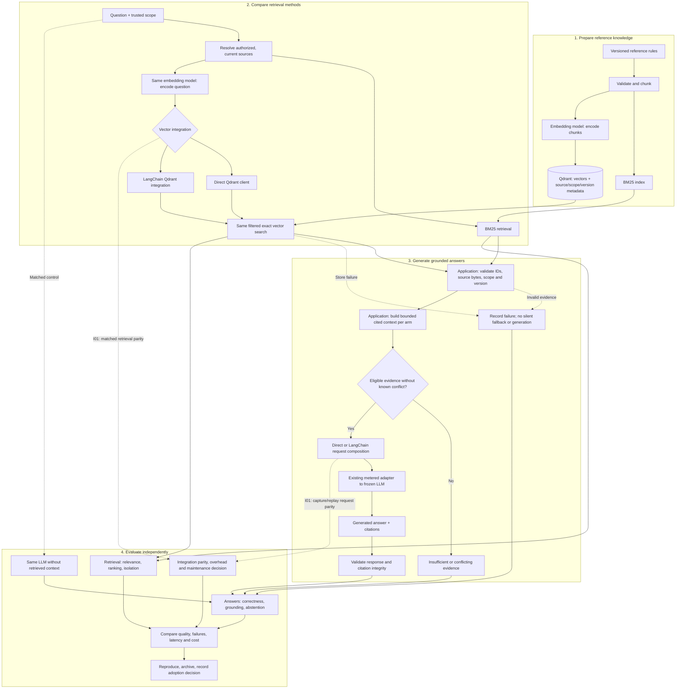
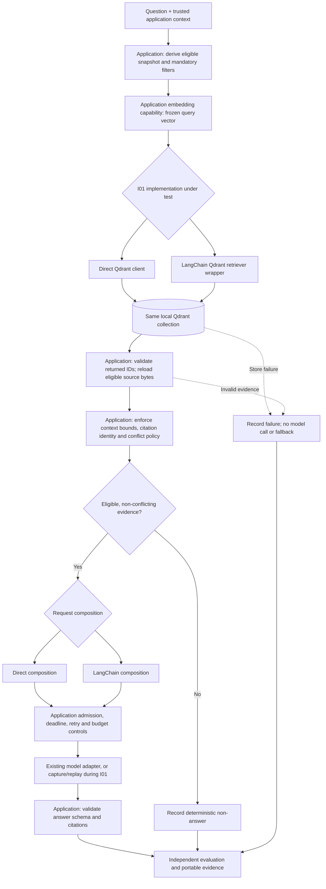

# P03 — Authorized reference retrieval and grounded responses

- Version: **1.3**.
- Created: **2026-11-07**.
- Revised: **2026-11-08**.
- Status: **S01–S05 / E01 implemented and verified; E02/E03/I01 remain planned, not executed**.
- Parent: [P03 roadmap](../../roadmap.md#p03--authorized-evidence-retrieval-and-grounded-answers).
- Planning baseline: `167a76c` — selected P02 provenance slice committed.
- Planned experiments: **P03-E01 lexical baseline**, **P03-E02 embedding/vector-database retrieval**, **P03-E03 generated RAG answers**.
- Planned integration trial: **P03-I01 direct versus LangChain Qdrant retrieval and request composition**, within S06–S09.
- Completion scope: **all three experiments and the bounded integration trial**, with live execution gated by frozen profiles and the standing approval policy; permanent LangChain adoption is not required.

## 1. Scope verification and outcome

P03 is the next capability after inspectable source references. It asks whether
the application can retrieve current, authorized definitions/rules and expose
useful evidence for a field explanation. It does not require completion of
P02's conditional workbook parsing or semantic-review studies.

| Scope check | Resolution in this plan |
| --- | --- |
| Reference evidence is not extraction truth | Retrieve field semantics and fictional policies, not gold answers, predictions, scores or diagnostic verdicts. A rule explanation cannot certify a PO field. |
| Reference approval and relevance labels are not yet available | Start with explicitly schema-derived or synthetic technical fixtures. Author query/relevance oracles separately before ranking results; do not claim new human review or production policy approval. |
| P02 proves location integrity, not entailment | Reuse exact-reference validation where suitable; separately measure whether a source is relevant and whether it supports a generated claim. |
| Access/version policy needs an owner | Trusted application context and a versioned catalog select eligible references before ranking/context construction. This is a fixture-level permission exercise, not a new identity platform. |
| A quote-based baseline is not generative RAG | P03-E01 is the comparator; actual learned embeddings/vector storage/search in E02 and actual LLM answers in E03 are planned P03 stages, not optional substitutes for its advertised topics. |
| Framework adoption is not the capability | Keep the current Python application. Plan a bounded direct-versus-LangChain integration trial with the same Qdrant store and application controls; LangGraph, MCP, approval UI and LangSmith remain later work. |

P03 delivers a versioned reference collection, exact/BM25 comparators, one
learned embedding model, one persistent vector database, permission-aware
retrieval, LLM-generated cited answers and separate retrieval/answer evaluation.
**E01 is model-free; I01 reuses saved vectors and capture/replay without new
model calls or API spend.** E02 and E03 require real encoding/generation, not
mocked vectors or quote-only output.

Keep one Python application and local **Qdrant** as its planned vector store.
Pin the reviewed server image/client and encoder before
installation or live encoding; no image, package or weights are installed by
this revision. Choosing one store is a bounded experiment, not a vendor survey.
Model identities and concrete invocation profiles remain to be frozen before
execution. Planned scope does not waive downloads, accounting or paid-call gates.

**LangChain** is a planned integration layer around Qdrant retrieval and RAG
request composition, compared with the direct implementation. It does not add a
retrieval method or change the source collection, model, prompt or quality arms.
Retain the simpler implementation if the trial does not justify adoption.
**[pgvector](https://github.com/pgvector/pgvector)** is a candidate for AspectLoop's separate PostgreSQL-backed retrieval
work, where relational data and permission queries may make it relevant; this
plan neither adds PostgreSQL to rd_ai nor selects a store for AspectLoop. Chroma
and Pinecone are not P03 comparison arms.

E01 completion alone is a checkpoint, not P03 completion. A completed E02/E03
comparison may reject dense retrieval or the RAG candidate without erasing the
exercise; unmet useful-answer criteria must remain visible. If execution is
blocked/deferred, record partial progress rather than closing P03. No unseen-data
or production reliability claim follows from this controlled development suite.

### Revised end-to-end flow

E01 execution is recorded in the [S01–S05 report](../../reports/P03-reference-retrieval.md#executed-flow).
The diagram below retains the full planned milestone: only its reference,
exact/BM25 and evidence-evaluation portions have run. No embeddings, Qdrant,
generation or LangChain coverage is implied by E01 completion.

This is the **planned** P03 flow. During execution, keep it synchronized with
stage implementations, comparison arms, authorization/failure paths and recorded
status before closeout. Preserve frozen protocol/plan snapshots; update this
living plan and the execution report rather than rewriting archived evidence.



BM25 and vector retrieval are separate comparison arms, not an unmeasured
hybrid. Exact known-key lookup remains a baseline alongside this flow. The
no-retrieval control has its own frozen request/profile; it does not bypass
application scope or acquire correction/submission authority.

### LangChain integration and ownership flow

This **planned** I01 comparison changes integration/composition code while
keeping one Qdrant collection, the same encoder outputs and the same application
policies. It is not a fourth E03 answer arm or a second model-call owner.



The LangChain wrapper maps into application-owned retrieval/request contracts.
Its `Document` content/metadata cannot grant scope, replace original source bytes
or establish answer correctness. Client lifecycle remains with application setup.
LangChain composition may call the existing metered capability; it does not
introduce a separate provider model wrapper, automatic repair or fallback.

## 2. Inherited capabilities and boundaries

Reuse P01's exposure/rubric definitions, independent-oracle discipline and
artifact/record verification utilities. Reuse P02's original-text reference
semantics for new UTF-8 reference sources. Preserve all existing inputs,
gold/schema/prompts, extraction records, unresolved charges and public archives.
The [P02 report](../../reports/P02-source-provenance.md) remains the authority
for its limited checks, not a source of reference answers.

P01's protocol is bound to its v1/v2 comparison and P02's protocol to its thirty
saved records and three field kinds. Neither is a generic experiment loader.
Add a narrow retrieval protocol and reuse suitable binding, publication and
archive primitives without loosening those historical protocols.

Keep retrieval in the existing application, with injectable source/index/model
access where useful. E01 adds no database or model dependency. E02 adds one
local Qdrant service with an isolated data volume; it does not split application
domains into new services or change Garage/archive ownership. No hosted search
subscription or additional host runtime is required. Python, dependency work,
encoder execution and substantial scripts run in Docker; native Ollama remains
the existing explicit exception for an approved local generation profile.

## 3. Reference collection, authority and query population

### Bounded collection

Propose **24 base reference units**, curated into standalone neutral UTF-8
texts under `data/references/` during S01:

- Fifteen scalar field-definition units derived from PO v1: seven header fields
  and eight line fields. Retain the line-items/order-membership context with
  each applicable definition; do not change the authoritative PO schema.
- Five normalization/context units covering identifier text/leading zeros,
  ISO dates and date roles, decimal strings, unit categories, and ordered lines
  versus catalog/package context. These explain existing semantics; they add
  no missing source values or new normalization behavior to extraction.
- Four explicitly fictional policies, two for scope A and two for scope B,
  with synthetic identifiers and distinctive controlled markers. They exercise
  lookup and isolation, not actual customer rules or authority to edit a PO.

Every unit records source ID, revision, kind/authority, target field/topic,
original-text hash, provenance, status, effective interval and access scope.
Schema-derived text traces back to the pinned schema JSON pointer and relevant
contract section, with the derivation recorded; its new text spans are not
misrepresented as raw byte spans in the original JSON. Synthetic policy text is
marked as such in content, metadata and results.

The catalog is a trusted fixture allowlist. `fixture_allowed` means approved for
this technical experiment, not human-approved business policy. Real references
require a separate recorded approval before ingestion. Document text, filenames,
queries and retrieved instructions cannot set catalog authority or grant access.
Fictional policies may not override PO v1 meanings or application permissions.

Only the explicit collection enters the index. Do not crawl `docs/`, `data/`,
`results/`, local reference repositories or archive contents. Exclude gold,
annotations, predictions, diagnostic findings, query/answer fixtures, private
workbooks, credentials and benchmark-specific facts. Relevance/expected-answer
files remain evaluator-only and are never passed to retrieval or generation.

### Forty query-context cases

Freeze **40 cases** with IDs, original query, optional explicit field/topic key,
trusted scope, snapshot/effective time, relevant source-unit IDs and expected
evidence/conflict outcome before collecting rankings:

| Group | Cases | Purpose |
| --- | ---: | --- |
| Explicit field/topic lookup | 12 | Known-key positive controls; keys are actual request input, never copied from the evaluator's relevant IDs |
| Free-text/paraphrased questions | 12 | Lexical retrieval without hidden topic labels or query rewriting |
| Insufficient/conflicting evidence | 8 | Four no-relevant-evidence cases and four active-conflict cases; no forced answer |
| Access/version lifecycle | 8 | Paired scope and update/deletion states with explicit expected visibility and currentness |

The last groups may use separately hashed mutation snapshots rather than the
base catalog. Their exact membership and relevance sets are frozen in S01.
Cases sharing a question or policy family stay grouped and are not reported as
forty independent customer examples. All labels are authored technical oracles
unless explicit human review is later recorded. They are not PO gold labels.

Write query/expected-evidence fixtures independently of ranking code and before
its outputs are observed. Disclose shared authorship and development exposure;
this is a controlled development suite, not an unseen benchmark. A changed
collection, tokenizer, query set or label receives a new identity and reason;
do not tune on reported failures and retain the original evaluation claim.

## 4. Retrieval, response and lifecycle contracts

### Trusted eligibility and snapshots

Use shared schema/context references plus two fictional scopes, A and B. Missing
or invalid trusted scope fails closed. A request can only access shared units
and its own permitted units. Query text or caller-supplied reference metadata
cannot widen the trusted scope.

The initial CLI is a local experiment runner: choosing a fixture principal is
not authentication. Production session/identity enforcement is outside P03;
future consumers must supply trusted scope through the application boundary.
Tests exercise the retrieval function with trusted fixtures and hostile query
content separately. Never present a CLI scope switch as a secure public API.

Validate source integrity and trusted lifecycle metadata, then filter active,
allowed, effective references **before ranking or context construction**. Do not
retrieve globally and remove unauthorized text after it entered a prompt.
Compute lexical corpus statistics over the eligible partition so inaccessible
documents do not alter its rankings or expose counts. Per-request traces/errors
contain only authorized results and bounded identifiers. A trusted test proof
may contain both fixture scopes; it is not an unauthorized request response.

Reference content cannot declare itself current. Supersession is explicit in
the trusted catalog; new versions replace old ones at the declared effective
time. Two incompatible active rules for the same authority/topic produce
`conflicting_evidence`, retaining authorized citations without choosing the
most convenient text. Schema meanings remain authoritative over fictional
policies; conflict does not authorize changing them.

E01 conflict detection is structural: the catalog assigns rule keys and explicit
supersession/exclusive-version relationships. More than one effective,
unsuperseded version of a mutually exclusive rule key is a conflict. Different
wording alone is not declared a semantic contradiction, and a normalization
note is not a competing field definition merely because it mentions that field.
Inferring new contradictions from arbitrary prose is outside the offline slice.

Publish immutable index snapshots atomically. Bind catalog, source versions,
chunker, access/lifecycle policy and retriever configuration into snapshot
identity. Reject mismatched/stale snapshots against the current trusted catalog.
Deletion/revocation affects current queries and rebuilt indexes; immutable
historical reports may retain explicitly historical fixture evidence. Do not
claim deletion from all past archives. No response cache is introduced in E01.

### Chunks and two baselines

- **Chunking:** one bounded rule unit per chunk initially. Preserve title,
  qualifications, scope/role notes and source identity. Reject an oversized unit
  rather than silently dropping conditions. No overlap or source-document
  cropping experiment is selected. Each chunk has a stable source/version/byte
  reference, content hash and chunker identity; duplicate content cannot inflate
  relevance counts through multiple chunk copies.
- **Exact lookup:** use only a field/topic key explicitly supplied in the
  request. Report its applicable population; missing keys yield no exact-lookup
  result, not an inferred evaluator label. It is a useful known-key baseline,
  not a like-for-like semantic-search comparison on unlabeled free text.
- **Lexical baseline:** implement one bounded BM25 variant using existing
  Python utilities/standard library, with `k1=1.2`, `b=0.75`, positive smoothed
  IDF, Unicode case-folded alphanumeric tokens, no stemming/learned expansion,
  deduplicated query terms and stable chunk-ID tie breaking. Freeze the exact
  formula/tokenizer in configuration and independent arithmetic tests. Use
  `k=3`, return only positive-score eligible chunks, and report empty queries
  explicitly. These are fixed experiment choices, not claimed optimal settings.

The [BM25 reference](https://doi.org/10.1561/1500000019), checked 2026-11-07,
supports the algorithm's role as a lexical ranking baseline; no hosted search
service or vendor-specific scoring behavior is selected.

### Evidence response versus generated answer

E01 returns a versioned response separate from PO objects: request/scope/snapshot
identity, `evidence_found`, `insufficient_evidence` or `conflicting_evidence`,
ranked excerpts and source/version/span/hash citations. `evidence_found` means
eligible excerpts were retrieved; it is not a claim that a question was answered
correctly. Empty eligible results and known conflicts remain explicit. A score
does not establish entailment, permission or semantic answerability.

Verify every quotation against the original reference bytes and current scope,
version and snapshot. Do not fabricate citations from a source ID that merely
exists. Treat instruction-like content as quoted data. No external link fetch,
tool invocation, PO mutation, submission or automatic source-support decision
is available from this response. P04 can later consume this read-only contract.

Model-generated explanations belong to E03, with a separate structured answer
contract and claim-to-citation rubric. Reusing a model adapter does not mean
reusing the PO response schema or treating an explanation as an extraction.

## 5. Ordered baseline work — P03-S01–S05 / E01

### P03-S01 — Freeze catalog, relevance oracles and protocol

1. Curate and audit the 24 reference units and their derivations/fixture status.
2. Freeze the 40 query-context cases, source/policy families, relevant evidence
   sets, conflict states and case applicability without inspecting rankings.
3. Define a narrow retrieval protocol binding catalog/texts, queries, evaluator
   oracles, chunk/ranking/scope policy, source code and resource/acceptance limits.
   Store a frozen plan snapshot separately from the living execution-status
   document so later status updates do not invalidate past protocol bindings.
4. Declare expected mutation/control outcomes and separate technical, human-
   reviewed and unknown label authority. Freeze retrieval relevance and answer
   propositions/rubric before rankings or generated answers are observed.
   Record E02/E03 as planned work, with concrete model/installation/invocation
   profiles to be finalized at S06/S07 before any live calls.

**Accept S01:** population and authority are explicit; the retriever can be
tested with evaluator fixtures absent. No benchmark-derived rule or invented
human review enters the reference collection.

### P03-S02 — Load and version the reference collection

1. Implement strict metadata and confined, bounded regular-file reads using
   existing artifact utilities. Validate hashes, source/chunk IDs, authority,
   lifecycle intervals and access metadata; reject duplicates and unsupported
   versions. Do not execute serialized objects or treat content as configuration.
2. Build reproducible rule chunks and an immutable lexical index snapshot.
   Retain exact source locations, derivation and configuration identities.
3. Stage publication atomically; reject incomplete/mixed snapshots and refuse
   overwriting historical artifacts. Changed source/catalog policy requires an
   explicitly new snapshot, not an undocumented in-place refresh.

**Accept S02:** repeat builds match; changed bytes and invalid lifecycle/access
metadata fail at the intended boundary; no silent lost qualifiers or stale load.

### P03-S03 — Implement eligible exact and lexical retrieval

1. Apply trusted scope, source integrity and current-version selection before
   query ranking. Keep public/shared and per-scope partitions explicit.
2. Add exact topic lookup and the frozen BM25 baseline through a small read-only
   retrieval API. Unknown topics, no hits, empty queries, ties and conflicts
   have documented deterministic outcomes.
3. Keep evaluator relevance IDs inaccessible to this API. Record ranks/scores,
   eligibility/snapshot identity and durations without unauthorized candidate
   text, query-controlled authority or hidden query rewriting.

**Accept S03:** positive retrieval works and paired scope/role negatives fail;
per-request context cannot contain another scope's controlled marker or IDs.
Exact lookup and lexical populations stay separate where their inputs differ.

### P03-S04 — Construct cited evidence and exercise lifecycle

1. Build the bounded evidence-only response with independently verified citations.
   An excerpt's exactness cannot upgrade its relevance or semantic authority.
2. Exercise source update, supersession, equal-authority conflict, deletion,
   scope revocation and failed/partial rebuilds. Old index handles must not
   bypass the current catalog's eligibility/revocation decisions.
3. Keep historical results reproducible against their pinned historical catalog
   while preventing that mode from being accepted as a current response.
   Explicit evaluator historical replay is not ordinary application access.

**Accept S04:** legitimate current lookups succeed, stale/unauthorized current
queries fail closed, conflicts abstain, and all emitted citations resolve to the
eligible reference version. No generated answer or applied correction is claimed.

### P03-S05 — Expose offline evaluation and independent controls

1. Add explicit CLI/Make entrypoints for protocol validation, index build,
   evidence lookup and retrieval evaluation. Run in network-disabled Docker
   without provider secrets, model services or accounting-volume mounts.
2. Evaluate all 40 cases, including failures, against independent relevance sets.
   Report applicable exact-lookup outcomes, lexical Recall@3, Precision@3 and
   MRR, empty-result/conflict behavior, false evidence retrieval and lifecycle/
   isolation outcomes. Never score a generated answer that did not run.
3. Compute metrics with explicit denominators. Recall is unavailable when no
   relevant eligible unit exists; report those cases separately. Precision@3
   divides by three, counting unfilled ranks as non-relevant; also report actual
   returned counts. Deduplicate at source-unit level and report family/scope/
   negative slices, not only pooled averages.
4. Test independent hand-counted rankings/arithmetic and the complete CLI:
   positive lookup, modified result/source/catalog/query-oracle bindings, hostile
   text, missing context, bounds, isolation and read-only reproduction.
5. Freeze and emit separate protocol/index/result/checksum bundles, refuse output
   replacement and support result comparison without rewriting evidence.

**Accept S05:** complete populations and correct arithmetic; no model/embedding
calls, hidden oracle access, ledger initialization/writes or private exports.
Metric failures produce a recorded reject/defer decision, not post-hoc tuning.

### E01 checkpoint — Preserve the baseline for matched experiments

1. Run focused behavioral checks and preserve the E01 source/index/result
   identities for the matched E02/E03 comparisons. Do not regenerate historical
   extraction outputs or retune the E01 queries after inspecting results.
2. Reproduce E01 from a public source export with exact reference/index/result
   hashes and no gold/prediction inputs, private settings, credentials or model
   runtimes. Real-process negatives must fail for the intended defect.
3. Retain the E01 checkpoint; S09 performs the complete gate and final archival.
   Use the same archival workflow for an earlier recovery checkpoint if needed.
4. Record adopted/rejected/deferred outcomes for exact lookup, lexical ranking,
   evidence presentation and the still-planned E02/E03 work. Record actual
   evidence and limits; do not mark P03 complete at this checkpoint.

**Accept E01 checkpoint:** integrity/lifecycle/authority controls pass, original
evidence is unchanged, exact reproduction succeeds and the E01 decision is
inspectable. A rejected lexical candidate does not satisfy an unmet retrieval
quality criterion; it can still close the bounded research question honestly.

## 6. E01 thresholds, controls and resource policy

| Gate | Predeclared criterion |
| --- | --- |
| Collection and population | 24 base units and exactly 40 frozen query-context cases, with explicit mutation snapshots; zero silent omissions or relevance labels inferred from returned rankings |
| Exact lookup mechanics | All 12 known-key positive cases return the expected current authorized unit(s); no oracle-supplied key for free text |
| Lexical adoption quality | Macro Recall@3 at least 0.85 over cases with nonempty eligible relevance sets; report Precision@3/MRR and all negative/family slices even on rejection |
| Permission/currentness | Zero unauthorized, deleted or superseded-current sources in returned context, citations or per-request traces in the declared controls; positive counterparts succeed |
| Conflict/empty eligibility | All declared active-conflict and no-eligible-source controls yield explicit non-answer outcomes; do not infer semantic answerability from a lexical score |
| Citations | 100% of emitted quotations/ranges/hashes/versions resolve to currently eligible source bytes; zero accepted forged or cross-scope citations in controls |
| Evaluation arithmetic | All independent fixture totals/rates match exactly; unavailable denominators remain unavailable; all 40 outcomes retained |
| Isolation and preservation | Zero model/embedding calls, generated tokens and new API spend; zero gold/prediction-oracle reads by retrieval, original-evidence or accounting writes |
| Reproducibility | Exact reference/index/evaluation reconstruction and archive restoration; no claim of production or unseen-data reliability |

The lexical threshold is a predeclared development adoption criterion, not a
guarantee the candidate will meet it or a reason to revise queries after scoring.
No-relevant free-text cases may still retrieve irrelevant lexical evidence;
record this failure separately rather than pretending `evidence_found` is a
correct answer or a calibrated abstention. Hard permission/currentness failures
block adoption regardless of aggregate retrieval quality.

Required control families, frozen in S01 and bound to independent test/process
selectors before the measured evaluation:

1. Exact topic and free-text positives; a missing/unknown topic cannot be rescued
   by reading the evaluator's relevant IDs.
2. Hand-counted tokenization, IDF/length normalization, scores/ranks, ties,
   Recall@3/Precision@3/MRR and empty relevance/returned populations.
3. Schema-meaning versus fictional-policy conflict, version overlap and explicit
   supersession; no arbitrary latest-text winner.
4. Paired identical questions under A/B/shared scopes, absent trusted context,
   forged scope in query/source text and cross-scope marker controls.
5. Cross-scope corpus-statistics isolation and unauthorized high-similarity bait;
   removing a forbidden unit cannot change the allowed partition's rankings.
6. Update, deletion and access revocation with old snapshot handles, plus legitimate
   historical evaluator replay against its own recorded authority boundary.
7. Duplicate chunks/revisions, mixed source/index metadata, hash tampering and
   failed/partial rebuild publication.
8. Correctly quoted but irrelevant/wrong-version evidence, forged citations,
   Unicode/CRLF boundaries and qualifiers preserved with their rules.
9. Instruction-like text, URLs, formula strings and synthetic poisoned references;
   content cannot authorize promotion, execution, external fetching or submission.
10. Changed query/relevance/result/protocol binding, missing/duplicate case,
    forbidden file traversal/symlinks, payload/query/context/deadline limits,
    output replacement and real-process zero-model/oracle/accounting isolation.

All controls have expected outcomes and legitimate positive counterparts.
Synthetic attack/control behavior is separate from live model susceptibility.
Fixture approval/status transitions are explicit trusted manifest changes;
introducing/removing a poisoned fixture does not establish resistance to all
data poisoning or training-time attacks.

Ceilings: 64 source units/chunks across base and mutation catalogs, 64 KiB per
source, 4 MiB total reference text, 40 query-context cases, 4 KiB per query,
`k=3`, and 12 KiB retrieved UTF-8 context per response. Reject an overlarge
whole chunk/context instead of clipping away qualifications. Serialized index
and result bundles are each capped at 32 MiB; bounds are checked before unbounded
accumulation. One build/evaluation invocation is capped at 300 seconds and a
verification command at 900 seconds. No automatic retry loop or model fallback.
S01 verifies the planned fixture population fits before measurement; an overrun
requires a recorded new protocol revision, not quiet case removal.

## 7. Planned model-dependent work — P03-S06–S09 / E02–E03

E02 and E03 are required planned stages, not conditional extensions. Execution
gates determine when their concrete runs may start; they do not make the topics
optional. E01 can be implemented and verified while those profiles are prepared,
but the milestone remains incomplete until actual E02/E03 work is recorded.

### P03-S06 / E02 — Learned embeddings and a real vector database

1. Freeze one embedding encoder artifact/revision/digest/license, tokenizer,
   preprocessing, document/query encoding modes, dimensions, similarity metric
   and local runtime. Use a small CPU-capable Docker encoder where suitable;
   any alternative native/provider embedding route needs its explicit profile.
   An arbitrary installed generation model is not an embedding-model selection.
2. Pin the local Qdrant server image by digest and the compatible client/API.
   Add only the necessary dependencies through `uv` in Docker. Keep the database
   in a separate Compose profile with isolated persistent storage and no public
   listener; if host access is needed, bind loopback only. E01/offline tests must
   not implicitly start it or download weights. No hosted account is required.
3. Encode the actual reference chunks and the actual 40 query-context cases,
   using the same frozen encoder family/modes. Persist vectors, source/chunk/
   version/scope metadata and encoder/index identities in Qdrant. Upsert, reload,
   filtered similarity query, update, deletion and restart/recovery must actually
   execute against the database. Synthetic vectors/mocks are tests, not E02's
   embedding/vector-database demonstration.
4. Enforce trusted active-snapshot and scope filters in the database query, then
   independently validate returned IDs/versions against the trusted catalog
   before loading text into context. Reject unknown/ineligible results and
   missing filters. Do not log or trust raw database payload as authorization.
   A database timeout/failure remains a failed vector outcome, not hidden BM25
   fallback attributed to dense retrieval.
5. Use exact similarity search initially for this tiny collection and compare
   with an independent hand-vector/exact-search oracle. Do not claim ANN/HNSW
   coverage unless approximate search is separately exercised. Validate finite
   vector values, counts/dimensions, metric and model identity, and manifest-bound
   reconstruction after restart/update/delete/revocation.
6. Compare E02 with E01 on the same queries, eligible sources, chunks, `k=3` and
   relevance labels. Keep encoding/index/query timing and all failed outcomes
   separate. Capture authorized top-k evidence bundles for the later RAG arms.
7. After the direct Qdrant path works, execute I01's retrieval parity slice below
   against the same server/snapshot and saved encoder outputs. Freeze the
   integration choice for E03 only after its request/control checks pass.

**Accept S06:** real encoder outputs and real Qdrant operations are demonstrated;
all hard isolation/currentness/integrity controls pass, and the complete matched
retrieval comparison is reproducible. A useful negative dense-vs-BM25 result
still exercises this stage; it does not justify adopting a worse retriever.

Before downloads/encoding, freeze maximum encoding inputs and physical batches,
including mutation rebuilds/retries, query-cache identity, memory, time and spend
bounds. The 64-reference/40-query base workload is not an unlimited rebuild
allowance. A paid embedding endpoint requires admission/accounting integration
and concrete invocation approval. Preserve existing ledger holds and cumulative
spend; do not create an unmetered helper or reset the budget.

Primary store references checked 2026-11-08:
[local Qdrant](https://qdrant.tech/documentation/quickstart/) and
[payload filtering](https://qdrant.tech/documentation/search/filtering/).
Implementation must verify/pin the actual chosen release/API; the documentation
links are not version pins or authorization to install/start the store.

### P03-I01 — Bounded LangChain integration trial

**Question:** Does LangChain reduce integration/composition work enough to justify
its dependencies without changing retrieval, requests or application controls?
This trial is now selected planned work; using LangChain permanently remains a
measured decision. Execute the direct baseline first, then the following checks
before freezing S07's live implementation:

1. Pin the minimal compatible `langchain-core` and `langchain-qdrant` packages
   with the reviewed Qdrant client through `uv` in Docker. Keep framework types
   inside the integration boundary. Do not replace the strict source loader,
   frozen chunker/BM25 implementation or independent evaluation with framework
   defaults. LangGraph, agents and LangSmith tracing are not needed for this trial.
2. Compare direct and LangChain retrieval for all 40 frozen query-context cases
   and the declared lifecycle/isolation controls against the real Qdrant server.
   Use the same saved chunk/query vectors, collection/snapshot, dense exact search,
   metric, mandatory filters, `k=3` and tie policy. Supply precomputed vectors via
   the supported API or a lookup-only embedding adapter that fails on a cache
   miss; never silently re-encode or use a default embedding model. Pin payload
   field names and mapping so both paths address the same metadata and sources.
3. Assert identical eligible source IDs, normalized ranking and citation/context
   bytes, with score conversion/tolerance and tie handling frozen beforehand.
   Validate returned references independently and reload original source bytes
   before context use. Missing/dropped filters, altered scope/version, forged
   metadata, store failures, changed document text and deadline failures must
   produce the same rejection/failure semantics. No unauthorized content may
   reach framework callbacks, traces or model requests.
4. Before live S07 calls, compare direct request construction with a small LangChain composition of
   the same application capabilities. Use a capture/replay adapter over all
   40 cases x three E03 context arms, preserving messages, answer schema,
   sampling/reasoning/token settings, skip policy and raw-response handling.
   Assert canonical model requests and validation outcomes match exactly.
   Use deterministic response fixtures initially, then replay S07's saved model
   responses through both paths at S08. Report this as integration replay,
   not an additional generation result or proof of answer quality.
5. Prove framework retries, query rewriting, fallback, output repair, implicit
   embedding calls and external tracing are disabled. The application alone owns
   admission, physical-call accounting, deadlines and bounded retries. Record
   wrapper/store call counts and demonstrate failure paths produce no extra
   model calls or spend. Optional parsing helpers cannot silently coerce answers
   or replace the application's schema/citation validators.
6. Record parity/failures, warm retrieval/composition latency, dependency/image
   impact and adapter/configuration work. Freeze trial invocation/time/resource
   ceilings and comparison criteria before measurement; keep encoder/generation
   cost outside this model-free replay. Adopt only if all controls/parity pass,
   operational bounds hold and a concrete integration/maintenance benefit is
   demonstrated. Otherwise retain the direct path and record why.

**Accept I01:** actual LangChain-to-Qdrant queries and capture/replay composition
are demonstrated and reproducible, with a bounded adopt/reject decision. Mocks
alone do not exercise the database integration. An unrun or blocked trial remains
incomplete; incompatibility found during the bounded trial may justify rejecting
the integration without blocking the direct E03 pipeline. No automatic additional
live encoding/generation comparison is included. Any such comparison needs a
separate protocol/population and concrete approved invocation.

Primary integration references checked 2026-11-08:
[LangChain Qdrant integration](https://docs.langchain.com/oss/python/integrations/vectorstores/qdrant)
and [retrieval composition](https://docs.langchain.com/oss/python/langchain/retrieval).
The latter currently redirects to the vendor's Deep Agents retrieval guide;
following its modular retrieval concepts does not select Deep Agents here.
Verify the chosen release's APIs during implementation rather than treating
documentation examples or their automatic embedding behavior as our run profile.

### P03-S07 / E03 — LLM-generated cited answers

1. Freeze one generator, route/digest where available, prompt, separate answer
   schema, sampling/reasoning/output/context settings and failure policy. Reuse
   current model adapters and admission/deadline/accounting controls where
   compatible. Design the narrow answer job/record integration before live calls:
   the existing PO-specific coordinator assumptions must not force answers into
   PO records or create an unmetered second execution harness.
   Freeze direct or LangChain composition after I01 parity/control checks;
   record the choice as implementation identity, not a new quality arm.
2. Build a fixed RAG pipeline: question plus independently authorized retrieved
   context goes to the LLM; it returns structured answer text, claims/citations
   and grounded/unverified/insufficient/conflicting status. Validate schema and
   citation identity/version/location independently of the model. Byte-valid
   citations alone cannot establish claim entailment or correctness.
3. Run three matched arms: **no retrieved context**, **BM25 context**, and
   **embedding/Qdrant context**. Use the same 40 cases, generator, prompt, output
   schema and generation controls; change only the supplied retrieval context.
   Do not silently merge lexical/dense results into a fourth hybrid method.
4. Freeze the answer rubric and expected technical propositions before generation.
   In all arms, forbid invented references; general-knowledge answers must be
   labelled unverified. The no-retrieval control may use model knowledge and be
   scored for correctness, but cannot receive grounding credit through invented
   citations. This avoids a control that is forced to abstain and then used as
   an automatic win for RAG. Unverified answers are diagnostic evidence, not
   application-approved field advice.
5. For RAG arms, empty eligible evidence and structural catalog conflicts produce
   explicit deterministic non-answer outcomes without a model call. Retain those
   cases in the full population, including their saved request/skip reason.
   Test model-level unsupported-answer/abstention behavior separately with
   authorized but irrelevant or insufficient context fixtures; do not claim a
   skipped request proves model resistance to injection or hallucination.
6. Start with a fixed 12-case pilot drawn across the four S01 groups, with all
   three arms. Review only the predeclared integrity/operational stop conditions
   before continuation, not whether the answer score is convenient. Reuse those
   saved outcomes, unchanged, for the remaining 28 cases. Changing model/prompt/
   context policy after the pilot requires a new experiment identity and matched
   rerun policy, not stitching incompatible outputs into one result.

**Accept S07:** actual LLM replies exist for every planned non-skipped RAG job,
with complete failed/refused/truncated/insufficient outcomes and physical usage
records. A quote-only template, mocked generator or E01 response cannot satisfy
this gate. Model outputs remain explanations, never authority to edit/submit POs.

Planned ceiling: 40 cases x 3 arms = **120 primary jobs**, at most 120 primary
generation calls; deterministic skips are separately counted. The 12-case pilot
is part of that population, not an additional repeat. Before any live command,
freeze exact physical-call bounds including retries/corrections, token/context/
output allowances, deadlines and the actual cumulative spending allowance. The
remaining 28-case phase must retain those controls. No automatic replacement
paid invocation is permitted after an upstream/dependency/budget stop.

Model and encoder identities, downloads and concrete request profiles remain
execution prerequisites, not reasons to remove E02/E03 from the plan. An existing
provider allowance does not approve a new paid invocation: present each final
tested command and allowance under the standing policy. Native generation also
requires its concrete scoped execution. This document revision starts no calls.

### P03-S08 — Separate retrieval quality from generated-answer quality

1. Report exact/BM25/dense retrieval results independently, using the same
   eligible relevance sets. Keep field-key applicability, source-family, scope,
   version and negative cases visible. Record encoding/store failures rather
   than scoring only successful vector queries.
2. Compare all three generated-answer arms with paired case outcomes: correctness,
   claim support/citation relevance, unsupported assertions, grounded coverage,
   abstention/conflict behavior, failure rate, calls/tokens/cost and latency.
   Distinguish wrong retrieval, wrong generation despite useful evidence and
   correct answers unsupported by the retrieved context.
3. Use independently authored technical propositions and explicit review status.
   Free-text semantic judgments need the frozen rubric and recorded reviewer/
   evidence/decision version; otherwise their rates remain unavailable. Report
   review coverage and disagreements. Do not let the generator grade itself,
   use provider predictions as truth or add an uncalibrated LLM/JEV judge.
4. Test citation structure/eligibility mechanically; score semantic support
   separately. Measure live prompt-injection effects only on calls that actually
   ran, alongside independently enforced application boundaries. Include all
   scopes and legitimate positive controls.
5. Measure complete pipeline usage, including reference/query encoding, index
   build/update and per-query retrieval/generation. Report cold setup separately
   from warm query latency and local hardware costs excluded from API billing.
   Do not claim amortized savings without stating the reuse/workload assumption.
6. Report I01's matched integration parity, operational/dependency overhead and
   adoption decision separately from E02 retrieval gains and E03 answer quality.
   Replayed responses cannot count as new model observations or evidence that
   LangChain improves model accuracy.

**Accept S08:** the full case/arm membership is preserved; ranking, factual and
grounding populations are explicit; known regressions/failures and unreviewed
claims cannot disappear inside a favorable aggregate. Missing semantic review
blocks a semantic quality conclusion, not the honest recording of executed RAG.

### P03-S09 — Reproduce, archive and close the full P03 scope

1. Run focused checks and Docker `make check`; preserve P01/P02 and the historical
   extraction matrix without new extraction inference. Exercise the actual local
   vector-store integration separately from network-disabled unit/process tests.
2. Reproduce retrieval/answer reports from saved encoder outputs, store export,
   context bundles and raw LLM outcomes without rerunning models. Separately
   demonstrate Qdrant restore/reload/query correctness against frozen embeddings.
   A database snapshot alone is not a portable semantic model/encoder artifact.
3. Archive all three experiments' evidence, encoder/store/prompt identities,
   control/implementation snapshots and resource accounting through the existing
   Garage upload/full-GET/restore workflow. Keep model weights/store data/bulky
   responses ignored; version compact manifests, indices and bounded reports.
4. Record actual exercised topics and separate adopt/reject/defer decisions for
   BM25, vector retrieval and RAG answers. A negative comparison can conclude an
   experiment, but does not establish useful autonomous field advice or satisfy
   unmet answer-quality/adoption thresholds.
5. Preserve I01's package/implementation identities, real Qdrant parity results,
   captured requests, replay/failure checks and engineering decision. Verify
   reconstruction without new model calls and record whether E03 used direct or
   LangChain composition. Rejecting the integration keeps a supported direct
   path; remove unused trial dependencies from the runtime at closeout.

**Accept S09:** E01, real E02, real E03 and I01 are executed and reproducible, hard
controls pass and quality/operational outcomes are reported with their limits.
If any planned stage remains unrun/blocked, mark P03 partial. Do not close it
with an offline-only substitute. Product reliability remains a separate claim.

### Adoption criteria versus exercised scope

| Decision | Predeclared criterion |
| --- | --- |
| Prefer dense retrieval over BM25 | At least 0.05 absolute macro Recall@3 improvement on the same answerable cases, no hard-control regression, and the pre-run operational bounds met; still report negative/regressed slices |
| Adopt a RAG answer candidate | Grounded claim precision at least 0.95 and correct-answer rate at least 0.85 on their explicitly anchored/reviewed populations, at least 0.80 correct insufficient/conflict behavior on applicable cases, and all hard permission/currentness/citation gates passed |
| Establish review coverage | 100% of applicable planned case/arm outcomes have a technical or reviewed status; unreviewed/unknown cases remain visible and cannot be dropped to meet an adoption threshold. If semantic review is incomplete, adoption is unresolved rather than a pass |
| Adopt LangChain integration | I01 request/retrieval/control parity passes, predeclared operational bounds hold, and a recorded integration/maintenance benefit justifies the added dependencies; retain direct implementation on rejection |
| Close P03 research execution | All three planned experiments and the bounded I01 trial run, all outcomes/failures and resource use retained, preservation/recovery gates passed, and decisions recorded; this does not require vector/RAG gains or permanent LangChain adoption |

The numeric quality thresholds are development decision criteria, not achieved
results. Freeze scoring units, authority, full expected populations and review
procedure before the pilot. Report semantic coverage alongside each rate and
retain all forty cases even where a particular metric is unavailable. Do not
lower thresholds or discard unknown/failed cases after observing outputs.

Only hybrid search, reranking, query rewriting, multilingual expansion and prompt
caching remain optional P03 extensions. I01 is planned integration work;
LangChain adoption is conditional on its results.
LangGraph/MCP/approval workflows remain P04; LangSmith and exposed UI/operations
remain conditional P04/P05. No alternate ecosystem or telemetry stack is selected.

## 8. Proposed artifacts and execution handoff

| Area | Responsibility |
| --- | --- |
| `data/references/` | Explicit neutral source texts, catalog, derivation and mutation manifests; no gold/predictions |
| `config/retrieval/` | Chunker/ranking/scope/lifecycle configuration and bounded protocol identities |
| `config/evaluation/` | P03 query-context/relevance/control fixtures, authority/exposure labels and experiment declarations, evaluator-only |
| `src/extraction_service/retrieval/` | Cohesive catalog/chunk/index/eligibility/retrieval/evidence responsibilities, added only when implemented |
| Existing inference/execution integration | Explicit embedding capability and answer jobs, shared admission/accounting/deadlines and distinct response records; no PO schema reuse |
| Bounded LangChain integration | Qdrant retrieval and request-composition adapters behind application contracts, plus direct-path parity/replay evidence; no independent model-call or authorization owner |
| Compose/Docker and dependency configuration | One pinned local Qdrant service/data volume and reviewed encoder/client dependencies, introduced only at the planned stage |
| Existing evaluation/CLI/Make runtimes | Retrieval and answer metrics, strict stage-specific commands and result publication without loosening P01/P02; live stage networking limited to approved endpoints |
| Focused retrieval and application tests | Independent ranking/arithmetic/authority/lifecycle/CLI controls, real database integration and separate approved model runs |
| Guides, reports and glossary | Actual commands, outcomes, source identities and exercised-versus-conditional topics |
| Ignored `results/` and compact `archive-index/` | Reproducible snapshots, complete results, logs and verified archive/restore proof |

The three E01 commands below are implemented; see the
[operations guide](../../guides/reference-retrieval.md) for publication and
reproduction. Vector/RAG interfaces remain **proposals, not implemented commands**.
S06–S07 will
freeze exact protocol paths, fixture inputs, model/store identities, snapshot/
result destinations and invocation bounds:

```sh
make validate-retrieval-protocol ARGS='--protocol config/retrieval/P03-E01-v3.json'
make build-reference-index ARGS='--protocol config/retrieval/P03-E01-v3.json'
make evaluate-retrieval ARGS='--protocol config/retrieval/P03-E01-v3.json'
make evaluate-retrieval ARGS='--protocol config/retrieval/P03-E01-v3.json --check-result results/submission/P03-E01-v3/report.json'
make build-vector-index ARGS='--protocol config/retrieval/P03-E02-v1.json'
make evaluate-retrieval ARGS='--protocol config/retrieval/P03-E02-v1.json'
make plan-rag ARGS='--protocol config/retrieval/P03-E03-v1.json --phase pilot'
make run-rag ARGS='--protocol config/retrieval/P03-E03-v1.json --phase pilot'
make run-rag ARGS='--protocol config/retrieval/P03-E03-v1.json --phase remaining'
make check
```

Vector-build and RAG run commands are gated live operations, not offline helpers.
Their placeholders are not concrete paid-invocation approvals. Pin/install the
local store and approved model artifacts separately before running them.

Provide a bounded evidence-lookup CLI as a local demonstration, not a public
authenticated API. Human inspection should include one known-key result, one
irrelevant lexical hit, one A/B isolation pair, a version conflict and a deleted
rule. Inspection does not create reviewed relevance/answer anchors unless its
judgment, scope, evidence, reviewer and version are explicitly recorded.

The protocol binds a separate immutable plan snapshot; status/guide/report
updates must not require retaining a misleading draft status in the living plan.
Implementation approval covers the planned stages, while downloads/live calls
remain subject to their explicit execution profiles and standing permissions.
Do not describe all of P03 as zero-inference. Stop on missing reference authority,
changed frozen evidence, oracle leakage, unapproved calls, cross-scope context,
unapproved accounting writes or unmet hard controls. Approved live calls must
write their intended durable accounting records; offline validation must not.
Missing archived comparators require restoration, not fresh inference.

Rollback removes only P03 additions/new snapshots/results. It preserves the
existing extraction contract, labels, P01/P02 results, ledger and archive formats.
No Git action or cross-repository changes follow from drafting this plan.

## 9. Topic mapping, completion and revisions

Use [roadmap section 4](../../roadmap.md#4-sources-and-meaning-of-topic-coverage)
for the pinned AI Engineer source mapping and OWASP 2025 edition. The BM25
reference above is background, not a refreshed review of the entire roadmap.

| AI Engineer topics | Exercise / boundary |
| --- | --- |
| RAG; Chunking; Retrieval Process; Context Sources | Planned E01 chunks/baseline, E02 dense retrieval and E03 actual model-generated cited answers; all are required stages |
| What are Embeddings; Semantic Search; Embedding Models | Planned E02 actual document/query encoding and matched BM25 comparison; lexical tokenization is not a learned embedding |
| Vector Databases; Indexing Embeddings; Performing Similarity Search | Planned E02 actual Qdrant persistence/filtering/query/update/delete/recovery; exact search initially, no automatic ANN claim |
| RAG Usecases; RAG vs Fine-tuning; Dynamic Filters; Context Security | Versioned field-rule explanations and pre-context scope filtering; no model training or mutation authority |
| Deterministic Evals; Evaluation Metrics; Cost/latency monitoring | E01 independent relevance/ranking controls and complete timing populations; E02/E03 add their actual model costs separately |
| Generation; Using SDKs Directly; Human Evals | Planned E03 actual LLM comparison and explicit claim review; record SDK or HTTP integration as actually used, and never claim human review from synthetic oracles alone |
| LangChain / framework integration | Planned I01 real Qdrant-wrapper queries and request-composition replay versus the direct baseline; no automatic agent, LangGraph, LangSmith or model-quality claim |

| OWASP 2025 risk | Selected and conditional boundary |
| --- | --- |
| LLM01 Prompt Injection | E01 untrusted reference text cannot control retrieval authority; live generator behavior only measured in E03 |
| LLM02 Sensitive Information Disclosure | E01 A/B/shared scope context and per-request trace isolation; no claim of production identity enforcement |
| LLM03 Supply Chain | Source/catalog/chunker/index integrity, pinned encoder/store/client and model identities, with update/recovery controls in the planned stages |
| LLM04 Data and Model Poisoning | Controlled reference promotion/removal fixture; no training-time poisoning claim |
| LLM05 Improper Output Handling | Citation/quote validation and data-only content; no browser, workbook or external execution added |
| LLM08 Vector and Embedding Weaknesses | E01 metadata/staleness controls; vector-specific isolation/drift/deletion only exercised by E02 |
| LLM09 Misinformation | Relevance, quoted-byte integrity and answer support remain separate; generated claims only scored after E03 anchor selection |
| LLM10 Unbounded Consumption | E01 bounded ingestion/index/query/context/results/time; E02/E03 must add encoding/generation/retry/spend ceilings |

- [x] S01 reference/query/control authority and protocol frozen independently of ranking outcomes.
- [x] S02 reproducible, integrity-checked reference/index snapshots implemented.
- [x] S03 eligible exact/lexical retrieval and positive/negative scope controls demonstrated.
- [x] S04 evidence responses, currentness/conflicts/deletion/revocation and historical replay boundaries verified.
- [x] S05 complete 40-case evaluation and real offline process controls recorded.
- [ ] S06 real learned embeddings and Qdrant storage/search/lifecycle executed and compared with BM25 across the frozen cases.
- [ ] I01 direct-versus-LangChain Qdrant retrieval and request-composition parity trial executed; engineering decision and E03 implementation identity recorded.
- [ ] S07 actual LLM generation recorded across matched no-retrieval/BM25/vector arms, including deterministic skips and failed outcomes.
- [ ] S08 retrieval, answer/grounding and complete operational populations evaluated with explicit review coverage and decisions.
- [ ] S09 full checks, prior-result preservation, model-free report reproduction, database recovery and verified archival completed.

Completing S01–S09, including I01, concludes **P03's planned retrieval and RAG experiments**.
Vector or RAG underperformance may yield rejection rather than adoption; merely
deferring those stages cannot satisfy the milestone. Missing semantic review
must leave answer quality/adoption unresolved, and no controlled fixture result
proves production access security or unseen-document reliability. This draft
authorizes no implementation, download, inference, paid call, hosted service,
new approval label or Git operation by itself.

| Version | Date | Change |
| --- | --- | --- |
| 1.0 | 2026-11-07 | Draft P03-E01 authorized reference/lexical retrieval with separate relevance and citation gates; retain embeddings and generated-answer studies behind explicit selection/execution boundaries. |
| 1.1 | 2026-11-08 | Make real embeddings, local Qdrant vector-database operations and matched LLM-generated RAG answers planned S06–S09 work; retain BM25 as comparator, add end-to-end flow and full milestone completion/adoption gates. |
| 1.2 | 2026-11-08 | Select bounded I01 direct-versus-LangChain Qdrant retrieval/composition trial, add ownership/parity diagrams and acceptance gates without expanding live generation arms; retain Qdrant for rd_ai and pgvector as a separate AspectLoop candidate. |
| 1.3 | 2026-11-08 | Implement and verify S01–S05/E01: frozen 24-unit/40-case fixtures, authorized exact/BM25 evidence, lifecycle/citation/process controls and 1,041-test gate. Link executed flow; E02/E03/I01 and S09 archival remain unexecuted. |
