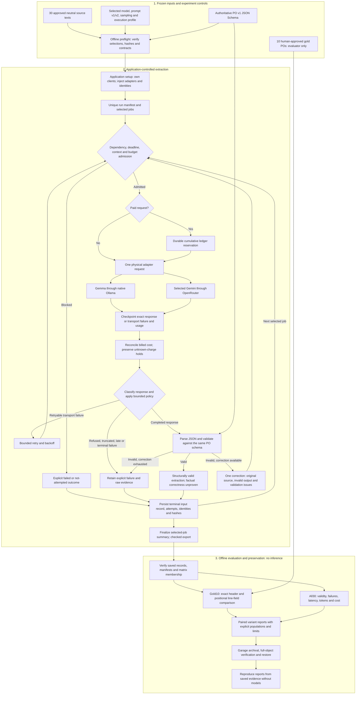
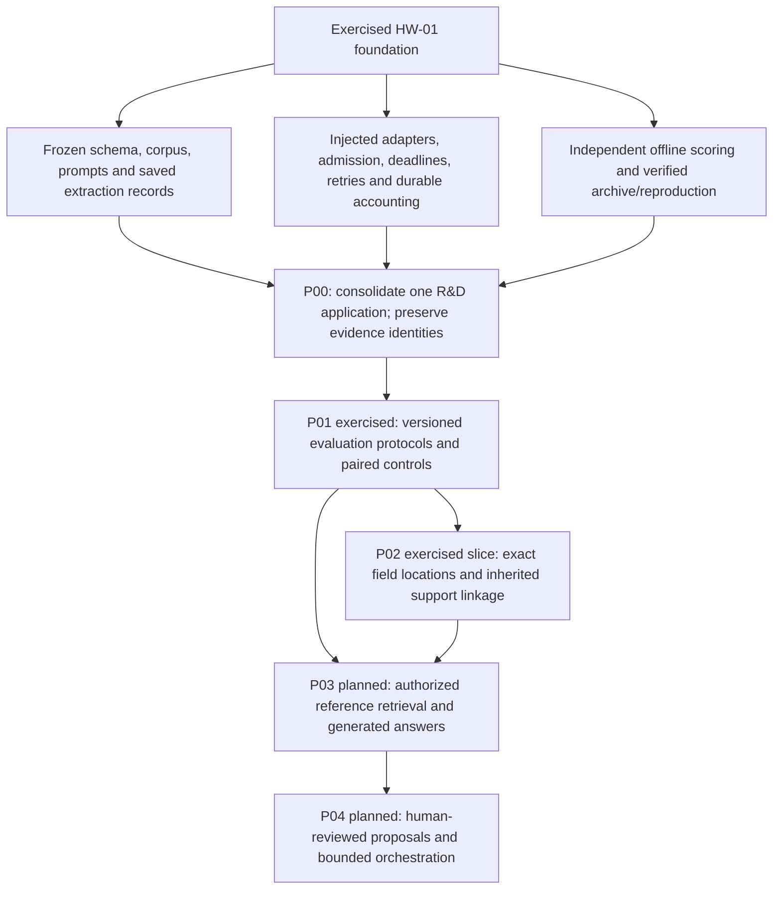

# Extraction foundation — historical HW-01 flow

- Version: **1.0**.
- Documented: **2026-11-08** from the implemented workflow and saved reports.
- Status: **Inherited, exercised foundation**; later milestone flows have their own status.

HW-01 established the extraction, execution and evaluation foundation now used
by the document-intelligence R&D project. This diagram describes the completed
foundation as it evolved through the extraction experiments, not just its first
smoke run. P00 subsequently moved the application to the repository root.
Historical run IDs, configurations and evidence retain their original identities.

## Extraction and evaluation flow

The two model boxes are **alternative selected backends**, not automatic
fallback or mandatory calls to both. Python runs in Docker; native Ollama owns
local inference. Early Docker-Ollama diagnostics remain historical evidence,
but Docker Ollama is not the selected local runtime for the inherited matrix.
Other screening candidates and optional local trials are documented separately.

Retries and the single schema correction are available capabilities, not claims
that every run used them. The final 240-observation matrix used neither transport
retries nor schema corrections. Provider inference required concrete approval;
the diagram does not authorize new calls. Admission failures preserve their
actual status and reason rather than inventing a physical attempt.

Gold answers never enter generation messages. Structural schema validity does
not establish source support or accuracy. Factual scores use gold10 only; the
remaining twenty documents contribute operational results, not inferred labels.
Gold10 was reused during development and is not an independent holdout.

## How this foundation feeds later milestones

These arrows indicate inherited capabilities, not automatic milestone approval.
P02's executed text-provenance slice does not imply all possible workbook or
semantic studies were completed. P03 retrieves a separate reference collection:
saved predictions, gold labels and diagnostic verdicts do not become its answer
corpus. Existing PO-specific execution assumptions must be adapted explicitly
before handling new answer jobs; reusing controls does not mean reusing PO output
objects for every task.

## Detailed evidence and related flows

- [Consolidated results and complete 240-observation matrix](../../REPORT.md).
- [Execution ownership, checkpointing and persistence](../guides/running-extractions.md#flow-and-ownership).
- [Coordinator retry, correction and accounting policy](execution-coordinator.md#request-and-correction-sequence).
- [Exact scoring and operational metric populations](evaluation.md).
- [Archive and restore workflow](../guides/archiving-results.md).
- [P00 consolidation record](../reports/P00-consolidation.md).
- [P01 executed flow](../reports/P01-evaluation-protocols.md#executed-flow).
- [P02 executed flow](../reports/P02-source-provenance.md#executed-flow).
- [P03 planned flow](../plans/milestones/P03-authorized-retrieval.md#revised-end-to-end-flow).

Keep this foundation overview aligned with its linked behavior while preserving
historical measurements and frozen protocols. Record future capability changes
in their milestone flows rather than presenting them as original HW-01 behavior.
