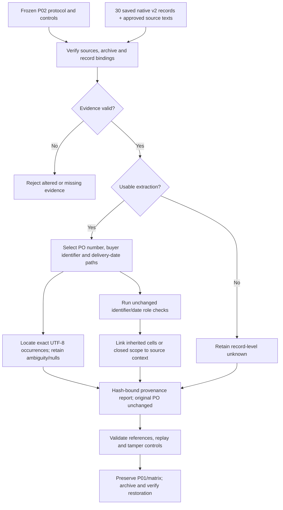

# P02 — Offline source-provenance execution

Executed 2026-11-07 from `3be1bdd` plus the explicit P02 candidate. This report
supersedes the draft plan's execution status while preserving its hash-bound
text. It concludes the selected text-provenance question only; workbook parsing,
new semantic resolvers and model/representation experiments remain unselected.

## Capability and scope

### Executed flow

This depicts the concluded P02 text-provenance slice. It is stored here because
the original plan is a hash-bound input to the preserved experiment. Maintain
this current-flow diagram during scoped changes without modifying frozen proof.

Literal location, inherited semantic verdict and context linkage remain distinct.
Gold answers are not read, no model runs, and these findings do not establish
whole-PO correctness or reviewed semantic accuracy.

### Implementation details

P02-E01 attaches original UTF-8 byte references to three declared field kinds
on the thirty native v2 baseline records already selected by P01. Exact literal
occurrences, inherited semantic role judgments and validated context linkage
are separate dimensions. The assessor reads approved source text and saved
records without gold answers, provider configuration or model setup.

The existing identifier/date checker remains unchanged. Explicit cell references
are mapped to their original source-record quotations; closed-scope absence
resolutions retain complete source context. PO-number occurrences remain
semantically unknown. No new layout, fuzzy matching, normalization or corrective
decision was added. Historical run records and PO v1 are unchanged.

Protocol v1 freezes the population/plan/textual controls, v2 binds executable
controls, and v3 selects a separate final output and process driver. None changes
the thirty inputs, three field kinds, thresholds or zero-inference policy.
Intermediate evidence is retained. A process check exposed JSON tuple/list
reload inequality; canonical JSON comparison fixed it. A subsequent resource
guard moved row validation before inherited assessment and bounds accumulated
field payloads. These corrections do not change inherited support judgments.

## Saved-evidence findings

| Population or finding | Count |
| --- | ---: |
| Pinned records retained | 30 |
| Usable extractions assessed | 29 |
| Unusable records, retained as unknown | 1 |
| Selected output fields | 1,707 |
| Unique exact literal occurrences | 907 |
| Ambiguous literal matches | 158 |
| No exact literal occurrence | 89 |
| Null values, without literal spans | 553 |
| Individual occurrence references | 3,344 |
| Resolved inherited context linkage | 1,316 |
| Unresolved linkage | 391 |
| Inherited supported findings | 476 |
| Inherited contradicted findings | 840 |
| Inherited unknown findings | 391 |

These are diagnostic/provenance counts, not accuracy scores. Multiple matches
count once under ambiguous fields and separately as occurrence references.
Inherited support may concern a null identifier/date on an incorrectly selected
row; it does not establish that the row belongs to the order. No support
precision/recall or missed-error rate is claimed without reviewed anchors.
The other twenty non-gold documents remain unlabeled, and gold10 remains reused
development data. No inference quality improvement was measured.

## Verification and preservation

The 33 focused P02 tests pass, including independently specified byte offsets,
Unicode boundaries, CRLF, changed references, semantic-role distinctions, null
and absence evidence, candidate/row/source bounds, hostile data and CLI isolation.
The eighteen declared control groups combine these tests, inherited tests and
the isolated real-process controls; they are not eighteen live model attacks.

The isolated public-source process exercise deletes gold-answer and annotation
directories and supplies no credentials/model runtime/ledger. Validation and
assessment succeed, JSON reload reproduces the report, and the actual CLI
rejects output replacement, an altered support verdict, a model-call protocol
change, source mutation and changed bundle inventory. Restoring the mutations
restores successful comparison; checked original source/evidence files remain
unchanged. This verifies an offline boundary, not production authorization.

P01's saved comparison reproduced exactly. Historical matrix reproduction
verified 240 observations, eight variants, 84 bundles and 1,594 payload files,
with matching evaluation/report tables and no private ledger or inference.
An initial read-only invocation could not write its reproduction output; the
documented Make target with its writable reproduction directory succeeded.

The final `make check` gate passed **1,015 tests in 308.65 seconds**, Ruff
lint/format, strict mypy on 216 source files, frozen gold validation and offline
preflight. The documented Make targets separately validated all thirty records
and reproduced the final saved report exactly. The isolated process controls
verified 106 original source/evidence files unchanged.

The source plan remains its original hash-bound draft; this execution report
records the implemented status rather than rewriting evidence after measurement.
Archive receipts and exact recovery verification are recorded below.
New model requests, generated tokens and API spending are **0 / 0 / $0**.
Human semantic review and human inspection-time measurement were not performed.

## Decision and remaining scope

Retain exact locations as an inspection capability with explicit ambiguity.
Retain inherited semantic diagnostics with their original limits. No automatic
rejection, correction, routing or whole-PO certification is enabled.

The next P02 decision is whether to select a reviewed source-support study or
a specific neutral workbook/representation question. New customer documents
are not assumed necessary, but semantic claims require explicit anchors and
predeclared thresholds. Framework/RAG/approval-interface experiments remain in
later milestones. See the [operating guide](../guides/source-provenance.md).

## Archived proof

- [Compact archive index](../../archive-index/623d195cf30a774d4ac6ff1e5c71930b90d8413a59cc6229a4826e3fad4e077b.json).
- [Garage upload and full-download receipt](../../archive-index/623d195cf30a774d4ac6ff1e5c71930b90d8413a59cc6229a4826e3fad4e077b.remote.json).
- [Exact restore and report-reproduction receipt](../../archive-index/623d195cf30a774d4ac6ff1e5c71930b90d8413a59cc6229a4826e3fad4e077b.verification.json).

Five bundles contain 99 payload files: the two saved source runs, intermediate
and final P02 results, and the verification bundle with protocols, controls,
implementation/test snapshots and check/process logs. Every restored payload
matches its original checksum. The restored final report reproduces exactly.
The archive's thirty observations are inherited, not new extraction runs.

The approximately 36 MB final report remains ignored by Git. The compressed
proof archive is 4,634,483 bytes. Only compact indices, metadata, code and bounded
documentation are candidates for versioning. Garage and the archive cache
remain on this laptop; this proves local recovery, not off-device backup.

The selected P02-S01–S05 text-provenance slice is concluded. New reviewed-anchor
studies, broader workbook understanding and inference remain separate decisions.
