# P03-S09 — Reproduction, preservation and research decisions

- Recorded: **2026-11-12**.
- Status: **S09 and P03 research execution complete**. Independent Garage
  download, isolated restoration and restored model-free reconstruction passed.
- Parent: [P03 implementation plan](../plans/milestones/P03-authorized-retrieval.md).
- Operations: [preservation commands](../../tools/closeout/README.md),
  [archive workflow](../guides/archiving-results.md).

## Executed checks

| Check | Outcome |
| --- | --- |
| Full Docker gate | 1,118 passed, two optional-SDK skips; 1,050.91 seconds; Ruff lint/format, strict mypy (236 files), gold 10/10 and preflight passed |
| Recovery tools | Three focused tests passed, including changed query results, damaged encoder parts and corrupted source recovery |
| Optional integration tests | All 16 passed in the separate integration image; default runtime confirmed to contain neither LangChain Core nor its Qdrant integration |
| P01/P02 preservation | Original verification bundle inventories passed unchanged |
| Historical extraction matrix | Existing model-free reproducer verified 240 observations, eight variants and published tables from the original archive |
| Qdrant logical recovery | Original E02 collections exported read-only; recovered into a separate empty Qdrant 1.20.0 service/volume |
| Recovered query correctness | All 40 original outcomes reproduced; source eligibility, independent exact cosine oracle and score tolerance retained |
| Recovered live controls | Scope A/B bait, currentness, revocation, update and deletion passed |
| Physical persistence | Separate stop/start followed by another 40-query reload passed |
| Encoder recovery | Original model/config/tokenizer files recovered to temporary storage, totaling 90,872,073 bytes, with frozen SHA-256 identity |
| Portable model-free reconstruction | E01 40 queries; I01 40 contexts and 120 captures; E03 120 jobs; S08 109 judge records, 36 human labels, actual-response parity and exact improvement metrics verified |

The default gate intentionally excludes optional integration packages. Their
separate verification closes those skips without adding them to the default
runtime. The historical matrix used the existing public policy and archived
records; no private ledger, model runtime or new extraction observation was
required. P01/P02 and existing evidence were not rewritten.

Qdrant recovery used the pinned server image and a logical export of IDs, vectors
and full payloads. This is not a binary snapshot or a claim of compatibility
with arbitrary future Qdrant versions. Original source bytes remain the evidence
authority. The original E02 report omits per-hit scores: the recovery checks the
independent cosine oracle, preserves selected sources/statuses/metrics and does
not invent original score observations.

The temporary E02 verification tree uses its original dependency declarations
from `I01-inherited-runtime`; the later optional integration environment is
preserved separately. The original E02 profile's invocation limits are not
silently reused as permission for another measured embedding experiment:
S09 records separate model-free recovery checks with zero encoding calls.

## Archive identity and recovery boundary

The archive is **92,422,407 bytes**, identified by
`58a69457b2555ef3347b669ebcb171bebf3f887f5f90d2b91b84c13b77783024`.

- [Compact archive index](../../archive-index/58a69457b2555ef3347b669ebcb171bebf3f887f5f90d2b91b84c13b77783024.json).
- [Garage full-GET receipt](../../archive-index/58a69457b2555ef3347b669ebcb171bebf3f887f5f90d2b91b84c13b77783024.remote.json).
- [Selection](../../archive-index/selections/P03-closeout.json).
- [Recovery verification receipt](../../archive-index/58a69457b2555ef3347b669ebcb171bebf3f887f5f90d2b91b84c13b77783024.verification.json).
- [Compact closeout summary](P03-closeout-summary.json).

An independent download performed another full GET and verified the received
archive before accepting its existing cache identity. The isolated restore
checked every payload and bundle inventory. Reconstruction then ran directly
from `results/restored/58a69457b2555ef3347b669ebcb171bebf3f887f5f90d2b91b84c13b77783024/submission/P03-S09-v1`:
all original query/context/capture populations, 120 answer jobs, 109 raw judge
records, 36 human labels and improvement metrics matched, without models, a
network or a spending ledger.

The sealed `P03-S09-v1` bundle contains 1,791 files and the complete E01/E02/I01/
E03/S08 evidence directories, approved public source/configuration/tests/docs,
saved embeddings, logical store export and encoder artifacts. The archive also
retains two original native v2 run bundles required by its inherited membership.
The index's `covered_observations: 30` describes that extraction membership;
P03's separate complete population remains 120 answer jobs.

The public source snapshot is an execution checkpoint, before final closeout
documentation. Its controllers and original experiment bindings are preserved;
the final closeout report and compact recovery receipts are versioned separately.

Encoder weights are stored as bounded base64 parts because the existing archive
requires UTF-8 payloads and limits individual files to 64 MiB. Seven specifically
reviewed source files contain synthetic authentication fixtures/header templates
that match its credential-pattern scanner. They are encoded without changing
their original content. Thirty Python module files use reversible canonical
names because leading underscores are prohibited in archive paths. All 37
source files recover to their original names/bytes before protocol verification.
No wildcard credential exemption or archive-policy relaxation was introduced.

The first recovery attempt was stopped after identifying an overly broad
temporary-copy step; the final code copies only required source/configuration
and the frozen vector artifact. Exact interrupted collections were checked
before reuse in the separate recovery instance. Earlier failed-seal inventories
are retained; no original run, source file or vector collection was replaced.

Private workbooks, real credentials, live spending-ledger contents and host
subscription credentials are excluded. The S08 historical accounting result
and original API costs remain preserved. New S09 generation, embedding and
subscription-judge calls: **zero**. New provider spend: **$0**.

The source copies, archive cache and Garage bucket are on the same laptop.
Verified local recovery is not an off-device backup. Both Qdrant instances are
stopped, with their volumes retained; Garage remains available. No originals,
existing volumes, Git history or model caches were deleted.

## Research decisions

| Component | Decision | Evidence and limit |
| --- | --- | --- |
| BM25 | Adopt as this project's reference retrieval baseline | Recall@3 1.0, MRR 1.0 and exercised hard controls on authored development fixtures |
| Dense vector retrieval | Reject replacement of BM25 for this measured workflow; retain reproducible comparator | Recall@3 1.0 gives no predeclared +0.05 gain; MRR 0.9853. Higher whole-population answer yield does not erase differing skip populations |
| RAG answers | Retain the R&D pipeline; defer product/autonomous-advice adoption | Answerable-case judge yield 24/30 BM25 and 26/30 vector versus 0/30 no-context under a strict, uncalibrated rubric; this is not zero factual correctness or independent validated accuracy |
| LangChain | Reject default integration for this bounded workflow | Retrieval/capture/actual-response parity provides no demonstrated maintenance benefit; optional historical replay dependencies remain outside default runtime |
| Sol judge | Retain provisional evidence only | Full records preserved, human disagreements analyzed; correctness/grounding ambiguity and missing granular calibration remain disclosed |

Human review remains optional complementary R&D evidence. Its completed overall
labels do not become unquestionable truth, and disagreement alone does not
establish a broken pipeline. The frozen product-adoption thresholds are not
lowered or retrospectively passed. Research completion requires reproducible
execution and honest decisions, not a positive result for every component.

## Exercised topics and limits

AI Engineer roadmap topics exercised include versioned ingestion, whole-rule
chunking, lexical and embedding retrieval, local vector storage/lifecycle,
context augmentation and citations, structured generation, deterministic and
model/human evaluation, direct-versus-framework composition, replay, resource
accounting and reproducible artifact recovery. No ANN, hybrid/reranking study,
agent, LangGraph, MCP or LangSmith adoption follows from this work.

The OWASP mapping remains scoped: evidence-as-data boundaries (LLM01), output
and citation validation (LLM05), application-owned authority and no tool actions
(LLM06), retrieval scope/currentness/revocation checks (LLM08), separate
provisional correctness/grounding claims (LLM09), and explicit runtime/call/
resource/spend bounds (LLM10). These are exercised technical controls, not a
production security certification or a broad prompt-injection resistance claim.

```mermaid
flowchart LR
    A["Full gate + historical matrix reproduction"] --> B["E02 logical export; isolated restore + live controls"]
    B --> C["Stop/start; 40-query persistence check"]
    C --> D["Public source + encoder + complete experiment snapshot"]
    D --> E["Model-free reconstruction + sealed inventory"]
    E --> F["Archive + Garage upload/full GET"]
    F --> G["Independent full download + isolated restore passed"]
    G --> H["Restored reconstruction passed; closeout receipt published"]
    classDef executed fill:#e7f4e8,stroke:#397647
    class A,B,C,D,E,F,G,H executed
```

