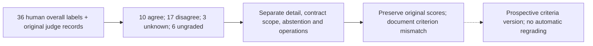

# P03-S08 — Disagreement analysis and acceptance criteria

- Recorded: **2026-11-12**.
- Authority: **agent-authored analysis of saved evidence**, not additional human
  labels or an independent second judge. No inference or score replacement.
- Inputs: [S08 report](P03-evaluation.md), frozen
  [E03 rubric](../../config/evaluation/P03-E03-rubric-v1.json), original question/
  answer bundles, user labels through correction R01 and saved Sol verdicts.

## What the disagreement population contains

The completed 36-item human sample contains ten agreements, seventeen binary
disagreements, three judge-unknown outcomes and six ungraded outcomes. These
categories are preserved, including separate calibration and audit membership.
They do not establish a judge error rate because acceptance criteria differ.

| Binary disagreement group | Items | Evidence-based interpretation |
| --- | ---: | --- |
| Human asks for more detail; judge accepts the frozen propositions | 4 | The narrow technical rubric and desired explanatory depth differ |
| Human rejects non-answer; judge accepts evidence-policy compliance | 4 | Usefulness and justified abstention differ; these are not fabricated facts |
| Human accepts generic explanation; judge requires project-specific facts | 8 | Short questions leave governing context unclear; generic plausibility does not establish contract compliance |
| Human accepts grounded answer; judge rejects omitted date-role warning | 1 | Correctness passes; rubric completeness fails on a requirement not explicit in the question |

### Detail versus rubric completeness: four calibration items

`754e8b2a583a32ec`, `898421634908fb16`, `4d10be9a4d102908` and
`b8aa940491ddce5b` were labelled partly correct/missing details by the user.
The answers nevertheless state the required buyer PO identifier/text-preservation,
net-total/decimal-string, or leading-zero rules. The judge's pass is consistent
with the narrow authored expectations; it does not establish that the explanation
meets the user's desired depth. No particular extra detail was specified in the
human feedback, so this analysis does not invent one.

The other two human partial answers, `c09aa5927a805851` and
`76ef312576da0f8d`, only say package size is not ordered quantity. The rubric also
requires ordered-row/catalog-row scope. They are already agreement cases, not
additional judge disagreements.

### Evidence-policy abstention versus usefulness: four calibration items

`e32a04001296f83b` and `8355a2277e8b7b7d` decline to assert a dispatch marker
when the supplied evidence establishes no applicable current dispatch rule.
`58e53a0f19399e5b` and `0aaab02890ae44e3` decline to define `xylophoniczz`.
The user marks these no-answer/not-pass; the judge passes them under the original
negative-case policy. This is a criterion mismatch, not evidence that the model
should invent a definition or resurrect a deleted rule.

The nonsense questions are intentional negative controls. Retain them in safety/
abstention evaluation, while separating them from answerable-task usefulness.
Any future clarification response is a new behavior to test, not an observation
from the current null-answer records.

### Generic explanation versus contract/policy meaning: eight items

Calibration: `99234e6cf5646dc5`, `c32e0b4e6baf9b82`, `62bf11c43dd6d8b5`,
`bd28f5c093611d63`, `c8d985f44379c5f9`, `7d89366865b39845`.
Audit: `1d20492cb365a18b`, `b4a1e855d5f31921`.

These human passes are generic no-context explanations. For example, the
`totalValue` answer permits a line-item amount and taxes/fees, whereas this
project defines a PO net product total serialized as a decimal string. A generic
dispatch-status explanation cannot establish a fictional scope-specific marker,
resolve conflicting rules or recover a deleted rule. Those are material
differences under the project contract.

However, questions such as "Explain totalValue" and "dispatch marker" do not
themselves identify every governing schema/scope/time condition. Treat the
human endorsement as general acceptability, preserve the contract mismatch,
and flag question underspecification. Do not pronounce every generic explanation
universally false or silently expand the question after seeing an answer.

### Correct but incomplete under the rubric: one audit item

`1ca8c777420720aa` gives a supported requested-delivery-date/line-linkage
explanation. The judge passes correctness and claim support but fails
completeness for omitting "do not substitute PO issue date." The user passes it.
The judge itself notes that the question does not explicitly request that extra
warning. Preserve the missing rubric proposition without converting it into a
factual contradiction. A future question must make the required scope explicit.

## Unknowns and operational failures remain separate

Three additional verdicts pass every expected proposition and completeness but
withhold correctness for absent evidence. Q13/no-context
`3a8ed26ec1fecf9e` is the clearest example: storing identifiers as strings
preserves leading zeros, independently of whether a citation was supplied.
This is a likely judge correctness/grounding conflation. Keep these verdicts
unknown in the original results; this analysis supplies no replacement score.

Six sampled outcomes were never graded: one upstream provider failure and five
deterministic application non-answers. They are pipeline outcomes, not six LLM
reasoning failures or six judge disagreements. Likewise, a model abstention with
an actual response remains distinct from an application skip.

## Criteria for the next evaluation version

These are **proposed prospective criteria**, not a retroactive change to the
frozen S07/S08 prompt, labels, rubric or numeric admission gate.

| Dimension | Acceptance rule |
| --- | --- |
| Question validity | Identify whether the task is answerable, underspecified, nonsense, conflicted or evidence-unavailable. State schema, scope and time when required |
| Factual correctness | Judge asserted facts against the governing task. Missing citation alone is not a factual error; distinguish contradiction from uncertainty |
| Completeness | Name mandatory facts before generation. Report missing facts separately from factual errors; avoid rewarding verbosity |
| Explanatory usefulness | Assess whether the requested explanation is sufficient. Extra depth requires explicit expectations rather than an implicit preference for longer answers |
| Grounding | Assess each substantive claim against eligible cited evidence. General knowledge may be correct yet ungrounded |
| Abstention | Pass policy compliance when evidence cannot support an answer. Separately report that the user did not receive an answer |
| Operations | Report provider error, skip, attempted response and model abstention separately, preserving all denominators |

For future structured grading, expose separate factual, completeness, grounding,
abstention and usefulness results. Do not label an appropriate abstention as an
answered factual success in the user-facing quality summary. Report answerable
cases and negative controls separately, alongside full-population outcomes.
Do not tune a replacement judge with this audit sample and then claim it remains
an independent audit. New criteria/profile require a new version and explicit
exposure accounting; another model run is not authorized by this report.

The immediate decision is to retain BM25/direct integration and provisional
judge authority. Human overall review is complete. Granular calibration and
semantic adoption remain unresolved; the current evidence supports documenting
that limitation rather than requiring more variants to obtain a favorable score.
