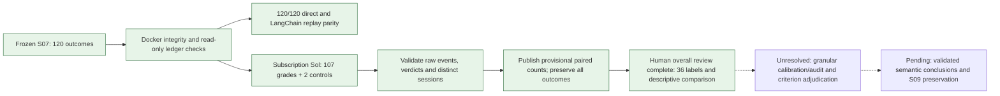

# P03-S08 — Saved-response evaluation and provisional judging

- Recorded: **2026-11-11**.
- Status: deterministic reconstruction and actual-response replay executed;
  subscription judging is provisional. Human calibration and semantic adoption
  remain unresolved.
- [Implementation plan](../plans/milestones/P03-authorized-retrieval.md#p03-s08--separate-retrieval-quality-from-generated-answer-quality),
  [generation evidence](P03-rag-answers.md),
  [operations and human-review format](../../tools/answer-evaluation/README.md).

## Independent measurements

S08 retains all forty questions and all three arms: 120 jobs, 108 original
physical generation calls, 107 structurally valid answers, one upstream provider
error and 12 deterministic skips. Original receipts, source bindings, inputs,
prompts, schema, model responses and the API ledger are preserved. There is no
new extraction/RAG generation, embedding or Qdrant execution in this evaluation.

| Retrieval arm | Relevance-positive cases | Macro Recall@3 | Macro Precision@3 | MRR |
| --- | ---: | ---: | ---: | ---: |
| BM25 | 34 | 1.000000 | 0.431373 | 1.000000 |
| Dense vector | 34 | 1.000000 | 0.431373 | 0.985294 |

These reproduce authored technical relevance scores, including revision-specific
source units such as `dispatch-A@1`. The six zero-relevance cases remain in the
full population; they do not have a defined recall denominator. The original
exact-key lookup comparator passed 12/12 positives. These measures establish
neither answer correctness nor semantic support. Dense retrieval still fails
the predeclared +0.05 recall-improvement gate; retain BM25.

Actual-response replay passed on **120/120 jobs** through direct composition
and the optional LangChain `RunnableLambda` composition. Each path replays the
same 108 saved response records, including Q07/BM25's upstream error, and twelve
skips. Actual S07 requests, output schema, settings, original timeouts and raw
response text are retained. No new model observation follows from replay. I01's
older synthetic flat-citation fixture is not used as a parser for real S07
answers. Direct integration remains selected; this adds no framework quality gain.

## Provisional semantic review

### Measured RAG improvement

Human review is **optional complementary evidence for these R&D metrics**.
It is not a prerequisite for reporting reproducible technical/judge measurements.
Human calibration is required only for a claim of human-calibrated judge
reliability; that stronger claim is not made here. Original scores and numeric
admission gates are unchanged.

**Provisional judge-assessed rubric-pass yield** means jobs with correctness and
completeness both passing, divided by all original jobs in the population. Skips,
errors and unknown grades earn no pass. Changes are percentage points (pp).

| Population | No context | BM25 | BM25 change | Vector | Vector change |
| --- | ---: | ---: | ---: | ---: | ---: |
| All 40 questions | 4/40 = 10% | 25/40 = 62.5% | +52.5 pp | 32/40 = 80% | +70 pp |
| 30 answerable questions | 0/30 = 0% | 24/30 = 80% | +80 pp | 26/30 = 86.7% | +86.7 pp |
| 10 negative controls | 4/10 = 40% | 1/10 = 10% | −30 pp | 6/10 = 60% | +20 pp |

Partitions use the frozen case `expected_status`: `evidence_found` means
answerable with applicable evidence; other statuses form the negative population.
This is task-level answerability, not what a no-context model can know. These
are thirty reference questions, not the historical thirty PO documents. All
arms retain identical case membership within each partition.

The positive signal is **24 and 26 rubric passes on the same 30 answerable cases**.
The no-context zero reflects a strict, uncalibrated rubric with known
correctness/grounding conflation; it does not mean every no-context answer was
factually wrong. These agent-authored development expectations are not an unseen
independent benchmark.

The negative-control row is **not a safety-success rate**. Application skips
earn no judge pass even when enforcing evidence policy. Different skip counts
explain much of the whole-population vector/BM25 difference.

| Population/arm | Graded responses | Application skips | Provider failures |
| --- | ---: | ---: | ---: |
| Answerable / no context | 30 | 0 | 0 |
| Answerable / BM25 | 29 | 0 | 1 |
| Answerable / vector | 30 | 0 | 0 |
| Negative / no context | 10 | 0 | 0 |
| Negative / BM25 | 2 | 8 | 0 |
| Negative / vector | 6 | 4 | 0 |

The compact summary includes denominators, answer statuses, operational outcomes
and deltas, reproduced by `make answer-evaluation-publish`. Tests verify matched
membership, duplicate rejection, fixed denominators and partitioning. The focused
Docker gate passed **39 tests**, Ruff lint/format and strict typing (169 files).
No new generator or judge inference was used.

### Judge execution and limitations

The judge candidate is GPT-6.1 Sol / medium through subscription-authenticated
Codex CLI 0.167.1. The profile allows one isolated CLI attempt per valid answer, with
the frozen expected propositions, question, answer and supplied source passages.
Two invented positive/false-claim controls precede the 107 actual answers;
controls are not additional RAG cases. The other thirteen original outcomes
remain visible without judge calls. Human feedback and audit labels never enter
the judge prompt. Scores produced by this procedure are **uncalibrated AI
judgments against agent-authored development expectations**, not human accuracy.

Validation checks verdict identity/schema, proposition and explicit-claim
coverage, exact quoted evidence, citation ownership, internal consistency,
complete turns, usage and observed tool events. It cannot prove entailment or
that the judge found every substantive summary claim. A byte-valid quotation
can still be semantically irrelevant. A generally correct no-context explanation
receives no grounding credit. Missing contract details and underspecified policy
questions are distinguished in rationales; failing a specific technical rubric
does not establish that a generic statement is universally false.

The original controller stopped after the first positive control because Codex
represents its feature-warning notice as an error item. The original manifest,
response and strict rejection are preserved. A separately bound R01 controller
recognizes only the exact pre-turn `skip_host_skill_discovery` notice; tests reject
other errors, late/repeated notices and actual tool events. R01 reuses the first
control unchanged and continues only unsent jobs. No original model observation
is replaced to improve its grade. Synthetic control success exercises the runner
and obvious false acceptance; it does not calibrate the judge against humans or
establish broad injection resistance.

The completed phase retains **109 valid provisional records in 109 distinct
sessions: two controls and 107 saved-answer grades**. No tool execution or quota
stop was observed. The R01 execution span was 2,363 seconds (39m23s); the original
control took eight seconds, excluding the intervening recovery work. Reported
usage was 750,808 input tokens and 31,385 output tokens. Cached input (234,624)
and reasoning output (9,439) are reported subfields, not extra additive usage.
The [compact reconstruction](P03-evaluation-summary.json) records provenance,
accounting, full-population denominators and execution totals.

| Arm | Original jobs | Graded answers | Provisional complete-and-correct passes | Ungraded original outcomes |
| --- | ---: | ---: | ---: | ---: |
| No context | 40 | 40 | 4 | 0 |
| BM25 | 40 | 31 | 25 | 9 |
| Dense vector | 40 | 36 | 32 | 4 |

These are **rubric-pass counts, not validated accuracy rates**. Ungraded outcomes
remain in the original population; the BM25 total includes eight skips and one
provider error. The judge marked all 46 BM25 and 47 vector explicit claims
supported, versus zero of 59 no-context claims. Those labels do not independently
verify semantic support or cover every possible assertion in the answer summary.

Inspection found three verdicts with every expected proposition passing and
completeness passing, but correctness unknown because source evidence was absent.
For example, Q13/no-context (`3a8ed26ec1fecf9e`) correctly described storing
identifiers as strings to preserve leading zeros; the judge nevertheless wrote
“Source-grounded correctness remains unknown because no evidence was supplied.”
This suggests correctness and grounding were conflated in these cases. Preserve
the original verdicts and flag them for adjudication; do not silently relabel
them or interpret the low no-context pass count as factual accuracy. The frozen
judge prompt is not revised after observing these results.

The final focused Docker gate passed **32 tests**, Ruff lint/format and strict
mypy across 165 source files. Frozen controller/source bindings and raw results
were revalidated during model-free publication. No new generator call or API
ledger write was made.

## Human authority and exposure

See the [disagreement analysis and prospective criteria](P03-evaluation-adjudication.md)
for the seventeen disagreements, unknowns and operational non-answers. This is
agent-authored analysis, preserving original human and judge decisions.

**Overall human review finalized (2026-11-12):** all 36 sampled items have
explicit user labels. `make answer-human-overall-review` validates exact sample
membership, phases and counts, binds source hashes, and saves
`human-overall-review.json`. This completes the requested overall human review;
it does not require the user to re-enter those labels into a granular schema.

| Sample | Human items | Pass | Partial | No-answer/not-pass | Agreement | Disagreement | Judge unknown | Ungraded |
| --- | ---: | ---: | ---: | ---: | ---: | ---: | ---: | ---: |
| Calibration | 24 | 10 | 6 | 8 | 5 | 14 | 1 | 4 |
| Audit | 12 | 8 | 0 | 4 | 5 | 3 | 2 | 2 |

For this descriptive comparison only, human pass means accepted; partial and
no-answer/not-pass mean not accepted. Judge acceptance requires both correctness
and completeness to pass; an explicit failure means not accepted, otherwise
unknown. Unknown/ungraded outcomes remain separate. Eight calibration items
were accepted by the judge but not the human; nine items across both phases
were not accepted by the judge but accepted by the human. These are criterion
disagreements, not a calibrated false-acceptance estimate: overall usefulness,
evidence-policy compliance and rubric completeness are not interchangeable.
There is no extension of sample labels to the other 84 jobs.

The overall review is complete while **dimension-specific judge calibration
remains unresolved**. Missing per-claim labels, rubric approval and abstention
judgments are recorded as unassessed, not fabricated. The final focused Docker
gate passed 37 tests, Ruff lint/format and strict typing across 167 files.

**2026-11-12 follow-up:** the user supplied overall labels covering all 36
packet items (24 calibration, 12 audit): **18 pass, six partly correct/missing
details, nine no-answer/not-pass, and three no-answer/not-pass with the question
flagged as "fake"**. Earlier endorsements were explicitly promoted to overall
passes. The user subsequently restored `3a8ed26ec1fecf9e` to pass in correction
R01; its earlier partial-correctness label remains in the history.
Original feedback, packets and judge verdicts remain intact;
the consolidated labels and annotated packet are ignored review artifacts.

These are human judgments of overall acceptability. A no-answer rejection does
not by itself establish that abstention was inappropriate under the frozen
evidence policy, and a question flagged "fake" requires rubric/question
adjudication. No per-claim support labels, approval of expected propositions or
independent-review declaration were inferred. Granular judge calibration remains
unresolved; no model rerun or retrospective verdict correction followed.

The following describes the earlier feedback checkpoint, retained for provenance.
The user endorsed six calibration items and four audit items as looking good.
That feedback remains intact in an ignored sidecar. It does not supply separate
correctness/completeness/claim-support decisions or approval of every expected
proposition; unmentioned items remain unreviewed. Complete human anchors remain
absent. The importer requires explicit reviewer identity, evidence/rationale,
phase/claim coverage and a declaration of review without consulting judge grades.
Calibration and audit comparisons stay separate; unknowns cannot silently pass.

The original packet order was no-context/BM25/vector, weakening arm blinding.
New v2 packets retain the same IDs/items with a reproducible shuffled order.
This preserves existing feedback and avoids repeating the presentation defect;
it cannot erase the reviewer's prior exposure or create an unseen holdout.

## Controls, accounting and preservation

Docker owns substantial processing, tests, report reconstruction and optional
LangChain replay. Only Codex judge execution and simple shell orchestration use
the authorized host exception. CLI jobs ignore user configuration, use fresh
temporary working directories, disable project instructions/host skill discovery
and listed tool/app/plugin/browser capabilities. Captured events must show no
tool execution. This records exercised controls, not a general filesystem or
prompt-injection security guarantee.

Before each job, quota metadata must establish included Plus access, no purchased
credit balance and at least 10% headroom in both quota windows. Unknown quota,
identity/access errors, deadlines and invalid results stop the phase. No credit
purchase/reset, model replacement or API fallback is automatic. Limits are one
CLI attempt per job, 180 seconds per attempt and 7,200 seconds per invocation.
CLI-internal transport requests are opaque; CLI attempts are not counted as
proven single physical provider requests. Output-token usage is inspected after
completion, not bounded by a provider-enforced output limit.

Subscription usage and review effort are separate from original API charges.
The API ledger remains read-only; all 215 prior reservations and $0.50135040 in
unknown holds are retained. Original E03 known cost is $1.1270655. Subscription
cost is excluded from marginal API billing, rather than described as free.
Requested model identity is recorded; hosted weights and reported runtime model
identity may be unavailable. Missing fields are not fabricated.

Raw input bundles, responses, quota records, manifests, replay results and paired
reports remain ignored under `results/submission/P03-S08-v1/`. S09 owns verified
archival/restoration. Human calibration is a gate for validated semantic
conclusions, not for preserving deterministic/replay evidence or provisional
grades. P03 remains partial; no answer-quality adoption follows from these checks.
