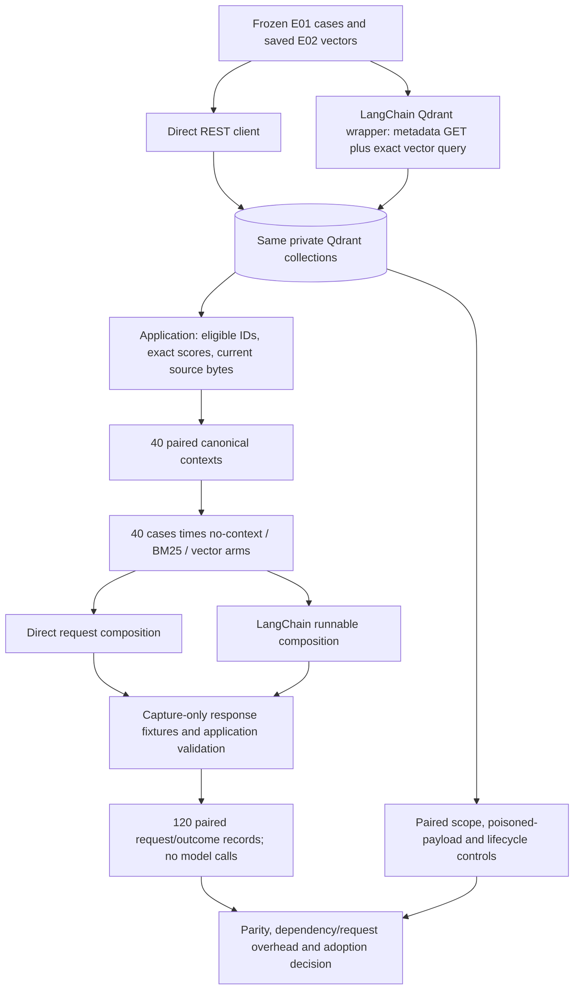

# P03-I01 — Direct versus LangChain integration

- Recorded: **2026-11-09**.
- Scope: **bounded integration trial**, not E03 generation or model-quality testing.
- Decision: **retain direct integration**; keep the optional trial for reproducibility.
- [Frozen profile](../../config/retrieval/P03-I01-profile-v1.json),
  [protocol/bindings](../../config/retrieval/P03-I01-v1.json),
  [compact results and report checksum](P03-langchain-integration-summary.json).

## Executed flow

## Results and interpretation

| Measure | Result |
| --- | --- |
| Retrieval parity | 40/40 cases, same eligible source IDs, ranking and original-byte context |
| Composition parity | 120/120 jobs across three arms; canonical request/validation reconstruction checked separately |
| Capture invocations | 108 per path; these are virtual fixture invocations, not physical model calls |
| Deterministic skips | 12 per path, including empty lexical context and known conflicts |
| Fixture validations | 44 structurally valid, 64 rejected per path; deliberately mixed fixtures, not accuracy |
| Live paired controls | Scope bait, untrusted payload text/metadata, revocation, currentness, update and deletion passed |
| Store traffic | 145 requests total: direct 53; SDK 46 queries plus 46 metadata requests, including controls |
| Encoding / generation / API spend | 0 / 0 / $0 |
| Setup and trial duration | 1.297s setup/import/validation within 1.974s total |
| Per-case median retrieval plus application validation | Direct 3.957ms; LangChain 4.651ms |

The trial demonstrates mechanical interoperability, not better retrieval or
answers. Both paths use the same vectors, exact search, filters, source gates
and application rendering/validation functions. Independent controls are needed
because agreement between two wrappers around the same functions is not an
independent correctness oracle. Synthetic replies include invalid JSON, forged
citations, valid unverified answers and mechanically grounded fixtures; their
validation rate has no interpretation as model accuracy.

The pinned by-vector method performs collection validation before each query,
even with constructor validation disabled. That validation passes the supplied
vector list and never invokes an encoder. It adds one metadata GET per SDK query.
Tests also observe a single failed GET on HTTP 503, without retries or fallback.

No demonstrated integration/maintenance benefit justifies replacing the existing
direct path for this small pipeline. LangChain still requires dependency/client
setup, metadata mapping, tracing controls and all application authority/citation
checks. This is a decision about this bounded use case, not evidence against
LangChain for other integrations or LangGraph's separate P04 questions.

Timing uses one pass, always direct first, and includes source validation. It is
not a throughput benchmark. The integration group adds 23 resolved distributions;
the observed integration image was 147,386,661 virtual bytes larger than the
observed checks image. This includes the trial/dev setup and package cache,
not a minimal library footprint or unique Docker disk consumption. The group is
excluded from default runtime installation, so these are optional trial costs.

## Identity, boundaries and verification

Packages were installed via Docker `uv`: **langchain-core 1.7.6**,
**langchain-qdrant 1.1.0**, **qdrant-client 1.20.0**. The integration uses the
[official Qdrant vector-store interface](https://docs.langchain.com/oss/python/integrations/vectorstores/qdrant);
its exact installed implementation was inspected before measurement. The
current and inherited dependency identities are separately bound. Original E01
and E02 manifests, labels, prompts, source bytes and encoder outputs are unchanged.

Application setup owns both clients. LangChain borrows its Qdrant client and
never owns permission selection, source truth, model admission or accounting.
Source IDs, vector scores and original bytes are checked outside the wrapper.
Untrusted store payload text cannot replace cited source text. Tracing is disabled,
credentials are absent, SDK cloud inference is false, and no model is mounted.
Qdrant was stopped after verification with its data volume retained.

Default `make check` passed **1,072 tests with two intentional optional-SDK skips
in 313.25 seconds**, lint/format, strict mypy across 229 files, frozen gold and
preflight. The separate integration image passed **all 16 integration tests in
0.94 seconds**, including those SDK-specific cases, plus lint/format/types.
The independent model-free reproducer additionally verifies all forty contexts
and 120 canonical capture records without network, database or model execution.
It checks a trusted report checksum and the frozen source/evidence bindings;
it does not re-execute live controls or reproduce their measured latency.
The verifier passed lint/format and strict mypy across 230 files; its real Make
entrypoint reconstructed canonical request bytes and validation outcomes, and
rejected a wrong report checksum with the intended digest-mismatch error.

The runtime uses a distinct fixture answer contract and provisional capture
settings, not a second PO model or the S07 production profile. This trial does
not prove live RAG deadline/budget execution, model resistance to prompt injection,
semantic grounding or new human review. S07 must define real answer jobs and
its generator profile; S08 must replay actual S07 responses through the chosen
integration as planned. Neither stage has run here.

Raw evidence and logs stay ignored under `results/submission/P03-I01-v1/`.
Final Garage archival/restore remains S09 work; no upload or off-device recovery
copy is claimed by this integration trial.
