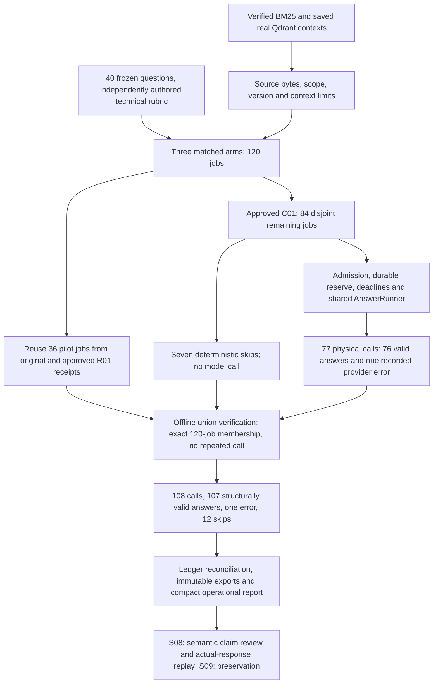

# P03-S07 / E03 — Full matched RAG generation

- Recorded: **2026-11-10**.
- Status: **S07 generation scope complete; S08 semantic review/replay and S09 preservation remain outstanding**.
- [Compact operational results](P03-rag-answers-summary.json), [pilot/recovery history](P03-rag-pilot.md), [operations](../guides/rag-answers.md).

## Results

All 40 frozen questions were exercised across no-context, BM25 and vector-context
arms. The 36 saved pilot jobs were reused unchanged. The separately approved
remaining28 invocation completed its 84 jobs without a budget/dependency stop.
Across all invocations there are **108 unique physical calls, 107 structurally
valid answers, one provider-error response and 12 deterministic skips**. No job
is unattempted. No billed pilot observation was repeated.

| Arm | Questions/jobs | Physical calls | Schema/citation-valid answers | Provider errors | Deterministic skips | Reported cost |
| --- | ---: | ---: | ---: | ---: | ---: | ---: |
| No context | 40 | 40 | 40 | 0 | 0 | $0.3718740 |
| BM25 | 40 | 32 | 31 | 1 | 8 | $0.3721620 |
| Vector | 40 | 36 | 36 | 0 | 4 | $0.3830295 |
| Total | 120 | 108 | 107 | 1 | 12 | $1.1270655 |

These are **operational and structural results**. Semantic accuracy, claim
entailment, answer completeness and useful-grounded-answer rates are unreviewed.
Valid JSON and real citation identities do not establish a correct explanation.
No semantic adoption threshold has been accepted from these counts.

## Protocol and controlled differences

The generator remained Gemini 3.5 Flash through Google AI Studio. All arms used
the same frozen answer prompt/schema, temperature 0, top_p 1, 8,192 output tokens,
provider-default reasoning, full-context admission policy and failure controls.
Only supplied evidence differed. No-context could answer from general knowledge
as unverified; irrelevant but nonempty RAG contexts reached the model. Empty RAG
contexts and structural catalog conflicts produced deterministic skips.

The original pilot's funding stop and the approved two-call R01 recovery remain
separate immutable records. C01 verified both receipts and the 31 known pilot
charges before selecting the disjoint 28-question population. Its $3 new-phase
allowance changed financial headroom; model, prompt, schema, input, retrieval
and generation settings stayed unchanged. There were zero retries/corrections
and no automatic replacement invocation.

BM25 was recomputed under the frozen E01 protocol. Vector contexts were reused
from I01's actual, byte-identified Qdrant queries. E03 revalidated source bytes,
scope and effective versions before each physical call; it made **zero new
embedding or database calls**. This measures generation on those contexts,
not new live retrieval performance. The provider publishes no weight digest;
the requested model alias/route, endpoint metadata and reported identity are
retained rather than claiming immutable hosted weights.

## Model-reported statuses

| Arm | Grounded | Unverified | Insufficient evidence | Application skips | Provider errors |
| --- | ---: | ---: | ---: | ---: | ---: |
| No context | 0 | 29 | 11 | 0 | 0 |
| BM25 | 29 | 0 | 2 | 8 | 1 |
| Vector | 30 | 0 | 6 | 4 | 0 |

These are the model's labels, not independent grounding or correctness scores.
Application skips are distinct from model abstention and demonstrate no model
resistance to injection/hallucination. S08 must review the frozen technical
propositions and specific claim/citation relationships, retain all failures and
report review coverage. The fixtures were agent-authored before generation and
have development exposure; no new human approval or unseen-data claim is implied.

## Recorded failure

**Q07/BM25** returned a completion error with code 502,
`provider_unavailable: Network connection lost`, and `finish_reason=error`.
It reported zero input/output tokens and zero cost. Its raw response, request,
admission and settled zero charge are retained. It remains a failed primary
observation; it was not retried or replaced. No truncation, refusal, malformed
answer or new unknown-charge hold was observed.

The failure stays in BM25's 40-case population for later reliability and answer
evaluation. It cannot be removed to improve a quality aggregate. Its upstream
network diagnosis establishes no model-capability or context-capacity finding.

## Cost and timing

| Invocation | Physical calls | Reported cost | Summed request duration | First reservation to last result |
| --- | ---: | ---: | ---: | ---: |
| Initial pilot | 29 | $0.3543990 | 206.63 s | 210.62 s |
| Approved R01 recovery | 2 | $0.0111975 | 8.34 s | 8.47 s |
| Approved C01 remaining28 | 77 | $0.7614690 | 455.32 s | 475.99 s |
| Total | 108 | $1.1270655 | 670.29 s | Separate invocations |

The continuation took about **7 minutes 56 seconds** from first reservation to
last result. Summed request durations exclude Docker builds, public metadata
preparation and approval gaps. They are not continuous whole-experiment wall
time or a controlled throughput benchmark. Total usage was **101,913 input and
108,244 reported output tokens**, including provider reasoning; all physical
records had reported usage fields.

C01's peak accounted-spend-plus-next-reservation exposure was **$2.3990025**,
within its $3 allowance. Actual continuation cost was below the rough $0.91
pilot extrapolation. The cumulative ledger now accounts for **$6.76109920**
under the unchanged $10 cap, leaving **$3.23890080**. All 215 pre-E03 entries
and $0.50135040 prior unknown-charge holds remain accounted for; every E03 call
has a known reported charge. No ledger initialization, reset or cap raise occurred.

The arm cost totals include different skip/error populations. They do not alone
establish a production cost advantage or amortized vector-store savings.

## Executed flow

## Verification and evidence

A separate network-disabled Docker pass reconstructed all 120 job records,
compared all 108 physical requests against frozen instructions/schema/settings,
checked admission and citation validation, matched each physical call to one
unique paid reservation and known charge, and verified phase funding exposure.
Exports matched their persistent originals byte-for-byte. The source collection
and cumulative ledger were read-only during this verification.

The original application controls had passed the 1,118-test default gate with
two optional SDK skips; the final focused answer gate passed 46 tests. C01's
combined continuation/recovery gate passed 23 tests, lint and strict typing.
Actual-response execution is separate evidence from those fake-adapter tests.
No application source, frozen experiment/profile, prompt, schema or inherited
record was edited during generation.

Raw journals, the full operational summary and verification helper are preserved
under ignored `results/submission/P03-E03-v1/`, with journals also retained in
the existing persistent results volume. Compact report data is versioned here.
Full archival/restore proof remains S09 work.

| Artifact | SHA-256 |
| --- | --- |
| Frozen E03 manifest | `3dc7a9fa647a5d86aca11003d196487f52cf521fa6c691b7a43c953e04a8faab` |
| Original pilot journal | `1fa806c4d28dec0563c4cdf3d09d67f4413f374c28e3814985c85744db7ba042` |
| R01 journal | `1f8f927fcf2ac4b619b5b1a41f50f9962fe424565eb4b493b146189006bbec22` |
| Pilot joint receipt | `2f429d7f1f58bdede7a9a066c5a72557cd544481b2963480b00108b066d42445` |
| C01 journal | `fa99d5401a466e1436c5db893ea42258f59467f86a3e824ec8a563102d220562` |
