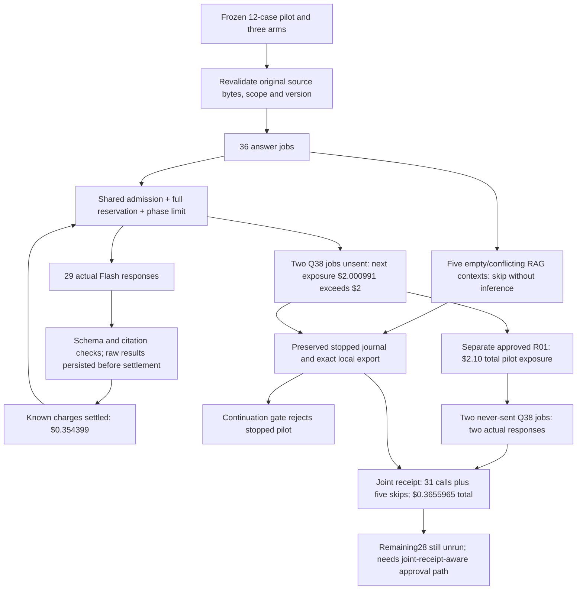

# P03-E03 — RAG pilot and financial recovery

- Recorded: **2026-11-10**.
- Status: **pilot population complete through separately approved R01 recovery; subsequent C01 generation is recorded in the [full report](P03-rag-answers.md)**.
- [Completed pilot summary](P03-rag-pilot-recovery-summary.json), [original stopped summary](P03-rag-pilot-summary.json), [frozen profile](../../config/retrieval/P03-E03-profile-v1.json), [operations](../guides/rag-answers.md).

## Outcome

The pilot covers 12 fixed questions across all four case groups, each with no
context, BM25 and saved real Qdrant context. The first approved invocation made
29 actual Gemini 3.5 Flash / Google AI Studio calls, then stopped at the phase
allowance. Separately approved R01 completed only the two never-sent Q38 jobs.
Together the immutable records account for all 36 pilot jobs. No billed job was
repeated and no remaining28 invocation ran.

| Arm | Jobs | Original calls | Recovery calls | Deterministic skips | Unattempted |
| --- | ---: | ---: | ---: | ---: | ---: |
| No context | 12 | 12 | 0 | 0 | 0 |
| BM25 | 12 | 8 | 1 | 3 | 0 |
| Vector | 12 | 9 | 1 | 2 | 0 |
| Total | 36 | 29 | 2 | 5 | 0 |

All 31 replies passed answer-schema and supplied citation identity/version/span
checks. No transport, refusal or truncation outcome was recorded. **Semantic
correctness and entailment are unreviewed**; this is not a 100% accuracy result.
The model labelled ten no-context answers unverified and two insufficient;
BM25 answers labelled eight grounded and one insufficient; vector answers labelled
eight grounded and two insufficient. These are model labels, not independently
verified support. The two recovery replies both reported insufficient evidence.

## Why it stopped

The approved $2 limit applies to accounted phase spending plus the next full
reservation. Each call requires $1.646592 of reservation headroom, then settles
to actual reported cost. After $0.354399 spent, the next reservation would bring
exposure to **$2.000991**, exceeding the limit by **$0.000991**. The proposed
allowance left only $0.353408 for settled work while keeping a full next-call
reservation available; it was too tight for this pilot.

The two jobs left unsent at that stop were **Q38/BM25 and Q38/vector**. At the
stop, cumulative spending was **$5.98843270** under the unchanged $10 cap,
leaving **$4.01156730**. All 215 prior reservations and
$0.50135040 prior unknown-charge holds remain accounted for. The pilot's 29
new reservations have known reported charges; none created an unknown hold.

The original journal/profile remain unchanged. The ordinary continuation gate
still rejects that stopped parent. The user's subsequent acceptance of the tiny
overage led to a separately scoped recovery and then explicit paid-invocation
approval; the frozen original $2 profile was not edited.

The approved **P03-E03-R01** financial addendum retained the original cost inside
a $2.10 total exposure envelope and selected only those two unsent jobs.
Its original application runner and generation controls are unchanged. Ten
focused tests and lint/types passed, including sent-job rejection, changed parent
membership, seeded cost accounting, duplicate-run rejection and unknown-charge
stops. A separate freeze/plan pass verified both parent identity and recovery
bindings without inference. The approved recovery then made exactly two physical
calls for **$0.0111975**, with no stop, retry, correction or new unknown hold.
Total pilot cost is **$0.3655965**. Current cumulative accounting is
**$5.99963020**, leaving **$4.00036980** under the unchanged $10 cap. The original
215 reservations/$0.50135040 holds remain accounted for; all 31 pilot charges are
known. The recovery and original records stay separate and linked by hashes.

## Usage and timing

| Measure | Observed |
| --- | ---: |
| Combined input tokens | 29,345 |
| Combined reported output tokens, including provider reasoning | 35,731 |
| Combined actual reported cost | $0.3655965 |
| Combined summed physical request duration | 214.97 seconds |
| Original first reservation through last physical result | 210.62 seconds |

The summed timing excludes Docker build, public metadata preparation and the
approval/implementation gap between invocations. It is not a continuous pilot
wall-time measurement. No embedding
or database calls were made: vector contexts came from I01's real, byte-identified
queries and original sources were revalidated. This pilot does not establish
new live retrieval latency or an amortized cost benefit.

## Recorded flow

## Verification and remaining work

The network-disabled cross-check reconstructed all planned requests, compared
admission evidence and exact supplied citations, matched raw physical results to
outcomes and settled ledger entries, and confirmed the continuation rejection.
The original ledger was read-only during verification. No application source,
prompt, schema, generation setting or frozen protocol was changed.

A second offline verification reconstructed all 31 requests/admissions and
mechanical validations, matched every known charge to one unique physical job,
verified both exports against persistent originals, and proved exact 36-job
membership without replacing the original unattempted outcomes. The joint
receipt records this accounting relationship; it grants no paid-run approval.

The raw journal and verification helper are preserved in ignored
`results/submission/P03-E03-v1/`; the original is also retained in the persistent
results volume. Journal SHA-256:
`1fa806c4d28dec0563c4cdf3d09d67f4413f374c28e3814985c85744db7ba042`.
Manifest SHA-256:
`3dc7a9fa647a5d86aca11003d196487f52cf521fa6c691b7a43c953e04a8faab`.

Recovery journal SHA-256:
`1f8f927fcf2ac4b619b5b1a41f50f9962fe424565eb4b493b146189006bbec22`.
Joint receipt SHA-256:
`2f429d7f1f58bdede7a9a066c5a72557cd544481b2963480b00108b066d42445`.

The pilot population is complete. The original continuation command deliberately
still rejects its stopped parent. The separately bound
[C01 continuation](../../tools/answer-continuation/README.md) now verifies both
receipts and the 84 disjoint remaining jobs, with 23 combined focused tests
passing and a $3 new-phase allowance. Its separately approved invocation
subsequently completed 77 calls for $0.761469, retaining one provider-error
response and all seven skips. The [full generation report](P03-rag-answers.md)
records the 120-job union and S07 completion. S08 semantic review/replay and
S09 reproducibility/archival remain outstanding. No human review or unseen-data
reliability claim follows.
