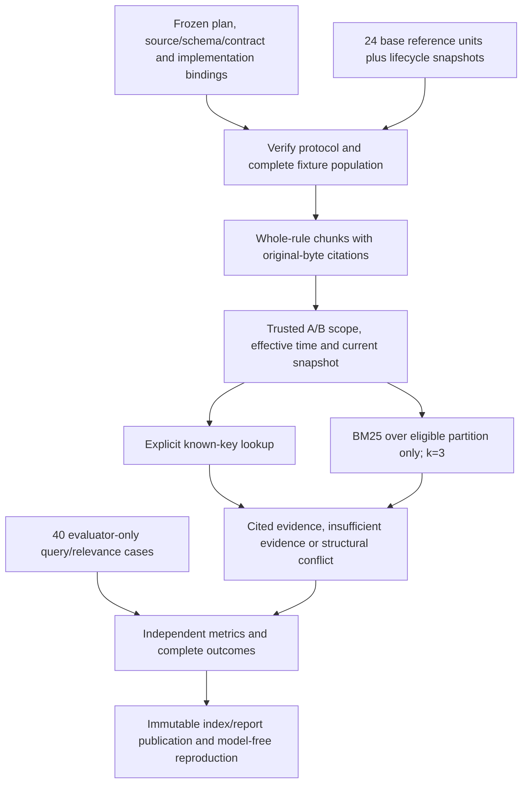

# P03-E01 — Authorized reference retrieval

- Recorded: **2026-11-08**.
- Scope: **S01–S05 / E01** only; later P03 stages remain unexecuted.
- Accepted evaluation identity: `P03-E01-v3`.
- Protocol identity: `f4cd8d3472613ca6ca7c5ca0fbad9b32cbb52d05dda6ce17059dbc8eaafe4a66`.
- Authority: agent-authored technical fixtures, shared authorship and development
  exposure; **no new human relevance review or semantic accuracy claim**.

## Executed flow

The reference collection contains fifteen schema field definitions, five
explanatory normalization/context units and four explicitly fictional A/B
policies. Rule text retains qualifications; each chunk is one complete unit.
Conflict/update/deletion/revocation catalogs exercise trusted lifecycle changes.
The frozen query population has twelve known-key, twelve free-text, eight
negative/conflict and eight scope/lifecycle cases. Relevance fixtures were
authored before rankings were observed and are inaccessible to the retrieval API.

## Results and decision

| Measure | Recorded result |
| --- | --- |
| Query population | 40 cases; 80 recorded method outcomes |
| Exact known-key positives | 12/12 |
| BM25 macro Recall@3 | 1.000 over 34 cases with nonempty relevance sets |
| BM25 macro Precision@3 | 0.431373 over the same population; unfilled ranks penalized |
| BM25 mean reciprocal rank | 1.000 over the same population |
| Declared status controls | Passed; keyed lifecycle and explicit negative/conflict controls |
| Model calls / new API spend | 0 / $0 |
| Semantic answer accuracy | Unavailable; no generation or claim review |

The lexical candidate meets the predeclared 0.85 recall gate on this small
technical suite. This is a bounded baseline decision, not production adoption
or proof that arbitrary questions are answerable. Exact lookups without a supplied
key are retained but not treated as applicable semantic-search comparisons.

Two lifecycle cases, Q38/Q39, illustrate an important failure: after the dispatch
rule is deleted/revoked, a lexical query can return an irrelevant review policy
sharing the word “marker.” The keyed lookup correctly returns insufficient
evidence. BM25 correctly excludes the unavailable rule but cannot establish
semantic insufficiency from word overlap. These outcomes remain in the report;
they do not receive semantic abstention credit. Permission, relevance and answer
support remain separate properties.

## Verification and protocol corrections

Focused verification has **26 passing tests**, including independent BM25 and
relevance arithmetic; partition-statistics isolation; invalid trusted scopes;
stale/current versus historical snapshots; deletion/revocation; source hash,
path/symlink/size and interval checks; exact lookup without inferred keys;
structural conflict; original Unicode/CRLF byte spans; forged citation fields;
query limits; atomic no-replacement publication; and real CLI execution.

The real process reproduces identical semantic results from a public-only copy
without gold, predictions, private settings, ledger or model artifacts. Changing
query fixture bytes then produces the intended protocol-binding failure.
The published report was also regenerated with `--check-result` without inference.
Elapsed times remain observations and are excluded from deterministic comparison.

V1 exposed an overly broad status-metric assumption: irrelevant lexical evidence
was treated as an authorization/status failure. V2 corrected applicability.
Cross-process reproduction then exposed nondeterministic floating-point
accumulation from set iteration; V3 fixes term iteration order. Labels and the
quality threshold stayed unchanged. Only V3 is the accepted reproducible result.
The public contract reference is explicitly allowlisted in Docker images because
it is a frozen derivation dependency; other documentation is not broadly included.

The final Docker `make check` gate passed: **1,041 tests in 307.35 seconds**,
Ruff lint/format, strict mypy across 220 files, frozen gold validation and offline
preflight. The initial image check exposed the missing public contract dependency;
the final image explicitly includes it and passes the real-process controls.
S09 archival and historical matrix restoration remain separate work, not claimed
from unit tests. Existing schema, extraction inputs, gold labels and prompts are
unchanged.

## Evidence and continuation

- [Frozen protocol](../../config/retrieval/P03-E01-v3.json).
- [Query fixtures and label authority](../../config/evaluation/P03-cases-v1.json).
- [Base reference catalog](../../config/retrieval/catalog.json).
- [Operations and reproduction](../guides/reference-retrieval.md).
- [Remaining P03 plan](../plans/milestones/P03-authorized-retrieval.md).

Raw snapshot/report files are ignored under `results/submission/P03-E01-v3/`.
Final Garage preservation belongs to S09; do not mistake their current presence
on this laptop for a verified off-device backup or completed P03 archival.
