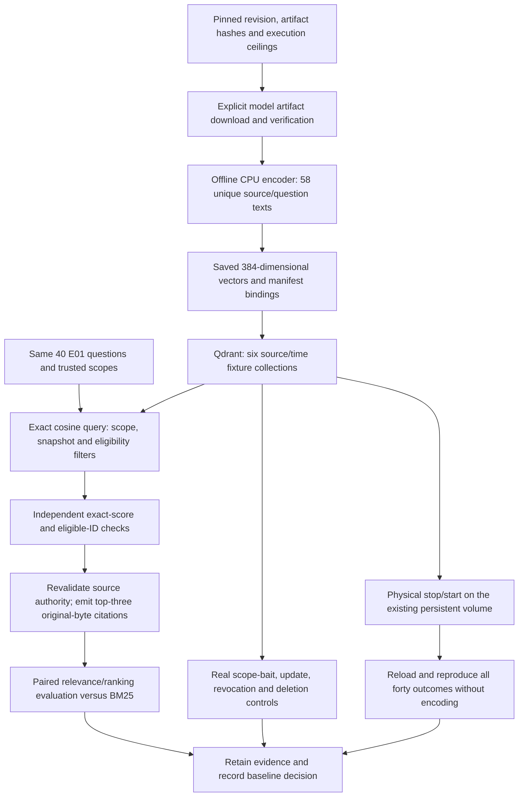

# P03-E02 — Learned embeddings and real Qdrant retrieval

- Recorded: **2026-11-08**.
- Scope: **S06/E02**, without E03 generation or I01 LangChain integration.
- Population: the unchanged E01 forty-case technical suite; 34 nonempty relevance sets.
- [Frozen execution profile](../../config/retrieval/P03-E02-profile-v1.json).
- [Implementation/vector bindings](../../config/retrieval/P03-E02-v1.json).
- [Compact result and raw-artifact hashes](P03-vector-retrieval-summary.json).

## Executed flow

## Model, store and boundaries

The encoder is **sentence-transformers/all-MiniLM-L6-v2**, revision
`1110a243fdf4706b3f48f1d95db1a4f5529b4d41`. The
[model card](https://huggingface.co/sentence-transformers/all-MiniLM-L6-v2)
documents 384-dimensional embeddings, mean pooling/normalization and Apache-2.0
licensing. The ONNX artifact is pinned by SHA-256 in the execution profile.
Tokenizer/config bytes are pinned separately. The 90,872,073 downloaded bytes
matched their declared hashes. Encoding used ONNX Runtime **1.31.1** and NumPy
**2.5.4**, locked dependencies, CPU-only execution and no text truncation.

**Qdrant 1.20.0** is pinned by immutable image digest, uses a private internal
network and a new `rd-ai_qdrant-e02` volume. No host listener, hosted account,
provider credentials or extraction ledger is involved. No Ollama service started.
The store used exact search; no ANN/HNSW, quantization, hybrid retrieval or
reranking improvement is claimed. See [Qdrant search documentation](https://qdrant.tech/documentation/search/search/).

## Results and decision

| Measure | E01 BM25 | E02 learned vectors/Qdrant |
| --- | ---: | ---: |
| Query cases retained | 40 | 40 |
| Nonempty relevance populations | 34 | 34 |
| Macro Recall@3 | 1.000 | 1.000 |
| Macro Precision@3 | 0.431373 | 0.431373 |
| Mean reciprocal rank | 1.000 | 0.985294 |

The vector arm finds all labelled relevant units within three results, but
places the relevant unit second for Q12 where BM25 places it first. The dense
candidate does **not** meet the predeclared +0.05 absolute recall-gain criterion.
Retain BM25 as the simpler baseline; keep the measured vector evidence for the
planned generated-answer comparison. This does not establish that dense search
is generally inferior: the small, authored reference suite already has a lexical
recall ceiling and includes known field-key questions. No labels or threshold
were changed to make dense retrieval win.

Dense retrieval also returns evidence for all six no-relevant-reference cases
(Q25–Q28, Q38/Q39). These are irrelevant-hit diagnostics, not correct answers or
successful semantic abstentions. There is no calibrated similarity cutoff or
generator in this experiment. All labels remain authored technical oracles,
not newly human-reviewed relevance or unseen customer data.

## Operations and verification

- **58 unique actual inputs / 58 encoder batches**, covering all reference/query
  texts, completed in **6.229 seconds** including encoder setup/hash checks.
- The initial store build plus comparison used **52** operation requests and
  **0.451 seconds**. This build diagnostic retains the initial output format.
- Real lifecycle controls used **12** operation requests: identical-vector A/B
  scope bait, revocation, snapshot currentness, vector replacement and deletion.
- A physical stop/start preserved the same six reference/time collections.
  Reload used **40** operation requests plus one server-version request, completed
  in **1.595 seconds**, and reproduced all forty initial semantic outcomes.
  The final reload additionally retains actual scores, source/encoding identity
  and implementation provenance. Every returned eligible-ID set and score passed
  independent exact-oracle checks. The worker used Qdrant scores for ranking;
  the Python oracle checked them rather than substituting its own result ranks.
- Generation calls and paid API spend: **zero**. Encoding is real local model
  inference; query timings reuse cached vectors and exclude fresh per-query
  encoding. Build/download timings are not warm end-to-end RAG latency or a
  fair hardware/performance comparison with the E01 process.

The Docker restart was required before preparation containers could start.
An initial lifecycle setup then refused missing deployment/control bindings
before any store request. Make now mounts those public evidence files read-only;
the admitted lifecycle phase passed. Neither failure caused automatic model
re-encoding, fallback or evidence replacement.

The final Docker `make check` passed **1,050 tests in 1,235.07 seconds**, Ruff
lint/format, strict mypy across 224 files, frozen gold validation and offline
preflight. The focused E01/vector stage also passed 35 tests. An additional
eight artifact-mutation tests then passed in 0.67 seconds with lint/format and
strict mypy across 225 files, without changing production code or rerunning models.
These cover modified vector bytes, missing required bindings and hash-valid but
wrong population/profile/implementation/dimension/zero-vector data. Offline tests
use independent vectors and HTTP fixtures; only the explicitly invoked live
phases count as actual encoder/store coverage. There is no new PO contract,
gold label, prompt or historical extraction inference.

## Preservation and next boundary

Raw vectors, initial/final reports and lifecycle evidence remain ignored in
`results/submission/P03-E02-v1/`; their hashes are in the compact summary. Model
files remain ignored under `results/embedding-models/`. Qdrant is stopped with
its persistent volume retained. S09 must perform final archive/restore work;
this report does not claim a Garage upload or database snapshot restoration.

E03 generated answers and I01 direct-versus-LangChain integration remain
unexecuted. E02 completion therefore does not close P03 or establish reliable
answers, production identity enforcement or extraction improvements.
