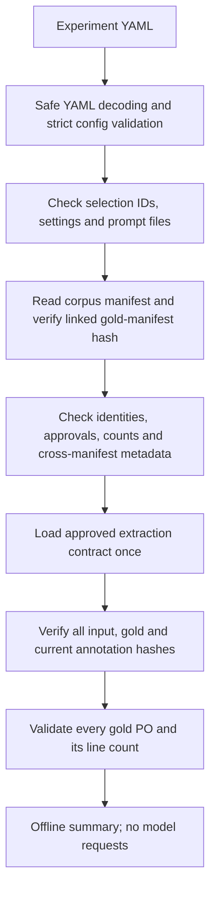

# Configuration, records and offline preflight

Sections 6.1 and 6.2 provide validated operational data and verify the complete
approved corpus. They do not connect models or execute experiments.

## Implementation responsibilities

| Module | Responsibility |
| --- | --- |
| `configuration/constants.py` | Environment names, dotenv file settings and service URL defaults. |
| `records.py` | Typed envelopes and the order of their validation checks. |
| `record_types.py` | Strict string protocol types and named outcome/status values. |
| `record_validation.py` | Status, request evidence, final extraction and accounting checks. |
| `corpus/loading.py` | Coordinate complete corpus loading under one approved contract. |
| `corpus/manifests.py` | Manifest reading, uniqueness, membership, approvals and cross-references. |
| `corpus/files.py` | Read and verify neutral inputs, gold labels and annotations. |
| `corpus/constants.py` | Frozen layout, counts, approval values and shared identity fields. |
| `cli.py` | Argument parsing, command dispatch and JSON reporting. |

## Run it

From the repository root:

```sh
make hw01-preflight
```

From `hw-01/`, use `make preflight`. Both build the locked check image and run
without network access, host Python, API credentials, Ollama or model weights.
The first image build downloads dependencies. `make hw01-check` also runs this
preflight after lint, formatting, strict mypy, pytest and gold validation.

To select another project-relative configuration, run from `hw-01/`:

```sh
docker compose run --build --rm checks python -m hw01 preflight --config config/experiments.yaml
```

Preflight returns exit `0` with JSON evidence or exit `2` with `setup_error`.
It creates no results and changes no dataset files. The report contains 30
inputs, 10 gold objects, 10 checked annotations, 30 source groups, 25 layout
groups, schema identity, experiment configuration and prompt hashes. It excludes
source text, gold values and credentials. `model_capabilities_verified: false`
makes the scope explicit: the configured model IDs are unverified candidates.

## Workflow



The loader retains source order and anonymous source/layout groups. It checks
the current `annotationSha256`; `originalAnnotationSha256` remains historical
metadata. The corpus manifest is the checked-in root of the hash chain, not a
cryptographic signature or substitute for human approval. Tests change copies
and rehash them when testing semantic errors, so an unrelated hash failure
cannot conceal a missing validation rule.

`load_corpus()` returns model-facing `CorpusInput` objects containing text and
provenance. Approved gold dictionaries are held separately in `LoadedCorpus.gold`.
Annotations are checked but not included in model input objects. The remaining
20 texts retain their unlabeled status.

## Configuration and settings

`config/experiments.yaml` defines models, prompts, sampling, runtime bounds and
one default selection. IDs must be unique within their lists, and each selection
must resolve. Duplicate YAML mapping keys, unknown fields, numeric strings,
booleans used as numbers, non-finite values and invalid ranges are rejected.
Output tokens and timeouts must be positive; retries are limited to 0–5 and the
API budget must be greater than zero and below $5. These are configuration
checks; the coordinator in section 6.4 will enforce runtime limits and spending.
Requested temperature/top_p ranges do not establish support by a model route.

The baseline v1 prompt and single sampling variant support reference validation.
They have not been measured. Additional variants, adapters and prompt refinement
remain later scope.

`ApplicationSettings.load(project_dir)` reads the HW's optional `.env` and
recognized process variables; process variables take precedence. The fields are
`OPENROUTER_API_KEY`, `HW01_OPENROUTER_BASE_URL` and `HW01_OLLAMA_BASE_URL`.
Unknown dotenv entries are rejected; unrelated OS environment variables are
ignored by pydantic-settings. Environment strings intentionally become URL and
secret objects; experiment and record models remain strict.

Service URLs accept HTTP/HTTPS and reject embedded credentials, queries and
fragments. A supplied empty credential is invalid. A missing key is allowed
offline and locally; `require_provider_credentials()` checks it before future
provider execution. Secret fields are excluded from repr and serialization,
and validation errors hide input values. Actual `.env` overrides are ignored;
only the harmless `.env.example` is tracked. The check image excludes `.env`
files and does not automatically import host credentials.

## Attempt and run records

`AttemptResult` represents one physical request with explicit outcome, raw
response/error, validation issues, model/provider identity, duration and optional
usage/cost. Missing measurements remain `None`, not invented zeroes. Zero is
appropriate when known, including zero API cost for local inference.

`RunRecord` validates final status, sequential attempt numbers/model identity,
evidence, input/config/prompt hashes, runtime and sampling parameters, and
accounting. Successful records require a schema-valid final
response and the identical parsed extraction; failed/not-attempted records
cannot carry a successful extraction. Unknown attempt usage/cost must remain
unknown in totals; otherwise totals include every physical request. Overall
duration cannot be shorter than its requests.

Validate with the approved contract supplied as context:

```python
record = RunRecord.model_validate(record_data, context={"contract": contract})
serialized_record = record.model_dump_json(indent=2)
```

The existing JSON Schema checks PO dictionaries and returned response text.
Pydantic checks the envelope; it never defines another set of PO fields. The
record checks require contract context even when reloading serialized records.
Frozen Pydantic models prevent field reassignment but do not deeply freeze
nested lists/dictionaries; callers must treat validated records as snapshots.
The later coordinator owns constructing and persisting them.

Implementation references: [strict validation](https://docs.pydantic.dev/latest/concepts/strict_mode/),
[validation context](https://docs.pydantic.dev/latest/concepts/validators/#validation-context)
and [settings](https://docs.pydantic.dev/latest/concepts/pydantic_settings/).
