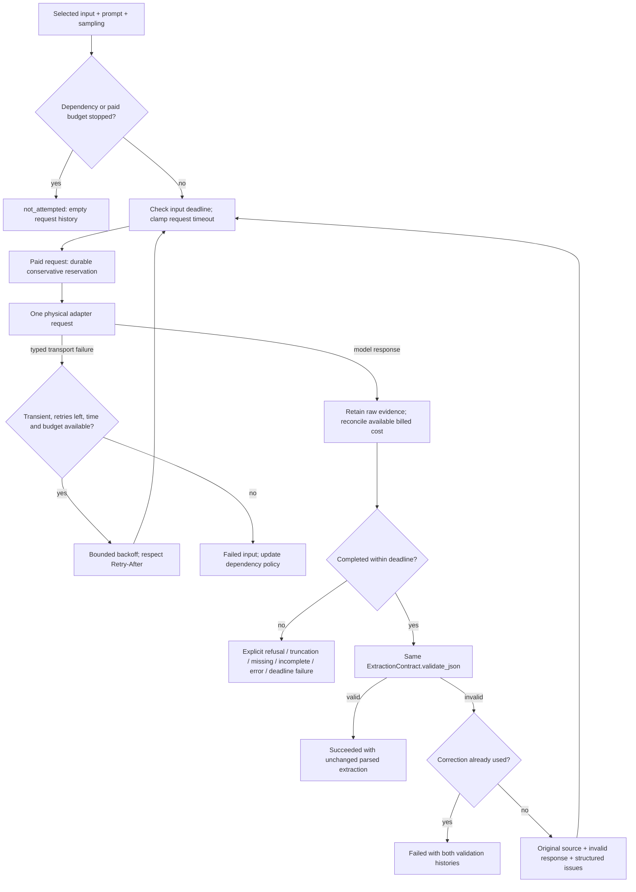

# Execution coordinator — plan section 6.4

The shared coordinator applies the same extraction contract, retry/correction
policy and operational accounting to OpenRouter and Ollama. It borrows adapters
from application setup and returns validated records. It neither constructs nor
closes HTTP clients and never reads expected gold answers.

The coordinator and persistent budget ledger are implemented. Section 6.5 adds
model services; the [6.6 application workflow](../guides/running-extractions.md) now
composes admission, the inference CLI and incremental persistence. Live smoke
acceptance remains a separately recorded gate. Routine checks stay offline.

## Responsibilities

| Module | Responsibility |
| --- | --- |
| `execution/types.py` | Selected jobs, scheduling/progress data and verified dependency identities. |
| `execution/coordinator.py` | Request sequence, deadlines and retry/correction/dependency decisions. |
| `execution/budget/guard.py` | Paid-request admission, reconciliation and invocation-wide spending stops. |
| `execution/results.py` | Validated run records, explicit accounting totals and batch summaries. |
| `execution/evidence.py` | Translate exact responses/failures into attempt records and render correction evidence. |
| `execution/policy.py` | Clock boundary, backoff/Retry-After handling and invocation-local dependency counters. |
| `execution/budget/pricing.py` | Explicit verified pricing ceilings for a particular paid route. |
| `execution/budget/ledger.py` | Locked, durable homework-wide reservations and billed-cost reconciliation. |
| `inference/transport/http.py` | One physical request, total network timeout and typed HTTP/envelope failures. |
| `records.py`, `record_validation.py` | Validate status, response evidence, identities and accounting against the PO contract. |
| `record_types.py`, `response_outcomes.py` | Named state/reason enums and a shared response-to-outcome mapping. |

`ScheduledExtraction` belongs to `execution/types.py`; `BatchResult` and
`BatchSummary` belong to `execution/results.py`. Existing imports from
`execution/coordinator.py` remain available as explicit public re-exports.

`execution/budget/` groups the ledger, pricing bounds and invocation-wide spending
guard. Its initializer contains only a description; callers import the owning
`ledger`, `pricing` or `guard` module directly. The coordinator continues to own
request sequencing, and application setup continues to own borrowed clients.

## Request and correction sequence

`transport_retries = R` means retries after the first physical request. Each
generation permits at most `R + 1` requests. A completed response with invalid
JSON/schema output permits exactly one correction generation, governed by the
same transport policy. The overall ceiling is `2 * (R + 1)`, further constrained
by deadline, dependency stops and spending.

Correction instructions include the original instructions, exact invalid output
and structured validation issues. Source text and schema stay the same. No
schema, label or response repair occurs. Refusals, truncation, missing content,
incomplete generations and model errors do not trigger a schema correction.
Even a schema-valid JSON object remains a failure when its response is truncated
or arrives after the input deadline.

## Time and retries

`request_timeout_seconds` bounds one request. `input_timeout_seconds` covers
the whole input/variant, including reservation work, both generations and
backoff. Each new request receives the smaller of the configured request limit
and remaining input time. Late responses are retained as deadline failures.
An exhausted input deadline normally permits the next input to continue.

HTTPX's ordinary timeout applies separately to connect/read/write/pool activity;
it does not establish a total wall-clock request limit. See
[HTTPX timeouts](https://www.python-httpx.org/advanced/timeouts/).
`JsonHttpClient` therefore runs an `AsyncClient` inside its owned
`asyncio.Runner` and wraps network I/O in
[`asyncio.timeout()`](https://docs.python.org/3.14/library/asyncio-task.html#asyncio.timeout).
The public `post()` interface remains synchronous. Cancellation stops waiting
for network I/O, including a slowly streamed response body; it does not establish
that a remote provider stopped generating or billing.

This client supports the sequential synchronous homework runner. Its private
runner is not an async API and must not be called from an already running event
loop or shared concurrently between threads. Injected synchronous test
transports are adapted separately; arbitrary blocking test handlers cannot be
preempted by async cancellation.

Only classified, retryable connection failures, timeouts, rate limits and
selected server errors enter transport retries. Authentication, explicit
quota/account failures, unsupported requests and protocol errors do not.
HTTP 429 with a recognized structured quota code is permanent; otherwise it
remains temporary throttling. Unclassified prose is retained without guessing
an account failure from its wording.

Known unsupported output limits raise `ModelConfigurationError` before HTTP.
The coordinator stops that dependency and settles any unsent reservation at
zero, retaining an empty physical-request history. Arbitrary `ValueError` or
other programming defects are not treated as this recognized setup condition.

Backoff grows exponentially from `backoff_initial_seconds`, bounded by
`backoff_max_seconds`. The coordinator accepts integer delay seconds or an HTTP
date in `Retry-After`, as defined in
[RFC 9110](https://www.rfc-editor.org/rfc/rfc9110.html#name-retry-after).
Malformed values fall back to configured backoff. A valid server delay above
the maximum ends retries for that input; it is not shortened to send an early
request. A delay that consumes the remaining input time ends at that deadline.

## Dependency-level batch stopping

State is keyed by runtime/backend, canonical endpoint, model name and verified
serving-provider or installed runtime version/digest. Model configuration aliases,
input IDs and prompt/sampling variants do not create new availability counters.

- The configured positive `dependency_failure_limit` defaults to three.
- One availability-failed input/variant increments its counter after its
  transport policy ends. Individual physical retries do not increment it.
- A deadline exhausted during transport attempts/backoff also counts as an
  availability failure.
- A returned model response resets the counter, including invalid, refused or
  truncated output. These outcomes do not indicate dependency unavailability.
- Authentication, quota and unsupported model/route/request failures stop that
  dependency immediately.
- Once stopped, subsequent combinations for that dependency have
  `not_attempted` status, a stop reason and no attempts. Independent dependencies
  can continue, without substituting another model.

Reuse one `ExtractionCoordinator` instance for all selected work in an
invocation. Start a new instance for explicit recovery in a later invocation,
while reopening the same cumulative budget ledger. There are no automatic
cooldowns, half-open probes or recovery requests.

## Cumulative budget ledger

The fixed ledger location is `results/budget-ledger.json` under the HW project
root, with a separate lock file. Application setup must initialize it explicitly
once using `BudgetLedger.initialize(opening_spend_usd=..., evidence=...)`, after
accounting for prior homework spending. Initialization refuses to overwrite an
existing ledger. Missing, malformed or incompatible ledger state blocks paid
requests; it is never silently replaced with a fresh allowance.

Each paid physical request requires:

1. A `VerifiedPricing` object for the exact endpoint/model/serving route.
2. A conservative input-token ceiling, output-token coverage and rates covering
   all applicable tiers, reasoning/output billing and fixed fees.
3. Evidence describing the verified source, date and assumptions. Use a verified
   full context ceiling when a tighter bound cannot be justified; do not guess
   token counts from characters. Coverage must include correction requests.
4. A durable reservation before calling the adapter.

`VerifiedPricing` checks identity and output-limit coverage. Its name records
the caller's verification responsibility; it does not fetch prices or prove that
an entered token ceiling is correct. No live pricing is embedded in the
implementation. Missing/mismatched pricing blocks the request.

The ledger uses decimal arithmetic, an advisory file lock, atomic replacement
and file/directory synchronization. Cooperating processes cannot reserve the
same remaining allowance simultaneously. Persistently mount the entire results
directory when adding the runtime service in section 6.5. Starting a different
model, stage or invocation must reopen this same ledger.

| Billing evidence | Ledger accounting |
| --- | --- |
| Known billed cost, including zero | Replace the reservation's accounted amount with that cost. |
| Missing cost, timeout or other transport failure | Retain the full reservation; do not assume the request was free. |
| Process fails before settlement | Retain the pending reservation for later review. |
| Deadline expires after reservation but before sending | Settle the unsent request at known zero cost. |
| Reported cost exceeds reservation | Record the actual cost and stop paid work because the pricing bound has been invalidated. |

Unknown charges remain conservatively reserved. The current automatic path does
not release them based on elapsed time or a rerun. External billing review is
needed before reclaiming uncertain charges. Preserve the ledger and its evidence
rather than deleting it to continue an experiment.

The ledger stores the configured cap below the assignment's $5 cap and rejects
incompatible policy when reopened. All smoke, screening, matrix and repetition
requests share it. `matrix_reserve_usd` protects remaining matrix funds from
other stages; matrix requests consume that allocation. With no positive matrix
allocation, non-matrix paid stages are blocked.

The checked-in configuration uses a $4.50 cap and $3.50 matrix allocation. This
is a spending allocation, not an estimate that the required matrix will fit.
Verified model pricing and the selected workload must establish affordability
before measured execution. Reservations do not guarantee the provider's invoice.

## Records and summaries

Each physical request produces an `AttemptResult` with its applied timeout,
outcome, transport timing, exact response or typed failure, structured issues,
available usage/cost, reservation link and accounting limitation. Retry delay
belongs to that failed attempt. Full returned model envelopes preserve reported
identity, finish/refusal/error details and runtime timings.

`RunRecord.duration_ms` includes requests and backoff; individual request timing
remains separate. Unknown usage or billed cost makes its corresponding run total
unknown. The ledger's conservative accounted amount is not substituted for a
billed-cost measurement. Local transport failures retain known zero API cost
and unknown tokens.

The returned PO object contains only contract fields. Operational evidence,
stage and dependency identity stay in its surrounding run record. Records reload
with the same authoritative contract context. Added optional evidence fields
preserve compatibility with earlier records.

`AttemptKind`, `AttemptOutcome`, `RunStatus` and `ModelRuntime` are string enums,
as are response/failure kinds, execution stages and budget-stop reasons. Internal
Python construction uses enum members; serialized JSON retains the existing
string values. Reload records through `model_validate_json()` with contract
context. `ExecutionReason` names stable codes, while provider messages remain
strings. Composed dependency/transport reasons share one formatter.

Known identity and accounting fields are compared through explicit attributes.
Accounting totals receive explicit token/cost values, rather than attribute-name
strings. JSON field keys remain ordinary strings at serialization/validation
boundaries.

`execute_many()` returns records and a summary containing success/failure/
not-attempted counts, applied execution configuration, dependency stops and
budget-stop reasons. `comparison_complete` means all selected combinations
were attempted without a batch stop; it does not mean every extraction succeeded
or matched gold. Failed and untouched combinations remain visible.

Only typed model/transport and budget-policy failures become ordinary recorded
execution outcomes. Unexpected defects propagate to application setup. The
application boundary's cleanup, persisted results and interrupted-run reporting
remain section 6.6.

## Verification

Run `make hw01-check` from the repository root. The offline suite covers:

- Exact response preservation, common schema validation and one correction.
- Separate retry limits for each generation, including the maximum request count.
- Deadline/backoff boundaries and timeout clamping for corrections.
- Dependency thresholds, response resets, fatal stops, variant aliases and
  independent endpoint progress.
- Unknown versus known billing, prior spending, matrix protection, concurrent
  reservations, ledger corruption and retained reservations after defects.
- Both real adapters and HTTP parsing through controlled responses.
- A real loopback server that slowly streams a body, plus client reuse after
  total-timeout cancellation.

No test uses the user's provider key, real model inference or private sources.
Live acceptance remains separate from these deterministic engineering checks.
