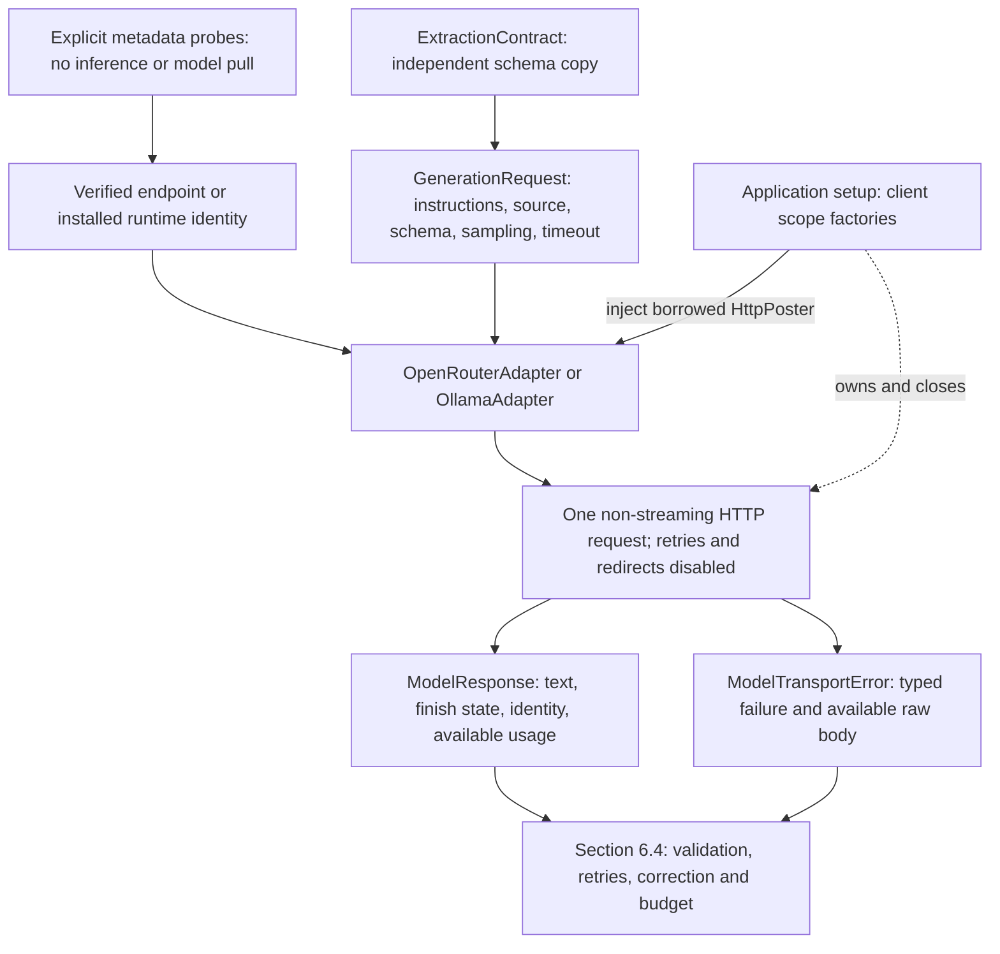

# Model adapters — plan sections 6.3 and 6.3.1

The `inference/` package provides one typed interface for OpenRouter and Ollama.
Both receive the same neutral source, rendered instructions, authoritative PO
schema and explicit sampling/output limits. Neither adapter decides whether the
returned text is a valid purchase order.

## Package layout

| Area | Responsibility |
| --- | --- |
| `openrouter/adapter.py`, `openrouter/payloads.py` | OpenRouter request translation and response parsing. |
| `openrouter/capabilities.py`, `openrouter/metadata.py` | Verified endpoint metadata and explicit public catalog probes. |
| `ollama/adapter.py`, `ollama/payloads.py` | Ollama request translation and response parsing. |
| `ollama/capabilities.py`, `ollama/metadata.py` | Installed model identity and explicit runtime probes. |
| `transport/http.py`, `transport/client_setup.py` | Shared HTTP implementation and application-owned client scopes. |
| `types.py`, `errors.py`, `messages.py`, `finish_reasons.py` | Shared request/response interfaces, classified failures and protocol values. |
| `wire_models.py` | Common validation policy for evolving remote envelopes. |

Package initializers contain only descriptions. Import adapters and setup probes
from their owning modules; provider packages do not import each other.

## Ownership and request flow



`GenerationRequest.from_contract()` obtains a deep copy using
`schema_for_provider()`. Request serialization makes no schema modifications.
Both APIs receive the full schema in their structured-output field and in the
system message. The source is a separate user message. Expected answers,
annotations and original workbooks are not adapter inputs.

`ModelAdapter` describes `identity` and `generate(request)`. Constructors receive
an `HttpPoster` protocol exposing only `post()`. Adapters do not construct, close
or reconfigure clients, and do not assume that a client belongs exclusively to
them. Identity is still derived from configuration and checked endpoint/runtime
metadata. Metadata probes are separate calls and never occur implicitly inside
`generate()`.

### Client construction and lifetime

`transport/client_setup.py` provides three context-managed factories:

| Factory | Configuration and ownership |
| --- | --- |
| `openrouter_client(settings)` | Requires the provider key and owns an authenticated generation client scope. |
| `openrouter_metadata_client(settings)` | Owns a separate unauthenticated public catalog client scope; no key is required. |
| `ollama_client(settings)` | Owns an unauthenticated scope for the configured Ollama URL, without installing or selecting a runtime. |

Application setup enters a scope once per service URL/authentication
configuration, reuses its client across requests and can lend it to several
compatible adapters. Model, routing and sampling choices remain request data.
Different URLs or credentials use separate scopes. There is no process-global
singleton, client registry or implicit caching.

Given already checked configurations/endpoints and a rendered request, application
setup can register multiple clients with `ExitStack`:

```python
from contextlib import ExitStack

from extraction_service.inference.ollama.adapter import OllamaAdapter
from extraction_service.inference.openrouter.adapter import OpenRouterAdapter
from extraction_service.inference.transport.client_setup import ollama_client, openrouter_client

with ExitStack() as clients:
    provider_http = clients.enter_context(openrouter_client(settings))
    local_http = clients.enter_context(ollama_client(settings))

    provider = OpenRouterAdapter(provider_config, endpoint, http_client=provider_http)
    local = OllamaAdapter(local_config, runtime, http_client=local_http)

    provider_response = provider.generate(request)
    local_response = local.generate(request)
```

Another compatible provider adapter can receive the same `provider_http`. The
application exits each client scope once, after all borrowers finish, including
when adapter construction or generation raises. Each factory closes its owned
`JsonHttpClient`, which closes its internal HTTPX client. No adapter `close()`
method is involved. Factories do not issue metadata, inference or pull requests;
explicit metadata probes use their own short-lived scopes.

| Common setting | OpenRouter | Ollama |
| --- | --- | --- |
| Schema | `response_format.json_schema`, `strict: true` | `format` |
| Temperature | `temperature` | `options.temperature` |
| Nucleus sampling | `top_p` | `options.top_p` |
| Output limit | `max_tokens` | `options.num_predict` |
| Streaming | `stream: false` | `stream: false` |

OpenRouter restricts `provider.only` to the checked slug, disables fallback
routing, and requires support for supplied parameters. No response-healing
plugin is enabled. Requests above the catalog's output limit fail before HTTP.
The shared HTTP client ignores host proxy settings and uses HTTPX with transport
retries set to zero. Retry policy belongs to section 6.4.

The implemented [coordinator](execution-coordinator.md) owns paid reservations,
validation and retries. Direct `generate()` calls above illustrate adapter
ownership only; measured homework inference must use the coordinator. The client
now owns an HTTPX AsyncClient and a private runner behind the same synchronous
interface, adding a total request timeout alongside HTTPX's phase timeouts.

Adapters let typed transport/parser failures propagate unchanged. They also let
unexpected programming errors propagate. Client scopes perform cleanup without
handling these failures as model outcomes. The coordinator implements retry/stop
decisions in section 6.4; the final CLI error boundary remains section 6.6.

## Returned evidence

`ModelResponse` keeps model text and the full HTTP envelope, requested identity,
reported model/provider, finish reasons, available request ID, elapsed HTTP time,
tokens and cost. Ollama also supplies available load/total timings in nanoseconds.
HTTP elapsed time and server inference/load timings have different meanings.

Internal categories are `ResponseKind` and `FailureKind` string enums. Python
construction under strict validation requires members such as
`ResponseKind.COMPLETED` or `FailureKind.TIMEOUT`. `model_dump()` retains enum
members; JSON serialization (`model_dump_json()` or `model_dump(mode="json")`)
keeps the existing string values. Reload serialized JSON with
`model_validate_json()` to restore the typed members.

Provider finish reasons remain nullable strings so unknown future values are
retained. Recognized values have `Final` constants in `finish_reasons.py`.
Classification uses explicit ordered guards: errors/refusals take precedence
over truncation and completion. An unknown finish reason cannot establish completion.

- `completed` means an ordinary completed generation, including empty or invalid
  JSON text. The coordinator still has to call `ExtractionContract.validate_json()`.
- Refusal, output truncation, missing content, incomplete generation and explicit
  choice-level errors remain separate states. Parseable truncated text is still
  truncated. Ollama's thinking field is retained in the envelope, not substituted
  for the answer. Natural-language refusals are not guessed by the adapter.
- Missing usage or OpenRouter cost is `None`; actual zero is retained. Local
  Ollama API cost is recorded as zero, excluding hardware/electricity costs.
- Malformed envelopes, HTTP errors and connection/timeouts raise
  `ModelTransportError` with typed `FailureEvidence`. Available raw bodies and
  `Retry-After` are retained. An OpenRouter error inside HTTP 200 is also a failure.
  Status-based retryability is evidence for the coordinator, not an adapter retry.
- The key never appears in request logs or normal representations. If a server
  reflects the known credential in its body/error, that occurrence is replaced
  with `[REDACTED]` and `credentials_redacted` is set. This explicit exception
  takes precedence over exact text preservation. Other content is not trimmed,
  repaired or coerced.

Requested identity and reported identity are separate: an OpenRouter response
can report a dated upstream model name. A missing reported provider stays unknown.
The local adapter requires the response model to match its verified installed tag.

## Model verification recorded on 2026-10-19

These are public metadata observations, not inference measurements. Recheck
metadata/prices before measured execution. The endpoint snapshot is not a runtime
cache and offline preflight still reports model capabilities as unverified.

### Historical provider selection — 19 October

The user approved **`google/gemini-3.8-flash`** through **`google-ai-studio`**.
The [OpenRouter endpoint catalog](https://openrouter.ai/api/v1/models/google/gemini-3.8-flash/endpoints)
advertised `temperature`, `top_p`, `max_tokens`, `response_format` and
`structured_outputs`, with a 65,536-token output limit. Its standard endpoint
listed $0.75 input and $3.75 output per million tokens. Thinking tokens can affect
billed output. These rates were already discounted in the listed prices.

The earlier `openai/gpt-6-luna` candidate was rejected for this experiment:
its [endpoint catalog](https://openrouter.ai/api/v1/models/openai/gpt-6-luna/endpoints)
did not advertise `temperature` or `top_p`. The adapter does not silently omit
those required experiment settings. That configuration pinned Gemini's serving
provider. No paid generation was performed during this implementation.

### Current provider smoke selection — 22 October

The active `config/experiments.yaml` selects **`google/gemini-3.1-flash-lite`**
through **`google-ai-studio`** for the completed 6.6.6 smoke. The user approved
this cheaper candidate; [live evidence](../reports/provider-runtime-verification.md) records
two valid outputs, one truncation and $0.01518250 in billed cost. Further paid
execution requires a new approved invocation. The v1 prompt, baseline sampling and 4,096-token
output limit are unchanged. Historical native exports and the separate
8,192-token diagnostic configuration retain their original identities.

The [current endpoint catalog](https://openrouter.ai/api/v1/models/google/gemini-3.1-flash-lite/endpoints)
advertises the required parameters, 1,048,576 context, a 65,536-token output
limit, and standard text rates of $0.25 input / $1.50 output per million tokens.
Those are catalog observations, not live schema acceptance or quality results.
Provider selection for the section 7 matrix still needs measured screening.

Google's [official local-tokenizer mapping](https://github.com/googleapis/python-genai/blob/main/google/genai/_local_tokenizer_loader.py)
maps this model to `google/gemma-4-E4B-it`. The public tokenizer was downloaded
without another API key, pinned by revision/hash and inspected without generation.
Local message/schema counts alone do not establish the full request count after
OpenRouter's upstream formatting. See [provider smoke preparation](../reports/provider-smoke-preparation.md).

`verify_openrouter()` fetches public metadata without credentials and checks the
configured model, exact provider slug and required parameter set. Entering the
generation client scope additionally requires `OPENROUTER_API_KEY` from settings.
Catalog structured-output support does not prove acceptance of every frozen
schema keyword. That requires the live smoke run in section 6.6.

### Local selection

The public [Gemma tag](https://ollama.com/library/gemma4:e4b-it-qat) exists.
Reading its [registry manifest](https://registry.ollama.ai/v2/library/gemma4/manifests/e4b-it-qat)
without downloading layers produced this SHA-256 over the returned manifest bytes:

```text
ee665637121887cf3befff38abbb1be4ee117c7db867d97a67e29049ecd7e15f
```

Its listed layers totaled **6,146,501,256 bytes** (~6.15 GB), including the model
and projector. This is a registry observation; it is not a claim that a model is
installed or that this amount equals runtime memory use.

`verify_ollama()` calls `/api/version`, `/api/tags` and `/api/show`, requires the
configured tag and text-completion capability, and records the installed digest
and server version. It never pulls a missing model. Native mode must be explicit
and receives the distinct `ollama-native` identity; otherwise `ollama-docker` is
recorded. Native mode also requires the explicitly configured host endpoint;
the flag does not install a runtime or change a URL. Container image identity
and comparison with the registry digest belong
to service initialization in section 6.5.

Ollama Docker initialization/readiness is documented in
[runtime setup](../guides/docker-runtime.md). Full extraction acceptance is separate in
the [6.6 runner](../guides/running-extractions.md). No host model runtime is required.
The explicit [6.7 native mode](../guides/native-ollama.md) reuses this adapter with the
existing desktop app, a separately pinned version and the same Gemma digest.
It requires native admission/identity checks and preserves distinct runtime records.

## Verification and next steps

`make hw01-check` runs the offline suite. Adapter tests exercise both real adapter
classes through HTTPX's controlled transport and exercise the production HTTP
transport against a loopback server. They cover request/schema/sampling fidelity,
finish/error states, exact text, unknown versus zero usage, malformed envelopes,
metadata identity, reflected-secret redaction and one request per generation.
No test uses the user's key, paid inference, a live local model or private sources.

The initial section 6.3 verification on 2026-10-19 passed all 301 tests, Ruff,
strict mypy, 10 gold
validations and the 30-input offline preflight. Eight deliberate defects in
disposable copies were all detected: provider fallback, dropped provider
`top_p`, weakened schema mode, dropped local output limit, trimmed model text,
accepted truncation, invented zero cost and followed redirects. These focused
probes establish sensitivity to those defects, not complete correctness.

After the enum refactor, the full Docker gate passed 322 tests, Ruff, strict
mypy, gold validation and offline preflight. A subsequent focused audit passed
all 109 adapter tests but exposed regression-test gaps: only five of 15 selected
mutations were detected by the committed suite. Temporary focused tests detected
the other ten; they also passed against the unchanged implementation.

The section 6.3.1 sharing tests now exercise alternate valid model/output
settings through the real HTTP wrapper. Remaining audit follow-ups include
connection-level retries, partially populated usage, each required endpoint
parameter, discovery after unrelated Ollama tags, the inclusive output-limit
boundary, and an error finish reason without a choice-level error object.
These are test-sensitivity gaps, not demonstrated runtime defects. Neither audit
used paid inference or a live model.

Section 6.3.1 adds post-only injected-client tests and real-client lifecycle tests
for shared/distinct clients, authentication/URL setup, partial construction,
generation failures and unchanged exception propagation. Existing HTTP-envelope
and loopback tests retain the real wrapper; injecting a final model result does
not replace that integration coverage.

Verification on 2026-10-20 passed `make hw01-check`: 342 tests, Ruff lint/format,
strict mypy, all 10 gold objects and the 30-input offline preflight. The adapter
subset contains 129 passing tests. No provider inference or live local model was
used; the extraction schema, dataset and experiment configuration are unchanged.

The subsequent 6.3.1 test-sensitivity audit passed the 342-test baseline and
restored baseline. Of 13 selected probes, five were detected, seven survived,
and one double-close probe was excluded as behaviorally equivalent because
HTTPX closes its transport idempotently. Nine temporary regression cases passed
on the unchanged implementation and detected all seven surviving defects.

Follow-up tests need independent configuration-based model/ID expectations,
different generation timeouts, different supplied credentials for authentication
and redaction, and a connection-failure probe beneath the real HTTP transport.
The existing shared-client identity checks can remain internally consistent
with an incorrectly derived identity. The connection-retry gap was already
documented in the earlier audit. These findings concern test sensitivity, not
demonstrated defects in the current runtime. The temporary regression cases are
not part of the repository suite, and the probe counts are not an overall
correctness score.

Section 6.4 adds the [shared coordinator](execution-coordinator.md), bounded
retries/correction, deadlines, dependency stopping and cumulative budget
reservations. Sections 6.5–6.6 add
Docker model services, persistence, CLI execution and the three-document live
smoke. The [selected-run CLI](../guides/running-extractions.md) is now implemented;
the full measured comparison remains sections 7–8.

Protocol references:

- [OpenRouter structured outputs](https://openrouter.ai/docs/guides/features/structured-outputs),
  [provider routing](https://openrouter.ai/docs/guides/routing/provider-selection)
  and [API response format](https://openrouter.ai/docs/api_reference/overview).
- [Ollama structured outputs](https://docs.ollama.com/capabilities/structured-outputs),
  [chat](https://docs.ollama.com/api/chat) and [installed models](https://docs.ollama.com/api/tags).
- [HTTPX transport configuration](https://www.python-httpx.org/advanced/transports/).
