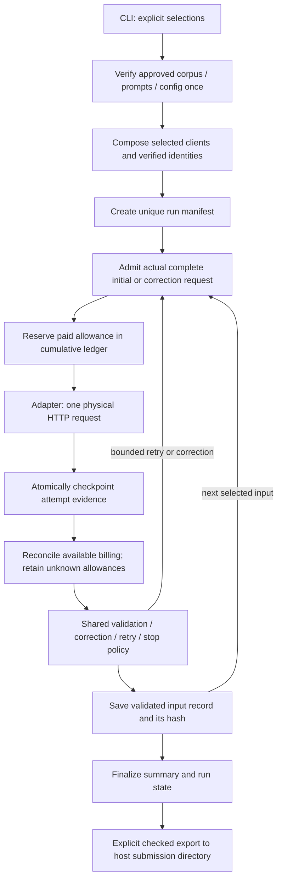

# Running and saving extractions

This is the application workflow for plan **6.6**, built on the adapters,
coordinator, budget guard and Docker setup from 6.3–6.5. Prompt screening,
the full comparison matrix and scoring remain sections 7–8.

## Commands

Run from the repository root. Docker and Make are the only host prerequisites.
Local weights must already be initialized with `make hw01-setup-local`.
Commands reuse the persistent results volume and never reset its ledger.

For the existing desktop app, use [native mode](native-ollama.md): explicitly
initialize its pinned weights with `make hw01-setup-native`, then pass
`MODE=native` to run/smoke. Python and results remain in Docker. Native and
Docker versions have separate pins; neither mode silently substitutes the other.

```sh
# Inspect selected work without network access or inference.
make hw01-plan-run ARGS='--model local --input B02-S030-PO01'

# One input, using v1/baseline defaults; refuse reuse of this run ID.
make hw01-run ARGS='--model local --input B02-S030-PO01 --run-id local-one'

# Full extraction, not a one-token readiness probe.
make hw01-smoke ARGS='--model local --run-id local-smoke'

# Default run: all 30 approved inputs, one configured model/prompt/sampling.
# Explicitly invoke only when ready for the CPU runtime and its duration.
make hw01-run ARGS='--run-id local-all-thirty'

# Export saved results from the Docker volume to the host; no inference.
make hw01-export-run ARGS='local-smoke'
make hw01-verify-export ARGS='local-smoke'
```

`--input`, `--model`, `--prompt` and `--sampling` can be repeated. Unknown or
duplicate IDs are errors. Requested inputs/models keep their explicit order;
defaults use corpus/config order. Prompts and sampling use config order.
Omitting model/prompt/sampling selects their configured defaults, **not every
candidate**. Explicitly selecting several models runs them sequentially.

The smoke defaults are **B02-S030-PO01, B02-S026-PO01, B02-S008-PO01**, the
small/middle/large representatives used in the recorded readiness check. Both
adapters must use these same IDs, v1 and baseline for live acceptance. An input
override is a scoped run; it does not establish the default smoke's acceptance.

`MODE=local` uses `local-run`, starts its healthy Ollama dependency, and supplies
no provider credentials. `MODE=provider` uses `app` without an Ollama dependency.
It is a service selection, not a model override: supply `--model provider` too.
Planning, budget administration and export use the network-disabled `offline`
service. Project-level targets omit the root `hw01-` prefix.

## Flow and ownership



Application setup owns client scopes. Compatible provider selections share one
authenticated client; metadata has separate unauthenticated scopes. Adapters
borrow clients, with no cleanup chain. `ExitStack` also closes owned clients on
partial setup or unexpected execution failure. Cleanup never clears spending.

Gold labels are checked offline but never enter generation jobs/messages.
The approved schema is the single PO contract. Raw output is retained, including
invalid JSON, refusal and truncation. There is no automatic repair or replay.

## Context admission and deadlines

Every physical request passes admission before a paid reservation or generation.
Correction admission includes the **actual preceding response and validation
issues**, not a stand-in fixture. Admission and reservation time belong to the
input deadline; generation receives the remaining bounded time.

For the pinned Ollama 0.40.6/Gemma4 combination, the application:

1. Checks initialized image/runtime/model identity, performs an empty model load,
   and verifies the effective context. Setup loading is reported separately.
2. Reads installed GGUF tokenizer metadata, reconstructs its BPE with the locked
   `tokenizers` library, and checks the supported metadata shape/byte fallback.
3. Uses `_debug_render_only` to obtain the server's complete rendered template.
   This pinned server returns before completion. It evaluates/generates no
   tokens; this is distinct from the older one-token readiness diagnostics.
4. Counts that template, adds two conservative boundary-token slots, and requires
   input bound + full configured output allowance ≤ effective context.
5. Sends the actual generation with explicit `num_ctx`, `truncate: false` and
   `shift: false`. Unsupported metadata/rendering or insufficient capacity stops
   work; inputs are never shortened.

The implementation depends on the pinned private debug field. A different
runtime/tokenizer requires renewed verification. See the official
[0.40.6 request types](https://github.com/ollama/ollama/blob/v0.40.6/api/types.go),
[early return in chat handling](https://github.com/ollama/ollama/blob/v0.40.6/server/routes.go)
and [Gemma4 renderer](https://github.com/ollama/ollama/blob/v0.40.6/model/renderers/gemma4.go).

On 21 October, a non-generating comparison reproduced all six archived prompt
counts exactly: S030 initial/correction 1,163/1,612; S026 2,005/2,454; S008
22,276/22,725. The admission bound adds two to those counts. This comparison
supports the pinned implementation; the actual request is still counted afresh.

The checked-in execution policy now allows **1,800 seconds per physical request**
and **7,205 seconds per input**. The earlier large CPU diagnostic required about
366 seconds before useful generation. Thirty minutes supplies an explicit
initial full-generation allowance; the input ceiling bounds up to four physical
requests and backoff. Admission/IO also consumes that ceiling, so an input may
exhaust it before every possible retry. These are bounded starting limits,
not a promise of completion or a measured throughput estimate. Runs save the
resolved configuration/hash; do not silently extend limits after a failure.

### Provider admission is fail-closed

OpenRouter catalog metadata establishes route/parameter support, **not an exact
Gemini tokenizer or complete request-token count**. The application accepts an
operator-verified coverage file keyed by exact request fingerprints. Each
certificate must come from a verified, non-generating provider count/bound,
covering the entire actual schema/messages/template. A byte/character heuristic
or a paid probe is not a certificate. An uncertified correction is rejected.

No live coverage file is supplied or claimed verified. `plan-run` prints initial
request fingerprints; timeout changes do not change the fingerprint. A future
automated provider counter can implement the existing `RequestAdmission`
protocol without changing adapters or the coordinator. Until verified provider
counting is available, provider live acceptance remains pending.

The 21 October check of Google's official
[local-tokenizer model mapping](https://github.com/googleapis/python-genai/blob/main/google/genai/_local_tokenizer_loader.py)
did not list Gemini 3.8 Flash. Google's documented
[countTokens API](https://ai.google.dev/gemini-api/docs/tokens) is another path,
but requires Google API configuration and verification that its counted request
covers OpenRouter's upstream schema/message transformation. No extra credentials
were assumed, no Gemini tokenizer was substituted, and no provider count or
generation was sent while implementing this gate.

## Explicit paid execution

Human approval of the concrete selections and cost estimate remains required.
`--allow-provider` is an explicit execution switch, not proof of that approval.
Neither Make nor the runner adds it automatically. Key/credits alone do not
authorize inference.

Initialize accounting once, declaring **actual prior HW spending and evidence**:

```sh
# Replace both values with the operator's declaration; never assume zero.
make hw01-budget-init ARGS='--opening-spend PRIOR_USD --evidence "PRIOR_SPEND_EVIDENCE"'
make hw01-budget-show
```

Initialization refuses an existing ledger. A paid run never initializes one.
Reopening preserves prior spend, all stages and unknown/in-flight reservations.
The policy leaves the existing matrix holdback and assignment cap in force.

Provider coverage JSON is a mapping from configured model ID to:

- `pricing`: existing `VerifiedPricing`, including the exact endpoint/model/
  serving dependency, verified input/output ceilings, decimal string rates,
  fixed request fee, and dated billing evidence covering applicable tiers.
- `context_length`: verified route context limit.
- `request_token_bounds`: mapping of exact request SHA-256 to verified positive
  prompt bounds, including any actual corrections that will be admitted.
- `evidence`: the non-generating counting source, date and assumptions.

Keep operator coverage under the persistent `results/` volume (for example
`results/provider-coverage.json`), outside image build contexts and Git. Never
put credentials there. The selected coverage is saved in the run manifest.

```sh
make hw01-plan-run ARGS='--stage smoke --model provider --input B02-S030-PO01 --input B02-S026-PO01 --input B02-S008-PO01 --coverage results/provider-coverage.json'

# Only AFTER counting/pricing evidence, explicit accounting and human approval:
make hw01-smoke MODE=provider ARGS='--model provider --coverage results/provider-coverage.json --allow-provider --run-id provider-smoke'
```

Planning makes no HTTP calls. Compatible coverage must match the selected
provider model/runtime/serving route and cover the requested output allowance;
otherwise the estimate remains null. With compatible operator evidence it reports
a conservative maximum for all configured retries and one correction, including
fixed request fees. Offline planning does not refresh live prices or route state.
This is an allowance, not expected billed cost. Null cost/accounted-spend means
unverified/unavailable, **not zero**. Runtime checks exact verified route identity;
the spending guard rechecks pricing/output coverage and cumulative budget before
each paid request. Public route metadata is refreshed at setup; the operator's
pricing evidence must remain current and cover billing tiers and reasoning.

## Durable files and exit status

Each unique `results/runs/<run-id>/` contains:

| File | Purpose |
| --- | --- |
| `manifest.json` | Intended jobs/hashes, stage, resolved experiment, setup/context identity, state, available summary and record/checkpoint hashes. |
| `purchase-order-extraction.v1.schema.json` | Exact approved schema bytes for independent reload. |
| `checkpoints/<variant-key>.json` | Admission evidence and latest completed physical attempts, including retry delays. Saved before billing reconciliation. |
| `records/<variant-key>.json` | Validated final `RunRecord`, raw responses, ordered attempts, usage/cost and failures. |

Variant keys hash input/model/prompt/sampling identity. Writes use atomic
replacement and fsync. The runner saves each input before starting the next;
persistence errors stop further requests. SIGINT/SIGTERM attempt finalization;
SIGKILL or a broken filesystem may leave `running` state or only earlier durable
files. An in-flight outcome is unknown, never fabricated as failed or free.
There is no automatic resume; another invocation needs a new run ID.

| Process exit | Meaning |
| --- | --- |
| `0` | Selected comparison completed; every extraction schema-valid. |
| `1` | Completed selected work with extraction failures retained. |
| `2` | Setup/selection/storage or unexpected application error. Available run evidence remains. |
| `3` | Incomplete comparison: untouched inputs, dependency/budget/admission stop. |
| `130` | Caught SIGINT/SIGTERM; available checkpoints retained. |

Make/Compose may wrap nonzero statuses in their own error code; the application
status is the one in its JSON output/container exit. Persisted state is the
authority when the process was interrupted. Per-input progress goes to stderr
without raw responses or credentials.

Export revalidates schema, records, identities, summaries and byte hashes;
rejects running runs, path escapes, symlinks and likely credential material;
refuses overwrite; and removes a partial destination on failure. It copies only
the declared run evidence, with `files.sha256.json`, to
`hw-01/results/submission/<run-id>/`. Raw operational logs, setup archives and
the cumulative ledger remain ignored. Review exports before explicitly adding
them to Git; exporting does not stage, commit or publish anything. These hashes
detect corruption; they do not establish authenticity against coordinated edits.

## Verification and acceptance

Routine `make hw01-check` runs application tests against a controlled loopback
HTTP service, including real CLI subprocesses. It needs no key, weights or
external network and performs no inference. It covers initial/corrected/failed
responses, complete selection, admission/deadline stops, durable reload/export,
interruption with an unresolved paid reservation, accounting and client cleanup.

The real three-document extraction smoke is selected through Make, not a live
pytest fixture. No live marker/fixture is introduced. Local readiness alone
does not complete this acceptance. Provider inference remains pending until its
verified counting/pricing, accounting declaration and human approval exist.
The full 6.6 acceptance is not passed merely because offline tests pass.

The [21 October smoke record](extraction-smoke.md) documents the user-stopped
local run: two saved valid outputs and one unfinished request. The final offline
Docker gate passed 566 tests. Neither the three-document local acceptance nor
provider live acceptance is complete; no automatic resume is scheduled.
