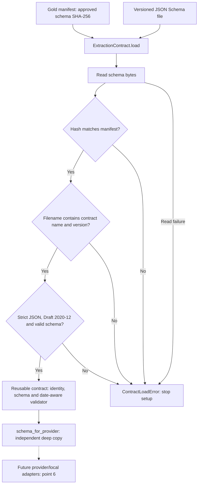
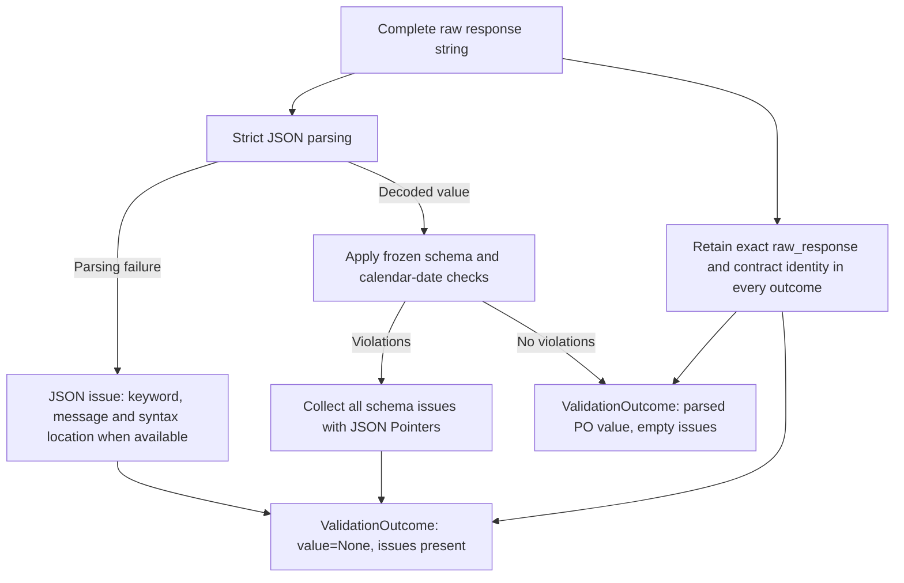

# Runtime extraction validation

The authoritative contract is
[`purchase-order-extraction.v1.schema.json`](../schemas/purchase-order-extraction.v1.schema.json).
It remains byte-identical to the schema approved with the gold dataset.
There is no second Pydantic definition of PO fields.

## One contract per run

At the start of a run, load the gold manifest's `schemaSha256`, then create one
`ExtractionContract`. Its loader reads the schema once, checks the approved
SHA-256, verifies the declared Draft 2020-12 dialect and validates the schema
itself. Identity includes the filename-derived contract name and version,
dialect and hash. An unreadable, changed or invalid schema raises
`ContractLoadError` before extraction starts.



Both future adapters receive this same contract instance. Use
`schema_for_provider()` to obtain a fresh schema dictionary for request
construction. Adapter-specific shaping operates on that copy; changing it
cannot weaken the validator's rules. Provider adapters are part of point 6
and are not implemented by this slice.

```python
import json
from pathlib import Path

from hw01.extraction import ExtractionContract

project = Path(".")  # Run from hw-01/ inside the service image.
manifest = json.loads((project / "data/manifest.json").read_text())
contract = ExtractionContract.load(
    project / "schemas/purchase-order-extraction.v1.schema.json",
    expected_sha256=manifest["schemaSha256"],
)
request_schema = contract.schema_for_provider()
outcome = contract.validate_json(raw_model_response)
```

## Response handling

The implementation separates these responsibilities:

| Module | Responsibility |
| --- | --- |
| `contract.py` | Public workflow, provider schema copies and validation outcomes. |
| `schema_loading.py` | Schema reading, hash/version checks and validator creation. |
| `json_parsing.py` | Strict JSON decoding and ambiguous-value rejection. |
| `validation_errors.py` | Decoder/schema issue translation and JSON Pointer encoding. |
| `validation.py` | Typed identity, issue and outcome records. |
| `constants.py` | Shared extraction protocol identifiers and filenames. |

Public consumers continue importing `ExtractionContract` and
`ContractLoadError` from `hw01.extraction`.

`validate_json()` parses the complete response and applies the frozen schema
with explicit calendar-date format checking. It does not fill defaults,
coerce types, normalize values, strip Markdown fences, reorder lines, drop
metadata, or attempt correction. Duplicate object keys and non-JSON
`NaN`/`Infinity` constants are rejected rather than silently interpreted.



The diagram starts with an existing response string. Point 5 makes no model
calls; future adapters will supply that string. Setup failures raise
`ContractLoadError`, while response validation failures return an outcome.

The `ValidationOutcome` contains:

| Field | Meaning |
| --- | --- |
| `schema` | Contract identity for the attempt record. |
| `raw_response` | Exact response retained for diagnostics and later correction. |
| `value` | Unmodified parsed PO object when valid; otherwise `None`. |
| `issues` | All JSON Schema errors, or a JSON decoder error. Empty means valid. |
| `is_valid` | Convenience property derived from `issues`. |

Each issue records a `json` or `schema` stage, keyword, message, instance
JSON Pointer and optional schema JSON Pointer. The empty pointer identifies
the document root. Syntax errors also identify line and column. These are
ordinary dataclasses that can be serialized with `dataclasses.asdict` for
future attempt records; they do not redefine or add fields to the PO object.
The caller owns retries and the one permitted correction attempt.

Schema validation checks structure and representation. It cannot establish
whether a plausible buyer name, product role or date actually matches the
input text, whether line order matches source evidence, or whether a total
is factually correct. Gold-based evaluation remains necessary for those
semantic errors. JSON Schema `description` text guides extraction but is not
an executable semantic validator.

Model, prompt, sampling, latency, token usage, cost and retry metadata belong
in the future attempt/run envelope. Adding such fields to a PO object is
rejected by `additionalProperties: false`. Pydantic configuration and run
models are reserved for point 6.

## Commands and exit status

`make hw01-check` from the repository root runs the Docker-only check suite.
`make hw01-validate-gold` loads one contract, verifies each gold file's hash,
and validates all approved gold objects. The JSON report includes schema
identity, gold/valid counts and per-case issues.

To inspect a response file already inside the image, run from `hw-01/`:

```sh
docker compose run --build --rm checks python -m hw01 validate-response data/gold/B02-S002-PO01.json
```

The CLI returns `0` for valid output, `1` for JSON/schema validation failure,
and `2` for setup, file or hash errors. It makes no model calls.

## Dependency maintenance

All Python dependencies and checks run inside Docker. To intentionally
refresh the lockfile after editing `pyproject.toml`, run from the repository
root:

```sh
docker build --target tooling -t rd-ai-hw01-tooling:0.12.11 hw-01
docker run --rm --mount type=bind,src="$PWD/hw-01",dst=/workspace --workdir /workspace --env UV_CACHE_DIR=/tmp/uv-cache rd-ai-hw01-tooling:0.12.11 uv lock
```

Review the lockfile diff and rerun `make hw01-check`. A normal check uses
`uv sync --locked` at build time and never updates dependency resolution.
