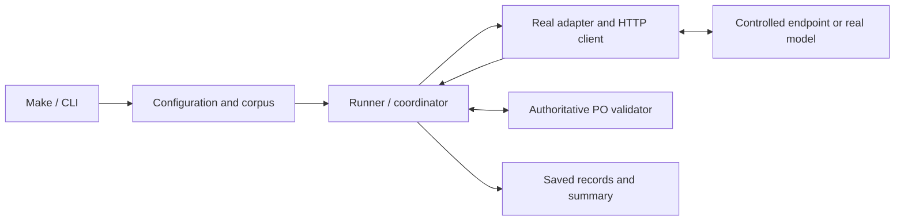

# HW-01 testing strategy

## Purpose and plan references

Use a broad base of focused unit/component tests, integration tests for module
boundaries, and a small set of complete workflow checks. Choose coverage by
failure risk and the behavior each assertion protects. Test-count percentages
are not acceptance targets. This follows the emphasis on integration coverage
and critical workflows in [Google's testing guidance](https://testing.googleblog.com/2021/06/how-much-testing-is-enough.html).

Plan references below identify sections of `HW-01-implementation-plan.md`,
kept locally in `.agents/specs/`. The table summarizes the relevant requirements
so this document is usable without that ignored planning file. Implementation
status is maintained in the [HW README](../README.md).

| Plan point | Responsibility | Testing contribution |
| --- | --- | --- |
| **5 — Frozen extraction contract and runtime validation** | One authoritative PO JSON Schema, strict parsing and structured validation evidence. | Unit/component tests for accepted and rejected responses; integration with records and both adapters. |
| **6.1 — Pydantic for configuration, settings and run records** | Strict operational data, credentials, status consistency and accounting. | Focused model tests; environment/YAML loading and record/contract round trips. |
| **6.2 — Corpus loader and offline preflight** | Frozen input/gold/annotation hashes, approvals, links, provenance and prompt references. | Real-file integration tests and CLI preflight checks, with no model requests. |
| **6.3 — Shared model interface and adapters** | Translate explicit requests and preserve response/error metadata for both backends. | Adapter integration tests with controlled HTTP responses, followed by live capability verification. |
| **6.4 — Shared coordinator, failure handling and budget** | Common validation, bounded retries/correction, deadlines, dependency-level batch stopping and cumulative spending limits. | Unit tests for decisions; integration tests for request sequences, stop behavior and accounting. |
| **6.5 — Docker services and environment setup** | Portable app/runtime setup, model initialization, readiness and persistent storage. | Process/container checks and live startup verification through the documented entrypoint. |
| **6.6 — Persistence, tests and integration acceptance** | Process selected inputs, save records and summaries, and exercise both real adapters. | Application workflow tests with a controlled model endpoint; a live smoke run on three documents per adapter. |
| **7 — Prompt and experiment design** | Version prompts and compare the model × prompt × sampling matrix. | Deterministic configuration/request checks plus separate measured model experiments. |
| **8 — Evaluation and results** | Compute accuracy, validity, latency and cost from saved records. | Unit tests for scoring/arithmetic and integration tests from records to aggregates. |
| **9 — Verification and acceptance** | Reviewer can run the submission and reproduce its evidence. | Final Docker/Make acceptance using tracked artifacts, recorded runtime identities and saved results. |

## Current coverage

The implemented contract and sections 6.1–6.2 already exercise several levels:

- [Contract tests](../tests/test_contract.py) and
  [record tests](../tests/test_records.py) cover validation rules, evidence and
  accounting, including integration with the actual PO contract.
- [Configuration tests](../tests/test_configuration.py) combine focused model
  validation with real YAML, environment and dotenv loading.
- [Corpus tests](../tests/test_corpus.py) and
  [preflight tests](../tests/test_preflight.py) use real public artifacts and
  disposable copies to verify cross-module behavior.
- [CLI tests](../tests/test_cli.py) and the preflight subprocess test invoke
  `python -m extraction_service`, checking process output and exit status.

A test file can contain more than one level. Executing pytest in Docker defines
its runtime environment; the components and boundaries exercised determine its
level. Complete extraction workflows, live model tests and scoring tests remain
pending with sections 6.3–8.

## 1. Unit and component tests

**Plan points: 5, 6.1, 6.4 and 8.**

Test one rule or cohesive component through its public API. Keep the real PO
validator and operational models where they are the subject of the test.
Dependencies on external inference, time and transport can be controlled.

Existing coverage includes required/nullable PO fields, enums, dates, decimal
strings, strict configuration, status consistency and usage/cost availability.
As the coordinator and evaluator are implemented, add focused cases for:

- Transient versus permanent transport failures and retry eligibility.
- One correction after invalid returned output, with a bounded request count.
- Request/input deadlines, budget reservations and cumulative spending.
- Dependency-level batch stopping: a positive configured threshold (initially
  three consecutive availability-failed input/variant outcomes), reset on a
  completed model response, immediate fatal-configuration stops and isolation
  between independent backends. Physical retries do not increment this counter
  individually; validation/refusal/truncation outcomes do not increment it.
- Unknown usage/cost, known zeroes and accounting for unsuccessful requests.
- Field/line matching, null scoring, validity denominators, percentiles and
  cost scaling, using independently calculated expected results.

Use a controllable clock and sleeper for deadlines and backoff. A scripted
transport can return a known sequence of responses or failures. Assertions
should verify decisions, request counts and recorded evidence without waiting
for real timeouts or making inference requests.

## 2. Integration tests

**Plan points: 5, 6.1–6.4, 6.6 and 8.**

Exercise cooperating application modules with real validation and real files.
For adapters, control the external HTTP boundary while preserving production
request construction and response parsing.

| Boundary | Required evidence | Plan points |
| --- | --- | --- |
| YAML/environment → operational models | Values, overrides and failures survive loading without coercion or credential disclosure. | 6.1 |
| Manifests/files → loaded corpus | Hashes, approvals, membership, annotation identity and gold line counts are checked; each input retains its provenance. | 6.2 |
| Adapter → HTTP request | Correct schema copy, source text, model/routing identity and applied sampling limits; labels and annotations stay outside inference requests. | 5, 6.3 |
| HTTP response → adapter result | Realistic success, refusal, truncation, usage/cost and error payloads retain their available evidence. | 6.3 |
| Coordinator → adapter → PO validator | Retry/correction sequences, final statuses, deadlines, dependency stopping and accounting agree across components. | 5, 6.4 |
| Runner → saved records | Records reload under the approved contract, summaries retain failures/unattempted cases, and run identity prevents silent overwrites. | 6.6 |
| Saved records → evaluation | Aggregates use the intended records, variant identities, matching rules and denominators. | 8 |

An HTTP test transport is sufficient for many adapter cases. A loopback stub
server is useful when checking actual HTTP or separate processes. Ordinary
integration tests remain independent of provider credentials and model weights.
Temporary files and stub responses belong to test fixtures; real inference
requests use only the approved neutral inputs.

## 3. CLI/system and end-to-end tests

**Plan points: 6.3–6.6 and 9.**

For HW-01, the user workflow starts at Make/CLI and ends with persisted evidence.
The extraction path to exercise is:

The coordinator owns retries and correction; both follow the same adapter and
validation boundaries shown above. Separate two execution modes at this level.

### Routine application workflow checks

**Plan points: 6.4–6.6.** Launch the real CLI in a separate process and use a
controlled model endpoint. This covers the application's complete workflow
while substituting for the external inference dependency.

Keep a small set of scenarios:

1. A successful response produces the expected record, summary and exit status.
2. Invalid output triggers one correction, preserving the first response,
   validation issues and accounting in the saved history.
3. Exhausted retries/deadlines remain failed results; a budget or dependency
   stop also records untouched inputs as not attempted. Request counts and
   summaries agree, and interrupted comparisons are identified as incomplete.

For dependency-stop integration, retain state across prompt/sampling variants
sharing the same backend/endpoint/model route, and verify that no HTTP request
is issued after that dependency stops. A completed model response resets its
consecutive availability-failure counter even when the response is schema-invalid,
refused or truncated. Check independent-backend progress and correct persistence
of actual attempts, unknown/billed usage and untouched inputs. A later explicit
invocation starts fresh dependency state while preserving cumulative spend.
Cooldown and half-open recovery tests belong to a future full circuit-breaker
extension; the planned HW-01 policy ends the affected batch for that invocation.

Use the real adapter, HTTP client, validator, coordinator and persistence path.
Substituting an adapter's final return value would leave HTTP wiring untested.
Use a temporary result directory, explicit process timeouts and inspect saved
records as well as command output. The existing subprocess tests cover the
currently implemented validation/preflight commands; extend the approach when
the extraction runner exists.

### Live end-to-end smoke

**Plan points: 6.3, 6.5, 6.6 and 9.** Exercise both real adapters on the same
three representative approved documents, with the selected v1 configuration.
Include Docker/runtime readiness and the documented application entrypoint.

Record model/provider/runtime identity, supported/applied parameters, response
outcomes, validation evidence, persisted records and available usage/cost.
Account for provider smoke spending in the same cumulative homework budget
used by later experiments. Keep native Ollama measurements distinct if that
optional runtime is exercised.

Judge model setup, application execution and extraction quality separately.
A schema-invalid response is a recorded extraction failure; correct handling
of that failure can still verify the application path. Missing credentials,
unavailable models or unsupported parameters leave the relevant live acceptance
unverified. They must not be reported as a successful model integration.

Live inference is explicitly selected and excluded from ordinary offline checks.
Run it when introducing/changing an adapter, model/runtime configuration or
packaging, and for the final submission acceptance. Its cost, setup time and
variable responses justify keeping this layer small.

## Model quality evaluation

**Plan points: 7–8.** The golden-set experiment measures field accuracy and
model behavior. Engineering tests establish that the service follows its
contract and records those outcomes faithfully.

Run the full two-model × two-prompt × two-sampling comparison on the 30 approved
texts as a separate measured experiment, within the configured budget. Compute
quality against the 10 approved gold objects from saved records. Include
unsuccessful and unattempted outcomes in the documented reporting rules;
preserve source/layout grouping and disclose prompt-tuning examples.

Live smoke and ordinary regression checks do not require every response to
equal the gold JSON. Schema-valid output can still have incorrect field values.
Conversely, quality evaluation must not silently repair schema-invalid output
or drop failures to improve reported metrics. Scoring and aggregation are
tested deterministically without rerunning models.

## Execution and adoption

All Python checks run in Docker. The current
[`make hw01-check`](../../Makefile) workflow runs lint, formatting, strict typing,
pytest, frozen gold validation and offline preflight. Root Make routes to the
homework target. Keep its network-isolated check service as the default gate.

| When | Work to add or run | Plan points |
| --- | --- | --- |
| Current contract/configuration/corpus changes | Existing unit, integration and validation/preflight process checks. | 5, 6.1–6.2 |
| Adapter/coordinator implementation | Request/response integration and focused retry, correction, deadline and budget cases. | 6.3–6.4 |
| Runtime/persistence completion | Controlled-endpoint CLI workflows and the explicit three-document live smoke for each adapter. | 6.5–6.6 |
| Evaluation implementation | Deterministic scoring tests and saved-record aggregation checks. | 8 |
| Prompt/model comparison and submission | Measured matrix, report reproduction and clean Docker/Make acceptance. | 7–9 |

Existing pytest and Docker tooling are sufficient. Introduce registered
`unit`, `integration` and `e2e` markers when separate selection becomes useful;
use an additional `live` marker for inference-dependent cases. Configure an
explicit default exclusion for live tests and a dedicated selection path.
Markers alone do not prevent tests from running. Register markers and reject
unknown names as described in the [pytest marker documentation](https://docs.pytest.org/en/stable/how-to/mark.html).
These marker and selection changes remain future implementation work.

Keep fixtures shared where useful, and split files/directories when that makes
responsibilities clearer. Exercise detailed failure combinations at the lowest
useful level; use broader checks to protect wiring and critical workflows.
Follow the repository's [test conventions](../../docs/coding-conventions.md#tests-and-enforcement)
and [mutation/reproduction process](../../docs/review-process.md#verification-and-experiments)
to verify assertion sensitivity. Layer coverage and passing tests provide
bounded evidence rather than a proof that no defects remain.
