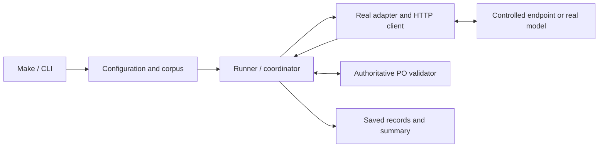

# HW-01 testing strategy

## Purpose and plan references

Use a broad base of focused unit/component tests, integration tests for module
boundaries, and a small set of complete workflow checks. Choose coverage by
failure risk and the behavior each assertion protects. Test-count percentages
are not acceptance targets. This follows the emphasis on integration coverage
and critical workflows in [Google's testing guidance](https://testing.googleblog.com/2021/06/how-much-testing-is-enough.html).

Plan references below identify sections of `HW-01-implementation-plan.md`,
kept locally in `.agents/specs/`. The table summarizes the relevant requirements
so this document is usable without that ignored planning file. Implementation
status is maintained in the [HW README](../README.md).

| Plan point | Responsibility | Testing contribution |
| --- | --- | --- |
| **5 — Frozen extraction contract and runtime validation** | One authoritative PO JSON Schema, strict parsing and structured validation evidence. | Unit/component tests for accepted and rejected responses; integration with records and both adapters. |
| **6.1 — Pydantic for configuration, settings and run records** | Strict operational data, credentials, status consistency and accounting. | Focused model tests; environment/YAML loading and record/contract round trips. |
| **6.2 — Corpus loader and offline preflight** | Frozen input/gold/annotation hashes, approvals, links, provenance and prompt references. | Real-file integration tests and CLI preflight checks, with no model requests. |
| **6.3 — Shared model interface and adapters** | Translate explicit requests and preserve response/error metadata for both backends. | Adapter integration tests with controlled HTTP responses, followed by live capability verification. |
| **6.3.1 — Adapter construction and HTTP client ownership** | Adapters borrow injected post-only clients; application scopes own construction, sharing and cleanup. | Focused injection/exception tests plus real-client sharing, authentication, URL and cleanup checks. |
| **6.4 — Shared coordinator, failure handling and budget** | Common validation, bounded retries/correction, deadlines, dependency-level batch stopping and cumulative spending limits. | Unit tests for decisions; integration tests for request sequences, stop behavior and accounting. |
| **6.4.1 — Audit regression coverage** | Close the ten identified assertion-sensitivity gaps in the implemented coordinator. | Focused offline regressions and bounded mutations in disposable copies. |
| **6.5 — Docker services and environment setup** | Runtime image, mode selection, bounded model initialization, readiness and persistent storage. | Controlled setup failures and container/storage checks, with separate live context/memory evidence. |
| **6.6 — Persistence, tests and integration acceptance** | Process selected inputs, save records and summaries, and exercise both real adapters. | Application workflow tests with a controlled model endpoint; a live smoke run on three documents per adapter. |
| **7.1 — Provider screening** | Compare explicitly selected candidates with fixed v1/baseline settings and record selection use of gold cases. | A measured screening experiment using the already-tested evaluator from section 8. |
| **7.2 — Required matrix** | Version prompts and compare the selected provider/local model × prompt × sampling combinations. | Deterministic selection checks plus the separate measured matrix. |
| **8 — Evaluation and results** | Compute accuracy, validity, latency and cost from saved records. | Unit tests for scoring/arithmetic and integration tests from records to aggregates. |
| **9 — Verification and acceptance** | Reviewer can run the submission and reproduce its evidence. | Final Docker/Make acceptance using tracked artifacts, recorded runtime identities and saved results. |

## Current coverage

The implemented contract and sections 6.1–6.5, including the 6.4.1 regression
follow-up, already exercise several levels:

- [Contract tests](../tests/test_contract.py) and
  [record tests](../tests/test_records.py) cover validation rules, evidence and
  accounting, including integration with the actual PO contract.
- [Configuration tests](../tests/test_configuration.py) combine focused model
  validation with real YAML, environment and dotenv loading.
- [Corpus tests](../tests/test_corpus.py) and
  [preflight tests](../tests/test_preflight.py) use real public artifacts and
  disposable copies to verify cross-module behavior.
- [CLI tests](../tests/test_cli.py) and the preflight subprocess test invoke
  `python -m extraction_service`, checking process output and exit status.
- [Adapter tests](../tests/inference/) exercise both production adapters through
  controlled HTTP responses, and the production HTTP client against a loopback
  server. [Adapter documentation](model-adapters.md) records tested boundaries,
  public metadata observations and remaining live verification.
- [Injection tests](../tests/inference/test_client_injection.py) supply only the
  borrowed `post()` capability and verify real adapter translation and unchanged
  typed/unexpected error propagation. [Client setup tests](../tests/inference/test_client_setup.py)
  exercise real HTTPX clients through controlled transports: compatible adapters
  share clients without changing each other's requests, and application scopes
  close clients once after success, generation failure or partial setup failure.

- [Coordinator tests](../tests/execution/) cover correction/retry bounds, clock
  and dependency decisions, cumulative spending, protected matrix funds and
  locked reservations. [Coordinator integration](../tests/inference/test_coordinator_integration.py)
  uses both real adapters and HTTP envelopes. A
  [slow-response loopback check](../tests/inference/test_total_deadline.py)
  verifies total timeout cancellation and subsequent client reuse. See the
  [execution documentation](execution-coordinator.md) for policy and limits.

- [Runtime setup tests](../tests/runtime/) cover offline provider isolation,
  bounded service discovery and initialization, identity mismatch rejection,
  exact loaded context, persistent storage and full-request token admission.
  They use controlled HTTP and temporary files. Separately selected Docker
  setup diagnostics and their [live evidence](docker-setup-verification.md)
  exercise actual image/model/storage/resources; no live pytest tests exist.

A test file can contain more than one level. Executing pytest in Docker defines
its runtime environment; the components and boundaries exercised determine its
level. Inference CLI/persistence workflows, live model tests and scoring remain
pending with sections 6.6–8.

### Coordinator audit follow-up — 6.4.1 complete

The coordinator implementation is complete. Its 20 October audit identified ten
test-sensitivity gaps: the existing suite passed the selected defective variants,
while the unchanged implementation passed distinguishing cases in a disposable
copy. The follow-up adds 14 repository cases and strengthens both existing
correction-evidence cases, replacing reliance on temporary audit cases.

| Audited behavior | Repository coverage |
| --- | --- |
| Settlement failure retains evidence and stops only paid work | [Spending policy](../tests/execution/test_spending_policy.py) |
| Fixed request fee contributes to the reservation quote | [Pricing](../tests/execution/test_pricing.py) |
| Zero allocation blocks optional work while allowing matrix work | [Spending policy](../tests/execution/test_spending_policy.py) |
| Optional holdback does not stop affordable matrix work | [Spending policy](../tests/execution/test_spending_policy.py) |
| Different models, versions and digests have independent stop state | [Dependency policy](../tests/execution/test_dependency_policy.py) |
| Correction requests contain the exact structured issues | [Coordinator](../tests/execution/test_coordinator.py) |
| Failure timing, tokens and cost cannot contradict attempt evidence | [Failure evidence](../tests/execution/test_failure_evidence.py) |
| Later backoff grows, caps and restarts for correction | [Deadlines](../tests/execution/test_deadlines.py) |
| Fully attempted invalid outputs still form a complete comparison | [Coordinator](../tests/execution/test_coordinator.py) |
| A nonretryable availability failure sends no retry | [Coordinator](../tests/execution/test_coordinator.py) |

Verified on 20 October 2026: `make hw01-check` passed 466 tests, lint, formatting,
strict typing, all 10 gold validations and the 30-input offline preflight. In a
disposable Docker copy, each of the ten deliberate defects failed its intended
repository assertion or rejection check, with no setup/collection errors. The
unmodified and restored copies each passed all 466 tests, and source/test hashes
matched after restoration. No production code, frozen data, schema or model
configuration changed, and no inference was performed. This closes the selected
audit findings; it does not establish exhaustive correctness or live acceptance.

## 1. Unit and component tests

**Plan points: 5, 6.1, 6.3.1, 6.4–6.4.1 and 8.**

Test one rule or cohesive component through its public API. Keep the real PO
validator and operational models where they are the subject of the test.
Dependencies on external inference, time and transport can be controlled.

Existing coverage includes required/nullable PO fields, enums, dates, decimal
strings, strict configuration, status consistency and usage/cost availability.
Coordinator categories below have existing coverage, with the completed audit
regressions listed above. Scoring cases follow in section 8:

- Transient versus permanent transport failures and retry eligibility.
- One correction after invalid returned output, with a bounded request count.
- Request/input deadlines, budget reservations and cumulative spending.
- Dependency-level batch stopping: a positive configured threshold (initially
  three consecutive availability-failed input/variant outcomes), reset on a
  completed model response, immediate fatal-configuration stops and isolation
  between independent backends. Physical retries do not increment this counter
  individually; validation/refusal/truncation outcomes do not increment it.
- Unknown usage/cost, known zeroes and accounting for unsuccessful requests.
- Field/line matching, null scoring, validity denominators, percentiles and
  cost scaling, using independently calculated expected results.

Use a controllable clock and sleeper for deadlines and backoff. A scripted
transport can return a known sequence of responses or failures. Assertions
should verify decisions, request counts and recorded evidence without waiting
for real timeouts or making inference requests.

## 2. Integration tests

**Plan points: 5, 6.1–6.4.1 (including 6.3.1), 6.6 and 8.**

Exercise cooperating application modules with real validation and real files.
For adapters, control the external HTTP boundary while preserving production
request construction and response parsing.

| Boundary | Required evidence | Plan points |
| --- | --- | --- |
| YAML/environment → operational models | Values, overrides and failures survive loading without coercion or credential disclosure. | 6.1 |
| Manifests/files → loaded corpus | Hashes, approvals, membership, annotation identity and gold line counts are checked; each input retains its provenance. | 6.2 |
| Adapter → HTTP request | Correct schema copy, source text, model/routing identity and applied sampling limits; labels and annotations stay outside inference requests. | 5, 6.3 |
| HTTP response → adapter result | Realistic success, refusal, truncation, usage/cost and error payloads retain their available evidence. | 6.3 |
| Application setup → borrowed HTTP clients | Correct URL/authentication, unauthenticated catalog probes, shared and distinct client behavior, and cleanup once per owned client during success or failure. | 6.3.1 |
| Coordinator → adapter → PO validator | Retry/correction sequences, final statuses, deadlines, dependency stopping and accounting agree across components. | 5, 6.4 |
| Coordinator → persistent budget | Each paid request reserves before sending; settlement failures retain evidence and stop paid work; optional-stage holdback leaves affordable matrix work available. | 6.4.1 |
| Runner → saved records | Records reload under the approved contract, summaries retain failures/unattempted cases, and run identity prevents silent overwrites. | 6.6 |
| Saved records → evaluation | Aggregates use the intended records, variant identities, matching rules and denominators. | 8 |

An HTTP test transport is sufficient for many adapter cases. A loopback stub
server is useful when checking actual HTTP or separate processes. Ordinary
integration tests remain independent of provider credentials and model weights.
Temporary files and stub responses belong to test fixtures; real inference
requests use only the approved neutral inputs.

## 3. Runtime/container setup checks

**Plan points: 6.5.1–6.5.6.** Implemented by runtime tests and the explicit
[Docker setup workflow](docker-runtime.md); retain these checks when changing it:

- Resolve provider and Docker-local startup paths independently. Provider-only
  setup does not start Ollama or download weights; local setup needs no key.
- Use controlled responses/process failures to check bounded readiness and
  initialization, missing models and identity mismatches. Ordinary tests do not
  download weights or invoke real models.
- Exercise the app's actual non-root identity and persistent results directory:
  create, lock, write and atomically replace ledger files; recreate the app
  container and verify accounted spending and unresolved reservations survive.
- Verify that ordinary shutdown preserves results and weights, and that a
  startup never resets a ledger or invents zero previous spending.
- Check offline preflight through the app runtime image and documented setup
  commands. The existing network-isolated check service remains independent.

Separately record live local setup evidence for the pinned image/model digest,
service versus model readiness, effective context and memory fit on the 16 GB
machine. The capacity check includes instructions, schema, source, correction
evidence and output allowance. Record the token-capacity method and actual Docker
resources; missing evidence is unverified setup, not a passing configuration test.
Model loading and cold startup remain distinct from measured document latency.
These setup diagnostics do not replace the extraction smoke in section 6.6.

Default context diagnostics select smallest, middle and largest initial messages
by UTF-8 bytes per prompt/sampling variant, then check their initial and `{}`
correction fixtures (currently 6 requests). An optional exhaustive command checks
all 60. Both use actual validator issues, full schema/source, output allowance
and the pinned runtime's token counts with truncation/shift disabled. Controlled
tests verify bounded/deterministic selection, both request kinds, each variant,
small corpora, explicit CLI selection and separate reports. Report selected and
total counts; a representative pass must not claim corpus-wide verification.
The fixture does not bound arbitrary future correction evidence: 6.6 must check
every actual initial and correction request before accepting it as fitting.
A selected-request failure remains an explicit blocker in live evidence; untested
inputs remain unverified without preventing a representative setup pass.
Actual run admission must use a non-generating method; the one-token setup
probes must not become hidden extra coordinator requests.

## 4. CLI/system and end-to-end tests

**Plan points: 6.3–6.6 and 9.**

For HW-01, the user workflow starts at Make/CLI and ends with persisted evidence.
The extraction path to exercise is:

The coordinator owns retries and correction; both follow the same adapter and
validation boundaries shown above. Separate two execution modes at this level.

### Routine application workflow checks

**Plan point: 6.6, integrating sections 6.3–6.5.** Launch the real CLI in a separate process and use a
controlled model endpoint. This covers the application's complete workflow
while substituting for the external inference dependency.

Keep a small set of scenarios:

1. A successful response produces the expected record, summary and exit status.
2. Invalid output triggers one correction, preserving the first response,
   validation issues and accounting in the saved history.
3. Exhausted retries/deadlines remain failed results; a budget or dependency
   stop also records untouched inputs as not attempted. Request counts and
   summaries agree, and interrupted comparisons are identified as incomplete.
4. Partial setup failure and an unexpected execution defect produce the
   documented nonzero exit status and credential-safe diagnostics. Owned clients
   close once, the original error is retained, completed evidence survives where
   storage is available, and the interrupted run remains incomplete.
5. Explicit selections send only the intended combinations. Budget initialization
   refuses to overwrite existing state; reopening retains prior spending across
   invocations. Missing/unsafe pricing or an unavailable ledger sends no paid
   request. Pair rejection paths with successful setup/execution cases.

For dependency-stop integration, retain state across prompt/sampling variants
sharing the same backend/endpoint/model route, and verify that no HTTP request
is issued after that dependency stops. A completed model response resets its
consecutive availability-failure counter even when the response is schema-invalid,
refused or truncated. Check independent-backend progress and correct persistence
of actual attempts, unknown/billed usage and untouched inputs. A later explicit
invocation starts fresh dependency state while preserving cumulative spend.
Cooldown and half-open recovery tests belong to a future full circuit-breaker
extension; the planned HW-01 policy ends the affected batch for that invocation.

Use the real adapter, HTTP client, validator, coordinator and persistence path.
Substituting an adapter's final return value would leave HTTP wiring untested.
Use a temporary result directory, explicit process timeouts and inspect saved
records as well as command output. The existing subprocess tests cover the
currently implemented validation/preflight commands; extend the approach when
the extraction runner exists.

### Live end-to-end smoke

**Plan points: 6.6 and 9, using the setup verified in 6.5.** Exercise both real adapters on the same
three representative approved documents, with the selected v1 configuration.
Include Docker/runtime readiness and the documented application entrypoint.

Record model/provider/runtime identity, supported/applied parameters, response
outcomes, validation evidence, persisted records and available usage/cost.
Account for provider smoke spending in the same cumulative homework budget
used by later experiments. Keep native Ollama measurements distinct if that
optional runtime is exercised.

Judge model setup, application execution and extraction quality separately.
A schema-invalid response is a recorded extraction failure; correct handling
of that failure can still verify the application path. Missing credentials,
unavailable models or unsupported parameters leave the relevant live acceptance
unverified. They must not be reported as a successful model integration.

Live inference is explicitly selected and excluded from ordinary offline checks.
Run it when introducing/changing an adapter, model/runtime configuration or
packaging, and for the final submission acceptance. Its cost, setup time and
variable responses justify keeping this layer small.

## Model quality evaluation

**Plan points: 7–8.** The golden-set experiment measures field accuracy and
model behavior. Engineering tests establish that the service follows its
contract and records those outcomes faithfully.

Implement section 8's deterministic scoring core and saved-record aggregation
before section 7.1 screening. Use the same tested evaluator for screening and
the required matrix; verify matching, failure denominators and accounting with
independently calculated fixtures, without model calls.

Section 7.1 screens the explicitly selected provider candidates on the same
10 approved gold cases with fixed v1/baseline settings. Record candidate and
stage identity, failed outcomes, actual available cost and the production-model
selection rationale. Smoke, screening and matrix spending share the same ledger.
Merely listing a candidate must not schedule it. Disclose that these gold cases
were used for model selection and prompt tuning: their later scores are
development-set measurements, not independent held-out generalization evidence.

Run the full two-model × two-prompt × two-sampling comparison on the 30 approved
texts as a separate measured experiment, within the configured budget. Compute
quality against the 10 approved gold objects from saved records. Include
unsuccessful and unattempted outcomes in the documented reporting rules;
preserve source/layout grouping and disclose prompt-tuning examples.

Live smoke and ordinary regression checks do not require every response to
equal the gold JSON. Schema-valid output can still have incorrect field values.
Conversely, quality evaluation must not silently repair schema-invalid output
or drop failures to improve reported metrics. Scoring and aggregation are
tested deterministically without rerunning models.

## Execution and adoption

All Python checks run in Docker. The current
[`make hw01-check`](../../Makefile) workflow runs lint, formatting, strict typing,
pytest, frozen gold validation and offline preflight. Root Make routes to the
homework target. Keep its network-isolated check service as the default gate.

| When | Work to add or run | Plan points |
| --- | --- | --- |
| Current contract/configuration/corpus changes | Existing unit, integration and validation/preflight process checks. | 5, 6.1–6.2 |
| Current adapter/coordinator changes | Existing request/response integration and focused policy checks. | 6.3–6.4 |
| Completed audit follow-up / later changes to audited guards | Maintain the targeted repository regressions; use corresponding bounded mutation probes when their sensitivity needs verification. | 6.4.1 |
| Runtime infrastructure implementation | Controlled setup failures, mode selection, non-root persistence/recreation checks and separate live context/memory evidence. | 6.5 |
| Before the first live test | Register the live marker, enforce default exclusion and provide explicit selection before any real runtime/model-dependent test is introduced. | 6.5–6.6 |
| Runner/persistence implementation | Controlled-endpoint CLI workflows, cleanup/error boundaries, selection and budget composition. | 6.6 |
| Integration acceptance | Explicit three-document extraction smoke for each real adapter, retaining failures and spending evidence. | 6.6 |
| Before provider screening | Deterministic scoring tests and saved-record aggregation checks. | 8 core, before 7.1 |
| Provider screening | Fixed-configuration candidate comparison, selection rationale and gold selection-use disclosure. | 7.1 |
| Required comparison | Selected provider/local two-prompt, two-sampling matrix over all 30 inputs. | 7.2 |
| After measured runs / final submission | Reproduce aggregates/report from saved records and verify clean Docker/Make acceptance. | 8 report, 9 |

Existing pytest and Docker tooling are sufficient. Introduce registered
`unit`, `integration` and `e2e` markers when separate selection becomes useful.
Before introducing the first real runtime/model-dependent test, register a
`live` marker, configure explicit default exclusion and provide a dedicated
selection path. Keep model pulls and external requests out of module imports
and collection; only explicitly selected live fixtures may perform them.
Markers alone do not prevent tests from running. Register markers and reject
unknown names as described in the [pytest marker documentation](https://docs.pytest.org/en/stable/how-to/mark.html).
These marker and selection changes remain future work. Live isolation is a
prerequisite for live tests; broad level tagging does not need to precede 6.4.1.

Keep fixtures shared where useful, and split files/directories when that makes
responsibilities clearer. Exercise detailed failure combinations at the lowest
useful level; use broader checks to protect wiring and critical workflows.
Follow the repository's [test conventions](../../docs/coding-conventions.md#tests-and-enforcement)
and [mutation/reproduction process](../../docs/review-process.md#verification-and-experiments)
to verify assertion sensitivity. Layer coverage and passing tests provide
bounded evidence rather than a proof that no defects remain.
